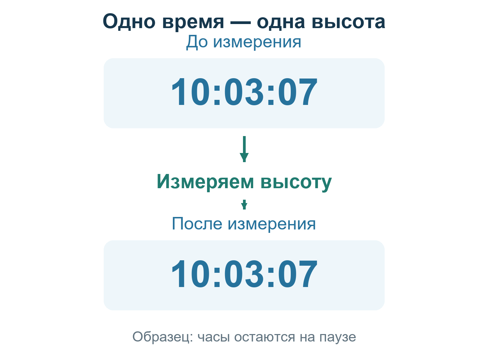

# Урок 2. Когда была измерена высота

**Вход:** [урок 1](01-SEXTANT.md) выполнен самостоятельно.

**Сегодняшняя цель:** записать высоту и точное время, относящиеся к одному и тому же положению Солнца.

## Зачем нужны часы

В первом уроке мы научились читать высоту. Теперь добавим к ней только одно: **когда именно её измерили**.

Солнце движется по небу. Поэтому нельзя взять высоту сейчас, посмотреть на часы позднее и соединить эти числа как будто они получены вместе.

У разных мест могут быть разные местные часы. Чтобы не путать их, навигатор использует общую шкалу: **GMT (время по Гринвичу)**. Не нужно пока знать географические расчёты; нужно отличать этот источник от других часов.

Название строки «Лондон» ниже относится к часам **в этой игре**. Оно не означает, что любые реальные лондонские часы в любую дату показывают гринвичское время: гражданские часы могут переводить на летнее время.

**Нужно:** секстант, судовой журнал с видимыми секундами, бумага. Последовательность с часами и паузой ещё должна быть подтверждена обычным игровым управлением.

*Число на часах — образец, не ваши новые показания.*

**Подумайте до действий:** если после измерения часы показывают другое время, можно ли приписать его старой высоте? Сначала объясните ответ, потом пробуйте.

## Практика: сначала установим источник

Перед попыткой найдите в настройках управления команды **«Судовой журнал»** и **«Пауза»**. Перепишите их на свой лист. Дальше используйте свои назначения, а не угадывайте клавишу. Самостоятельно — не значит наизусть: урок остаётся перед вами.

### 1. Найдите гринвичские часы

При закрытом секстанте откройте судовой журнал. Найдите строку **GMT**; в русской подписи она может называться **«Лондон»**. Это штатная строка игры, а RadioNavigation добавляет к ней секунды. Не выбирайте «Берлин», местные часы или секундомер `F7`.

**Проверьте:** видите, как сменяются несколько последовательных секунд. Если строки или секунд нет, запишите, чего не хватает; точного времени наблюдения пока нет.

### 2. Установите дату

Запишите день, месяц и год, соответствующие этим часам. Около полуночи гринвичская дата может отличаться от даты других часов. Если на панели с часами даты нет, возьмите её с игрового календаря и запишите, откуда именно.

**Проверьте:** известно происхождение даты, а не только удобное число из соседней строки.

### 3. Остановите игровое время для упражнения

Закройте журнал. Включите паузу своей штатной командой, указанной в настройках игры. Снова откройте журнал.

**Проверьте:** два чтения с промежутком не менее двух реальных секунд совпадают до секунды. Если время продолжает меняться, пауза не подтверждена. Не считайте надпись или доставку клавиши доказательством остановки часов.

### 4. Запишите остановленное время

Перепишите дату и часы полностью: часы, минуты, секунды. Рядом напишите **GMT (время по Гринвичу)**. Закройте журнал, не снимая паузу.

### 5. Сделайте новое касание

Повторите упражнение с секстантом из урока 1. Запишите **Hs (высоту нижнего края Солнца по секстанту до поправок)**. Отсчёт предыдущего урока не приписывайте этому новому времени.

### 6. Замкните проверку

Закройте секстант, снова откройте журнал и прочитайте дату и секунды.

**Проверьте:** они остались теми же, что перед наведением. Тогда время и высота связаны одной остановленной сценой. Если время изменилось, свяжите новое снятие с его действительным моментом; не исправляйте дату задним числом.

## Как выглядит законченная запись

На вашем листе должны быть: **дата; GMT (время по Гринвичу); Hs (высота до поправок); нижний край; источник часов**.

### Разбор образца — не ваши измерения

Сохранённый пример имеет запись: **2 сентября 1939 года; метка времени 10:03:07Z; Hs (высота до поправок) = 39°13,4′; нижний край Солнца**.

*Метка времени сохранена без изменений. В уроке 4 описана отдельная сверка чисел альманаха: сдвиг на час не поддерживается, а склонение расходится с независимым расчётом. Не переносите на свои часы время образца и не считайте эту сверку проверкой игрового момента.*

Копирование этой строки не подтверждает вашу сцену. Если игровой момент другой, запишите его, а не время образца.

## Если приходится работать без паузы

Время снимается непосредственно в момент контакта кромки с горизонтом. Помощник может читать часы вслух, пока наблюдатель держит касание. Если не можете связать секунду с контактом, отметьте «время измерения не установлено». Это ограничение способа работы, не приглашение получить время скрытой командой.

## Самостоятельная попытка

При закрытом приборе снимите паузу своей обычной командой и убедитесь по журналу, что секунды изменяются. Затем выполните новую запись для другого игрового момента по шагам урока: снова остановите время, снимите новую высоту и проверьте часы после снятия. Текст можно читать, готовую строку образца копировать нельзя. Сохраните обе записи; прежние время и высоту на новый лист автоматически не переносите. Если понадобилась подсказка ведущего, исправьте непонятный переход и повторите его.

## Один проверяемый результат

**Есть одна собственная запись «дата — время — измеренная высота», и можно объяснить, как доказана их одновременность.**

- [ ] Выбраны гринвичские часы с секундами и правильная дата.
- [ ] Выполнено новое измерение, а не переписан старый угол.
- [ ] Совпадение времени до и после проверено или секунда снята в момент контакта.
- [ ] Вы можете повторить последовательность без подсказки, пользуясь текстом урока.

Пока это не выполнено, к поправкам не переходим. Невозможность прочитать часы в текущей игре нужно проверить отдельно, а не заменять готовым временем образца.

**После самостоятельного успеха:** [урок 3 — исправление высоты](03-HEIGHT-CORRECTIONS.md). [К началу курса](README.md).

**Для ведущего:** самостоятельный проход этого урока в игре ещё не подтверждён. Описание действий не означает их успешного выполнения.
