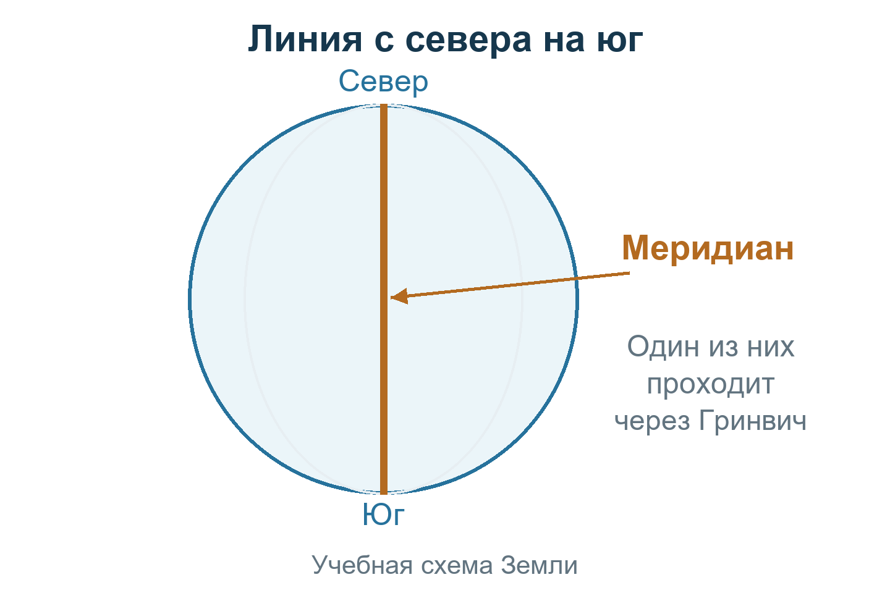
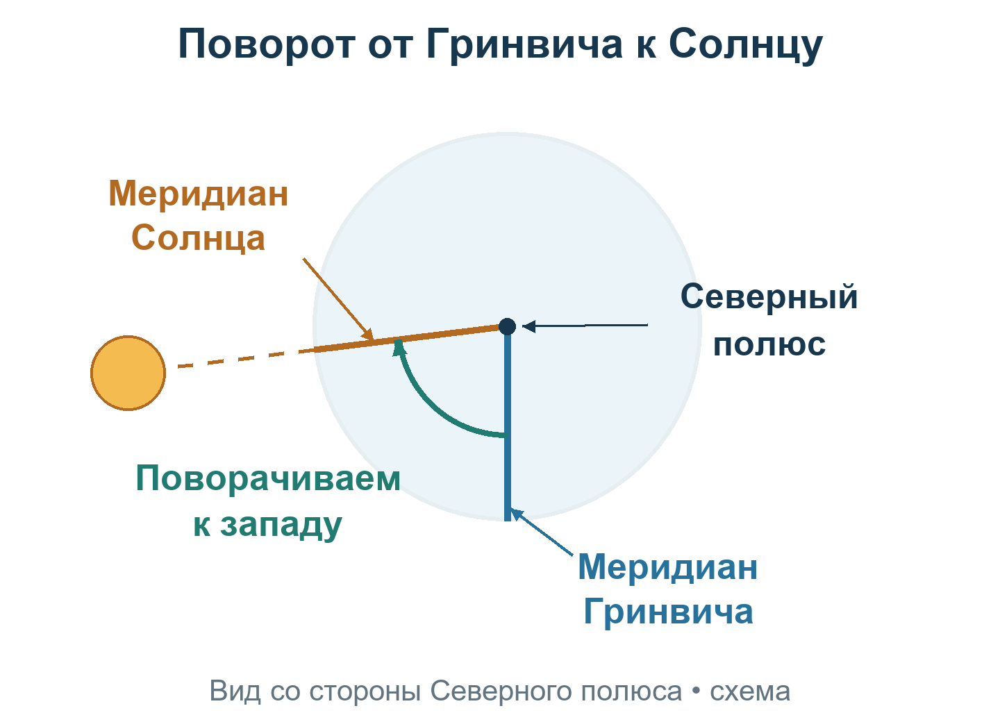
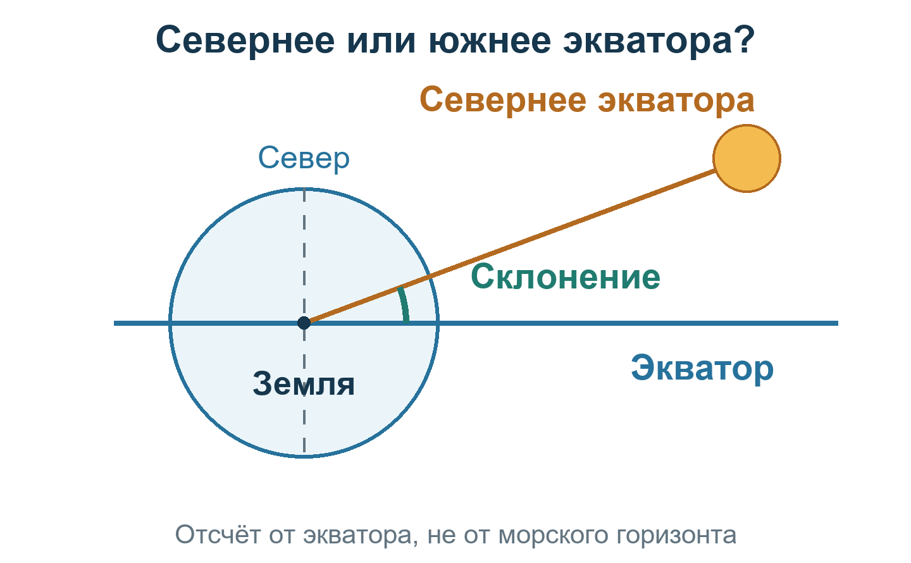
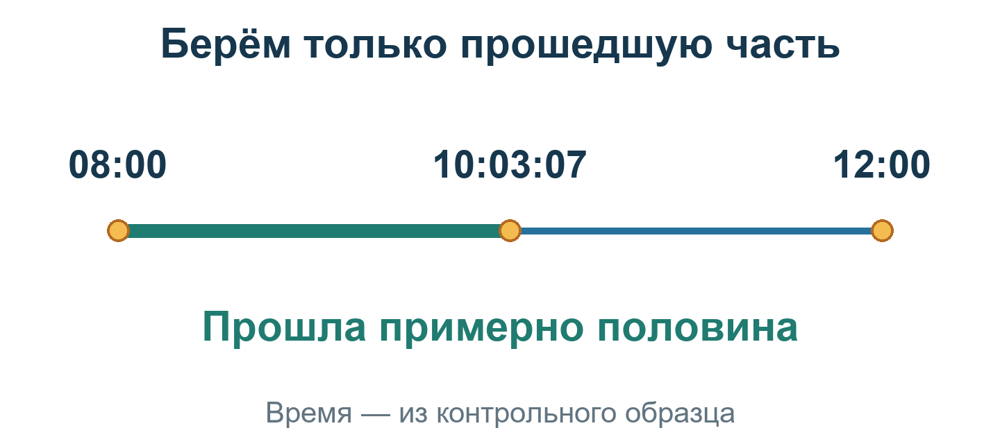

# Урок 4. Где находится Солнце

**Вход:** дата, время и известная шкала времени из наблюдения или бумажного условия. Ho из [урока 3](03-HEIGHT-CORRECTIONS.md) сохраните для урока 5; для чтения альманаха нужна не высота, а момент.

Найдём два числа, описывающие положение Солнца: гринвичский часовой угол GHA и склонение δ. Вместе со временем и принятой точкой они позволят вычислить ожидаемую высоту.

## Сначала Земля, потом числа

В прошлом уроке мы исправили высоту. Теперь узнаем из книги, где было Солнце в записанный момент. Эта книга называется **альманахом (сборником чисел для разных дат и часов)**. Нам нужны два числа, но сначала разберём их смысл по одному.

Представьте на глобусе линию от Северного полюса к Южному. Такая линия называется **меридианом**. Один из меридианов проходит через Гринвич — место, по которому названы наши общие часы.

### Первое число: поворот вокруг Земли

Смотрим на Землю со стороны Северного полюса. Начинаем с меридиана Гринвича и поворачиваемся **к западу**, пока не дойдём до меридиана Солнца. Величина поворота — первое нужное число. Полный оборот равен 360°.

Альманах даёт **GHA (гринвичский часовой угол Солнца)**: насколько направление Солнца повернулось к западу от гринвичского меридиана.

### Второе число: севернее или южнее экватора

**Экватор** — окружность на поверхности Земли посередине между полюсами. Представьте плоский лист, который разрезает Землю пополам по этой окружности и продолжается далеко в пространство. Это **плоскость экватора**. Направление на Солнце может находиться с её северной или южной стороны.

Второе число — **δ (склонение Солнца)**. Оно показывает угол к северу или к югу от плоскости экватора. Знак «плюс» означает северное склонение, «минус» — южное. **На этом рисунке синяя линия показывает плоскость экватора сбоку, не морской горизонт.** Угол на схеме увеличен: в примере склонение около 8°, а не треть прямого угла.

Оба числа описывают **Солнце**, не положение вашей лодки.

<!-- nav-diagram:gha -->

Для исторического разбора ниже нужны бумага и [альманах SH5, страница PDF 57](source-tables/%5B1%5D%20Nautical%20Almanac%20SH5%201939-1945.pdf#page=57). Если файл открылся с начала, введите 57 в поле страницы PDF. В [полном бумажном примере](WALKTHROUGH.md) используется отдельная карточка с явной шкалой времени; поиск в SH5 — самостоятельное упражнение чтения источника, не обязательный этап перед той карточкой.

## Разбор образца — не ваши измерения

**Исторический образец · 2 сентября.** Разбираем сохранённые условия на **2 сентября 1939 года**, с меткой **10:03:07Z**. Это упражнение на чтение книги и арифметику, не новое наблюдение. Для новой условной задачи [практикума](TRAINING.html) нужна только её собственная карточка, не числа этого разбора. Если открыли урок из полного разбора 3 сентября ради геометрии GHA/δ, после объяснения [вернитесь к своей карточке](GUIDE.html#walkthrough).

### 1. Найдите день, год и нужную таблицу

Откройте **PDF 57**, найдите блок **2-Sep** и под заголовком **1939** — пару столбцов **GHA** и **δ**. На странице **одна непрерывная числовая сетка**. Над ней напечатано **Time = GMT-1** с одним перечнем портов отправления; под ней — **Time = GMT** с другим перечнем портов. Это не две разные таблицы, между которыми можно выбрать готовый ответ.

**Ограничение образца:** соответствие метки времени строкам книги для новой игровой сцены не установлено, солнечные числа не полностью согласованы с независимым расчётом. Поэтому здесь учимся читать заданные клетки, но не объявляем результат проверенным наблюдением. Метку не сдвигаем на час по подписи GMT-1; подробное расследование и величины расхождений — в [источниках и ограничениях](GUIDE.html#limits).

**Для собственного наблюдения** сначала установите, как часы игры связаны со строками выбранного альманаха. Совпадения слов GMT в заголовках недостаточно. Если соответствие неизвестно, остановитесь: нельзя добавлять или вычитать час по удобному ответу. Сборник покрывает 1939–1945 годы; для другой даты этих страниц недостаточно.

**Проверьте:** выбран нужный день, пара столбцов своего года и нужная строка времени; верхняя и нижняя портовые подписи не приняты за два набора чисел.

### 2. Возьмите ближайшую предыдущую строку времени

В заданном образце метка находится между строками **08:00 и 12:00**. Перепишите:

- в 08:00 GHA (гринвичский часовой угол) = **300°01,1′**;
- в 08:00 δ (склонение) = **+8°11,1′**;
- в 12:00 δ (склонение) = **+8°07,5′**.

**Проверьте:** оба склонения северные, они немного уменьшаются.

### 3. Найдите изменение часового угла

От строки 08:00 до заданной метки 10:03:07 прошло **2 часа 3 минуты 7 секунд**.

Откройте [**PDF 73**](source-tables/%5B1%5D%20Nautical%20Almanac%20SH5%201939-1945.pdf#page=73), *GHA increments* (приращения гринвичского часового угла), колонку **Sun (Солнце)**, не Aries (Овен).

Перед секундной строкой познакомьтесь с новым знаком: **″ — угловые секунды**. В одной угловой минуте 60 угловых секунд. Это деления угла, не секунды на часах. Для Солнца в этой таблице одна секунда времени даёт 15″ угла.

- Два часа: верхняя строка hour = 2 → **30°00,0′**.
- Три минуты: нижняя строка 3, Sun → **0°45,0′**.
- Семь секунд времени: по секундной шкале → **1′45″** дуги. Проверка: 7 × 15″ = 105″ = **1,75′**.

Сложите: 30°00′ + 45′ + 1,75′ = **30°46,75′**.

**Проверьте:** за немного больше двух часов получилось немного больше 30°. Минуты времени и минуты дуги — разные единицы.

### 4. Получите часовой угол на момент наблюдения

300°01,1′ + 30°46,75′ = **330°47,85′**.

Получено **GHA (гринвичский часовой угол Солнца) = 330°47,85′** по заданным клеткам образца. При переходе через 360° вычитают полный оборот; здесь он не понадобился.

**Предел этого правила:** 15°/ч — ровный шаг таблицы приращений, но реальный GHA Солнца меняется не строго равномерно. Для этого упражнения оставляем заданные 330°47,85′; для собственного наблюдения нужен согласованный с источником способ приращений, а не предположение, что 15°/ч всегда точно. Числовое сравнение с независимой эфемеридой — в [статусе проверки](QA-STATUS.md).

### 5. Найдите изменение склонения

За весь интервал от 08:00 до 12:00 изменение равно:

8°07,5′ − 8°11,1′ = **−3,6′**.

Это **d (изменение склонения за четыре часа)**; оно также напечатано в крайнем столбце. Не применяйте −3,6′ за каждый час.

### 6. Возьмите только прошедшую долю интервала

В уроке 3 мы находили число между соседними клетками. Здесь та же мысль: между 08:00 и 12:00 прошло чуть больше половины времени. Значит, берём чуть больше половины изменения склонения.

- Прошло: 2 × 3600 + 3 × 60 + 7 = **7387 секунд**.
- Четыре часа: 4 × 3600 = **14 400 секунд**.
- Доля: 7387 ÷ 14 400 ≈ **0,513**.
- Поправка: −3,6′ × 0,513 ≈ **−1,85′**.
- Склонение: +8°11,1′ − 1,85′ = **+8°09,25′**.

Запишите **δ (склонение Солнца) ≈ 8°09,25′ N (северное)**.

**Проверьте:** итог между двумя исходными склонениями; взята чуть больше половины четырёхчасового изменения. Долю сохраняйте до дальнейших вычислений. Склонение в расчётном листе записываем до **0,01′**, но сотые после интерполяции не означают точность исходной таблицы до сотой: её клетки напечатаны до **0,1′**. Hc и интерсепт считайте по сохранённой доле, окончательные округления выполняйте на стадии прокладки.

## Самостоятельная попытка

### Заполняйте по одной строке

В расчётном листе сохраните **адрес исходных чисел** — книгу, страницу, день, год, время строки и заголовок столбца — вместе с самими клетками. Тогда ошибку чтения можно отличить от ошибки приращения. Согласование шкалы часов и источника нужно установить отдельно.

**Следующая попытка:** [П3 — от строки к моменту](TRAINING.html#step-almanac). В нём другая, явно условная карточка: сначала заполните пропуски с подсказкой, затем решите для нового времени. Для тренировки адреса **на настоящем SH5**, отдельно от условной карточки, остаётся [У10](EXERCISES.md).

В самостоятельном задании сохраните исходные клетки, прошедшее время и арифметику. Альманах и инструкцию держите открытыми, ключ задания — отдельно. Для собственных данных используйте свою дату и подтверждённое соответствие времени строкам книги.

## Один проверяемый результат

**Получена пара «гринвичский часовой угол — склонение» для записанного времени, с указанными страницей, днём, годом и исходными строками.**

Пока исходная шкала времени не подтверждена, бумажный образец можно разбирать, но собственное навигационное наблюдение не объявляется проверенным.

[Урок 5 — расчёт для принятой точки](05-CALCULATED-HEIGHT.md). [К началу курса](README.md).
