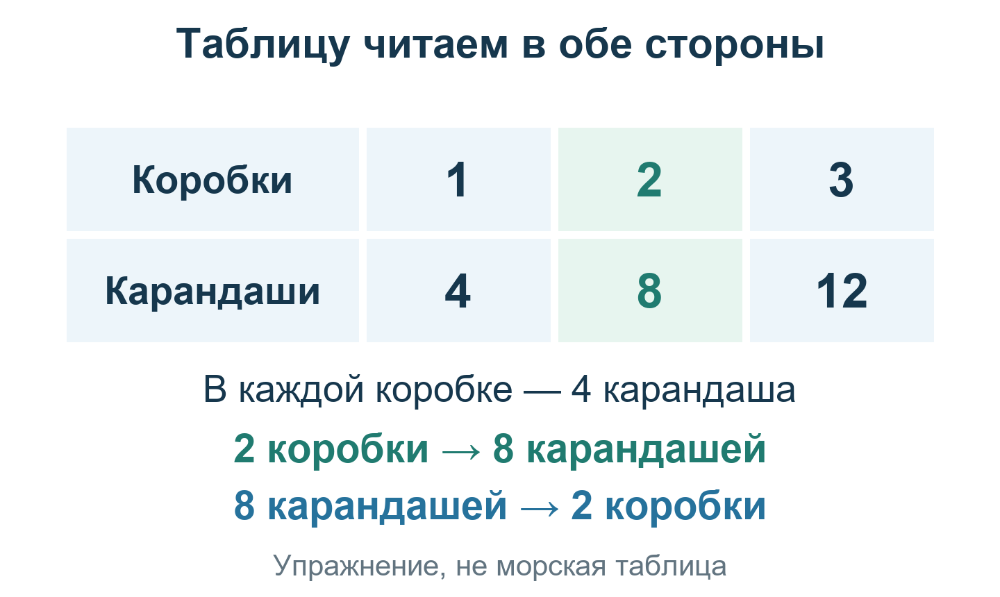

# Урок 5. Какую высоту ожидаем в выбранной точке

**Вход:** есть Ho (измеренная высота центра Солнца после поправок) и положение Солнца из [урока 4](04-ALMANAC.md).

**Сегодняшняя цель:** узнать, на сколько морских миль будущая линия отстоит от выбранной точки и в какую сторону её сдвигать.

## Сначала разберёмся с точкой на карте

Представьте клетчатый лист: одной строки мало, чтобы указать клетку. Нужен ещё столбец. На морской карте у точки тоже есть две части «адреса».

**Широта** показывает, насколько место севернее или южнее экватора. Линии одинаковой широты называются **параллелями**. **Долгота** показывает положение к востоку или западу от гринвичского меридиана. Меридианы идут в направлении север—юг. На нашей небольшой учебной сетке параллель рисуем поперёк листа, меридиан — сверху вниз.

**Покажите:** какую точку выбирают две выделенные линии? Почему одной линии недостаточно?

Координаты пишутся парой: сначала широта, затем долгота. Например, **55°00′ N (северной широты), 6°12,15′ E (восточной долготы)**. Минуты здесь угловые, как в записи секстанта. Другие обозначения: S (южная широта), W (западная долгота).

Навигатор сначала имеет **DR (счислимое место — оценку положения по начальному известному месту и пройденному пути)**. Для удобного чтения таблицы он выбирает рядом **AP (принятую точку расчёта)**. Она не обязана совпадать с оценкой положения и **не является найденным местом лодки**.

**Какое начальное место допустимо:** установленное положение **самой лодки** у известного причала, прошлое определённое место либо отдельное обоснованное определение по берегу. Координаты видимого маяка или мыса — координаты **ориентира, не лодки**. Названия порта недостаточно: нужны точка, время и основание, почему лодка была именно там. После отхода добавляется записанный путь. **Текущий точный маркер лодки** как DR не используйте: это готовая истина, а не счисление. Подробно — [откуда брать данные](DATA-SOURCES.md).

Задача таблиц: «Какой была бы **исправленная высота центра Солнца**, если бы мы находились в выбранной точке в момент наблюдения?» Это не сырое показание барабана. Сравнивать будем две одинаково определённые величины: высоту после поправок и расчётную высоту центра, а не нижний край с центром.

Почему сравнение полезно? На Земле есть точка, над которой Солнце в этот момент находится прямо над головой. При движении к этой точке высота Солнца растёт, при движении от неё — уменьшается. Поэтому превышение или нехватка высоты подсказывает сторону сдвига будущей линии. Само место лодки это ещё не даёт.

Пойдём тремя короткими частями: **выберем точку → найдём для неё высоту по таблицам → сравним две высоты**. После каждой части можно сделать перерыв. Получать все числа за один присест не нужно.

**Перед частью A:** выполните упражнения У1–У4 на градусы, интерполяцию и часовую меру из [тренажёра навыков](EXERCISES.md). Перед частью B — У5 на прямое и обратное чтение; перед частью C — У6 на знак разности. Условия и ответы находятся на разных страницах; урок и таблицы закрывать не нужно.

**Нужно:** карта, известное счислимое место, бумага и [F-Tafel, страница PDF 34 (F I)](source-tables/%5B2%5D%20F-Tafel.pdf#page=34), затем [страница PDF 79 (F II)](source-tables/%5B2%5D%20F-Tafel.pdf#page=79). Неизвестное начальное место нельзя заменить скрытыми истинными координатами игры. Без него самостоятельная близкая точка расчёта не обоснована; возможен только бумажный пример.

## Разбор образца — не ваши измерения

На время образца даны:

- Ho (высота после поправок) ≈ **39°24,06′**;
- GHA (гринвичский часовой угол Солнца) = **330°47,85′**;
- δ (склонение Солнца) ≈ **8°09,25′ N (северное)**;
- счислимое место **54°53′ N (северной широты), 5°45′ E (восточной долготы)**.

## Часть A. Выберите принятую точку

### 1. Выберите близкую целую широту

Ближайшая целая широта — **55°00′ N (северная)**. Запишите её как широту принятой точки.

**Проверьте:** это выбор удобной точки, не новое измерение координат.

### 2. Найдите угол Солнца относительно местного меридиана

К гринвичскому часовому углу прибавьте восточную долготу счислимого места:

330°47,85′ + 5°45′ = **336°32,85′**.

Это **LHA (местный часовой угол Солнца, отсчитанный к западу)**. Наш угол больше 180°, поэтому Солнце восточнее местного меридиана. Удобный меньший угол с восточной стороны:

360°00′ − 336°32,85′ = **23°27,15′**.

**Как вычесть минуты, если сверху нуль:** займём один градус. Поскольку в нём 60′, запись **360°00′ = 359°60′**. Теперь отдельно вычитаем градусы и минуты: 359 − 336 = 23; 60 − 32,85 = 27,15. Получается тот же ответ. Обычное правило десятичных чисел «занять десять» к градусам и минутам здесь не подходит.

Запишите **tE (восточный часовой угол) = 23°27,15′**. При местном угле от 0° до 180° использовали бы tW (западный часовой угол), равный самому местному углу. Западная долгота при сложении берётся с минусом; результат сначала приводят к полному обороту.

### 3. Выберите угол, который напечатан в таблице

В F I (таблице вспомогательных величин) углы подписаны в часовой мере. **Это не показание часов наблюдения.** Один час угла равен 15°, одна минута угла в часовой мере — 15′ дуги.

23°27,15′ соответствуют примерно **1 ч 33 мин 49 с** угла. Заголовки F I идут через 4 минуты. Ближайший напечатанный снизу — **1h32m**, то есть **23°**: 15° + 32 × 15′ = 23°. Следующий, 1h36m, уже дальше.

Запишите выбранные **1h32m = 23°**, сохранив восточную сторону.

### 4. Подберите долготу принятой точки

Для восточного случая долгота принятой точки равна:

360° − выбранный угол − гринвичский часовой угол.

В образце: 360° − 23° − 330°47,85′ = **6°12,15′ E (восточной долготы)**.

Проведите вычитание двумя маленькими шагами: **360° − 23° = 337°**; затем **337°00′ = 336°60′** и вычитаем 330°47,85′. Так получаются 6° и 12,15′, а не десятичные 6,1215°.

Получилась **AP (принятая точка расчёта) = 55°00′ N, 6°12,15′ E**.

**Мы не двигаем лодку.** Мы выбираем удобную точку на карте, для которой таблица читается ровно. Полученная позже линия пройдёт рядом с этой точкой; расстояние до неё и покажет поправка `a`.

**Проверьте:** 330°47,85′ + 6°12,15′ = 337°; 360° − 337° = **23° точно**. Для западного случая долгота получается как выбранный западный угол минус гринвичский угол, с приведением к −180…+180°.

Принятая точка должна оставаться близкой к счислимому месту. Ориентир **до 60 морских миль** здесь — учебное ограничение, не универсальная граница точности: важны также высота светила и удаление вдоль линии. Если близость не установлена, не выдавайте местное прямолинейное построение за надёжную прокладку.

**Остановка A:** на листе есть DR, выбранная AP и обратная проверка её часового угла. Пока не можете объяснить, почему AP не является местом лодки, к F II не переходите. Для отдельной тренировки достаточно У4; весь урок заново выполнять не нужно.

**Почему угол стал ровно 23°:** мы подобрали долготу принятой точки так, чтобы таблица читалась без добавочной поправки за округление. Считать теперь нужно именно для этой точки. Это не значит, что лодка переместилась.

## Часть B. Найдите расчётную высоту

### 5. Прочитайте три числа из F I

Откройте **печатную 8 / PDF 34**, группу **1h32m**, строку широты **55°**:

- U (вспомогательный угол) = **32°48,2′**;
- V (вспомогательное логарифмическое число) = **9,98881**;
- Gr.δ (граничное склонение для выбора стороны азимута) = **52,7°**.

**Как читать сокращённую клетку:** полная запись V имеет общую начальную часть **`9,`**, напечатанную не на каждой строке. К клетке **`98 881`** восстанавливаем именно эту часть: **`9,98 881` = `9,98881`**. Нельзя просто вставить запятую в сырые цифры `98881`: получилось бы другое число. U напечатано как **`32 48,2`**: здесь пробел разделяет градусы и минуты. Сначала выясняйте заголовок и общую часть своего столбца.

**Уточнение к нижней подписи рисунка:** восстанавливаем общую начальную часть **`9,`**, а не просто вставляем запятую после первой цифры `98 881`. Схема сохранена; верное чтение — **9,98881**, не 9,8881.

**Проверьте:** V переписано со всеми цифрами, не как 0,98881. В книге общая начальная часть числа может не повторяться на каждой строке.

Текущая учебная ветвь: широта и склонение северные, часовой угол меньше 6 часов. В ней складываем вспомогательный угол и склонение. Другие полушария и ветви здесь не угадываем. Шесть часов угла означают 90° от меридиана, не обязательный заход Солнца.

### 6. Сложите углы

32°48,2′ + 8°09,25′ = **40°57,45′**.

Назовите сумму **q (угол для следующего чтения таблицы)**. Это угол, не логарифмическое число. Данный подробный проход использует q между 0° и 90°; при иной ветви остановитесь, а не меняйте сумму по догадке.

### 7. Прочитайте F II для этой суммы

Сначала вспомним обычную таблицу. В каждой коробке по четыре карандаша. По числу коробок можно найти число карандашей. Можно читать и обратно: по числу карандашей найти число коробок.

*Это только упражнение на чтение таблицы, не морские данные и не формула навигации.*

**Попробуйте без подсказки:** сколько карандашей в трёх коробках? Сколько коробок нужно для четырёх карандашей? *(Ответ: 12 карандашей и 1 коробка.)* Дальше сделаем похожий поиск в настоящей таблице: сначала от угла к числу, позднее — от числа обратно к углу. Сами соответствия там другие.

Откройте [**F II (таблицу логарифмов синуса), печатная 53 / PDF 79**](source-tables/%5B2%5D%20F-Tafel.pdf#page=79). Логарифм здесь — готовое вспомогательное число; вычислять синус самостоятельно не требуется. Смысл таблицы простой: она заранее переводит углы в числа так, чтобы **умножение заменить сложением**. Поэтому дальше мы складываем два табличных числа и вычитаем 10.

Столбец **40°**:

- строка **57′** → **9,81651**;
- строка **58′** → **9,81665**.

У нас 57,45′, то есть доля между строками **0,45**:

9,81651 + (9,81665 − 9,81651) × 0,45 ≈ **9,81657**.

**Проверьте:** число между обеими клетками. Не берите колонку соседнего целого градуса.

### 8. Выполните одно сложение

К числу из F II прибавьте V (логарифмическое число из F I), затем вычтите 10:

9,81657 + 9,98881 = **19,80538**;

19,80538 − 10 = **9,80538**.

Десятка нужна из-за принятой положительной записи табличных логарифмов. Это правило работы с таблицей, не градусы и не минуты. Числа ниже 9 на малых углах сами по себе не являются ошибкой.

### 9. Найдите высоту обратным чтением

На той же странице F II найдите **9,80538 между клетками**, а не ищите угол 9°:

- столбец **39°**, строка **42′** → **9,80534**;
- там же строка **43′** → **9,80550**.

Доля: (9,80538 − 9,80534) ÷ (9,80550 − 9,80534) = **0,25**.

Высота: 39°42′ + 0,25′ = **39°42,25′**, примерно **39°42,3′**.

Это **Hc (расчётная высота центра Солнца для принятой точки)**. Сохраните 42,25′ для следующего вычитания.

**Не перепутайте:** Hc — расчётная высота центра, Ho — измеренная высота центра после поправок, Hs — исходный отсчёт нижнего края. Для сравнения нужны **Ho и Hc**; исходная Hs здесь уже не подходит.

Как в таблице с карандашами: на шаге 7 начинали с угла и искали число. Сейчас начали с числа и нашли угол. Если число оказалось между двумя клетками, используем уже знакомую долю между ними.

**Проверьте:** высота между 39°42′ и 39°43′. Если число попало в соседнюю строку или столбец, вернитесь к чтению клеток. Для этой ветви q остаётся между 0° и 90°; при другом результате остановитесь, а не подбирайте ответ.

**Остановка B:** сохранены q, число прямого чтения, сумма с V и две клетки обратного чтения. Подпишите у каждого: угол или логарифмическое число. У5 тренирует только этот переход; знак сдвига пока не нужен.

## Часть C. Сравните две высоты

### 10. Вычтите расчётную высоту из измеренной

Теперь сложная часть позади: осталось сравнить два угла. На рисунке они округлены для удобного чтения. В вычитании ниже оставим дополнительные цифры.

**Сначала скажите:** какое число меньше? Затем считайте разницу.

Градусы одинаковы, поэтому достаточно вычесть минуты:

24,06′ − 42,25′ = **−18,19′**, примерно **−18,2′**.

Если отрицательные числа ещё непривычны, сначала найдите положительную нехватку: **42,25 − 24,06 = 18,19**. Измеренная высота меньше ожидаемой на 18,19′. Минус в записи сообщает именно «меньше», а не отрицательную физическую длину.

Это **a (интерсепт — расстояние сдвига линии от принятой точки)**. Одна минута высотной разницы соответствует одной **NM (морской миле)**; морская миля равна 1852 м. Поэтому для карты запишите **−18,2 морской мили**.

Связь угла с расстоянием относится именно к этому построению на поверхности Земли: перемещение примерно на одну морскую милю к точке под Солнцем изменяет исправленную высоту примерно на одну угловую минуту. Это не правило «любая угловая минута равна миле»: минуту долготы на карте мы уже отличали от минуты широты.

Отрицательный результат означает **от Солнца**: измеренная высота ниже расчётной. Положительный означал бы **к Солнцу**. Если вычитаются уже минуты, ещё раз умножать их на 60 нельзя.

**Остановка C:** есть Ho, Hc и подписанный сдвиг a в морских милях. Объясните его сторону без рисунка готового ответа. Для следующего шага нужны только эти поля и AP; продолжение — после перерыва или сразу, по вашему выбору. Короткий маршрут и новая задача — в [практикуме](TRAINING.html).

## Самостоятельная попытка

С текстом шагов и таблицами под рукой, но без готовых ответов, повторите выбор точки, чтение клеток и вычитание на чистом листе. Объясните разницу между оценкой положения лодки и принятой точкой, а также между отсчётом нижнего края и исправленной высотой центра. Затем работайте со своим наблюдением, только если его ветвь и близкое счислимое место установлены.

При рабочем округлении ожидаются **39°42,3′** и **−18,2 морской мили**. Более длинные контрольные значения повторять не нужно: они служат для сверки, а не для большей точности наблюдения.

## Один проверяемый результат

**Записаны расстояние сдвига и сторона «к Солнцу» или «от Солнца», а весь расчёт относится к одной подписанной принятой точке.**

- [ ] Принятая точка не объявлена местом лодки.
- [ ] Её часовой угол проверен обратной суммой.
- [ ] Расчётная высота получена между двумя прочитанными клетками.
- [ ] Вы объясняете знак интерсепта без подсказки.

Направления линии на карте пока нет. **После самостоятельного успеха:** [урок 6 — первая линия положения](06-POSITION-LINE.md). [К началу курса](README.md).

**Для ведущего:** рабочее округление образца сопоставлено с сохранённым расчётом. Самостоятельный проход новичком ещё не подтверждён. Бытовая таблица с карандашами учит только прямому и обратному поиску; она не заменяет F II и не объясняет её численные соответствия.
