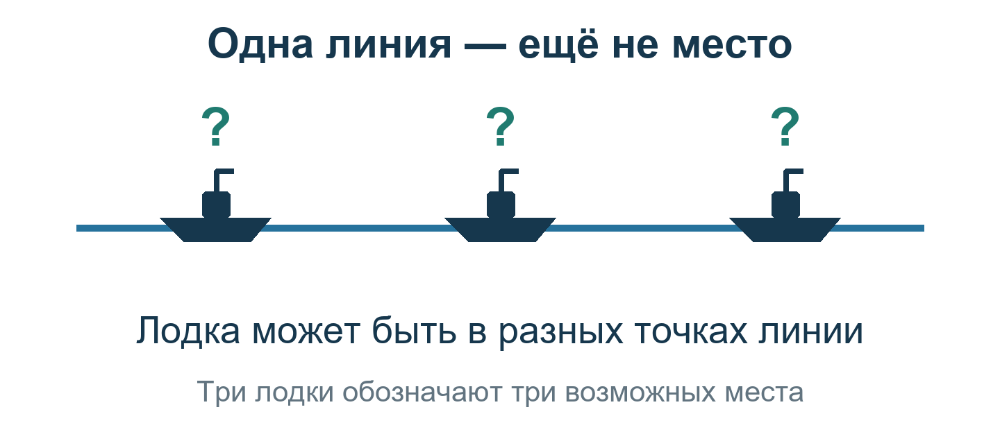
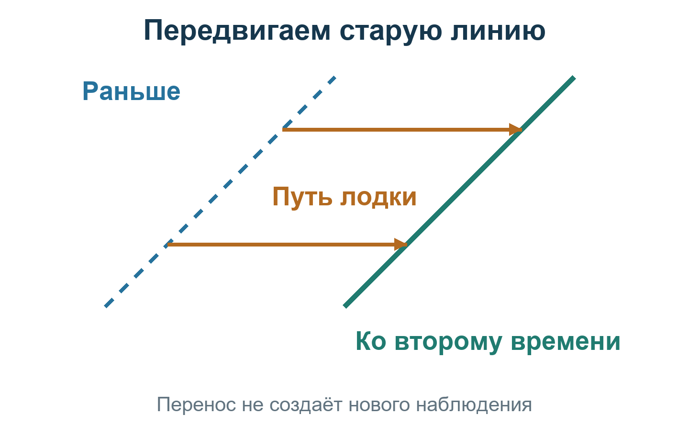
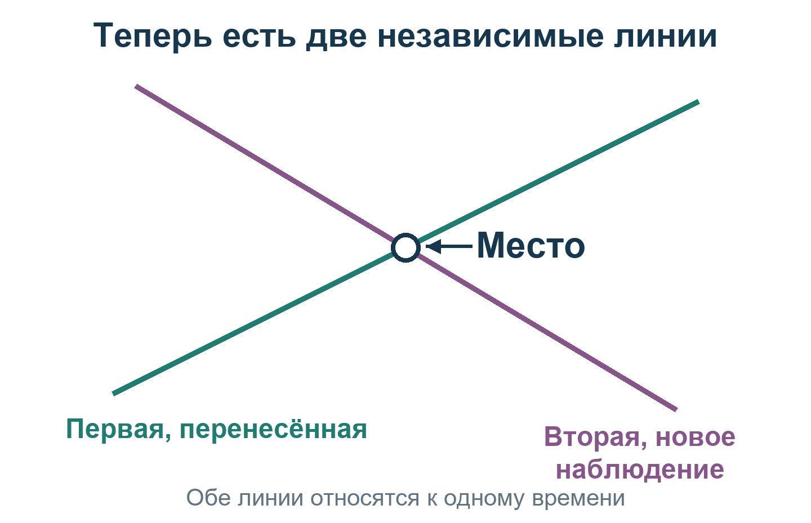

# Урок 7. Определяем место по двум наблюдениям

**Вход:** [урок 6](06-POSITION-LINE.md) выполнен самостоятельно. Вы умеете строить одну линию, не объявляя её координатами лодки.

**Сегодняшняя цель:** получить место на карте по двум независимым наблюдениям, учтя движение между ними.

## Почему просто подождать недостаточно

Вспомним прошлый урок. Одна линия ещё не выбирает единственную точку: лодка может быть в разных местах этой линии. Нарисованные ниже лодки — разные возможные места **одной** лодки, а не три судна сразу.

**Объясните:** почему нельзя просто выбрать середину линии и назвать её местом лодки? Потому что одна высота не выделяет середину. Это не означает, что все точки одинаково вероятны: счисление и другие сведения могут выделять часть линии. Произвольно выбранная середина — догадка, а не измеренный результат.

Новая высота даёт новую **LOP (линию положения)**. Если направления линий заметно различаются, пересечение позволяет выбрать точку.

Но первая линия описывает, где лодка могла быть **раньше**. Если за время ожидания лодка прошла несколько миль, она уже не обязана находиться на старой линии. Первую линию нужно передвинуть вместе с пройденным путём.

**Нужно:** секстант, часы, освоенные таблицы, карта и ходовой журнал. Его задача — сохранить, куда и сколько прошла лодка между наблюдениями.

Не берите два случайных отсчёта, сделанных во время предыдущих уроков, если путь между ними не записан. Для практической задачи начните новую пару наблюдений и ведите путь с самого первого.

## Практика: приготовьте два независимых листа

### 1. Выполните первое полное наблюдение

Повторите освоенный путь уроков 2–6. На листе №1 сохраните дату, GMT (время по Гринвичу), Hs (высоту нижнего края Солнца до поправок), поправки, таблицы, принятую точку и построенную линию.

**Проверьте:** это собственное измерение и собственная линия, а не скопированный ответ образца. Время первой линии подписано.

### 2. Начните запись пути сразу

От момента первого наблюдения записывайте начало и конец каждого участка, направление движения и скорость. При смене курса или скорости начинайте новую строку. Рядом укажите источник курса и скорости: игровой прибор, ходовой журнал или ваша оценка.

**Поймите различие:** компас показывает направление носа, а лаг может показывать скорость относительно воды. Для переноса нужен путь относительно неподвижного морского дна. Встречаются обозначения **COG (направление пути над грунтом)** и **SOG (скорость над грунтом)**. Курс, азимут и линия на карте должны быть в одной системе — истинной. Если компас магнитный, а поправка неизвестна, перенос не выдавайте за точный.

Если известны только компас и лаг, это счислимая оценка. Запишите неизвестное течение и возможный снос, не подставляйте нуль. Если путь совсем не установлен, перенос и определение места по двум разновременным линиям пока невозможны. Чтение скрытых координат игры не считается ведением пути.

### Между наблюдениями: верните ход игрового времени

После первого наблюдения мы оставили игру на паузе. **Снимите её своей обычной командой**, затем откройте журнал и проверьте, что секунды изменяются. Продолжайте записывать путь лодки. Реальные минуты чтения урока не заменяют прошедшее игровое время. Пока игра стоит, ожидание не изменит положение Солнца и не даст нужного нового направления.

### 3. Выполните второе полное наблюдение

Дождитесь заметного изменения направления Солнца и повторите уроки 2–6 на листе №2. Снимите новую высоту и новое время. Постройте вторую линию по её собственным данным.

**Сколько ждать.** Точное число часов заранее не задано: направление Солнца меняется неравномерно. **Смещение относительно мачты или палубы ненадёжно: лодка могла повернуть.** После второго полного расчёта сравните истинные азимуты или направления построенных линий. Не нужно заранее ловить ровно 30° в окуляре: меньший угол вы измерите на карте. Почти параллельные линии дадут неустойчивое пересечение; тогда нужно более позднее независимое наблюдение, а не поворот лодки ради другого вида Солнца.

**Можно предварительно выбрать момент на бумаге.** Если источник солнечных данных и ожидаемый путь уже известны, для двух возможных будущих моментов рассчитайте ожидаемые Hc и Zn по урокам 5–6, без Hs и поправок наблюдения. Сравните направления с первой линией. Это прогноз для выбора времени, не второе измерение; после настоящего касания всё пересчитывается для фактического момента и пути. Без согласованных исходных данных такой прогноз тоже недоступен.

Для нового касания снова установите время порядком урока 2: вернитесь к обычному ходу, если пользовались ускорением, включите проверенную паузу и свяжите новую высоту с новым моментом. Первое время к ней не переносите.

**Проверьте независимость:** вторая линия получена новым измерением, не скопирована с первой и не является её переносом. Показания высоты могут случайно совпасть — сами по себе одинаковые цифры не доказывают зависимость. Два касания одного Солнца в одной неподвижной сцене не создают разных направлений для определения места.

Здесь «независимые» означает **отдельные наблюдения**, а не доказанную статистическую независимость их ошибок. Общая ошибка часов, нуля или горизонта может влиять на обе линии.

### 4. Проверьте угол между линиями

Возьмите меньший угол между их направлениями, от 0° до 90°. Обратные направления одной прямой считаются одной ориентацией.

**Как измерить:** продлите обе линии до пересечения, поставьте центр транспортира в точку пересечения и совместите нуль с одной линией. Отсчитайте угол до второй линии. Если получилось больше 90°, возьмите дополнение до 180°: например, 150° означает тот же меньший угол 30°.

При угле примерно **30–90°** пересечение удобнее. Почти параллельные линии дают ненадёжную точку: небольшая ошибка высоты сильно сдвигает пересечение. Фиксированное ожидание в часах нужного угла не гарантирует — направление Солнца меняется неравномерно. Если угол слишком мал, лучше подождать и сделать третье наблюдение, чем объявлять ненадёжное пересечение местом.

## Научимся переносить линию

### 5. Посчитайте путь каждого участка

Из времени конца участка вычтите время начала с учётом даты. Переведите результат в часы: часы + минуты ÷ 60 + секунды ÷ 3600.

**Путь в морских милях = скорость в узлах × время в часах.** Узел — одна морская миля за час.

### Упражнение только на арифметику, не новые наблюдения

В сохранённом учебном примере переноса заданы **08:03:07 → 11:03:07**, движение **на восток, 090°**, скорость **10 узлов**.

- Прошло **3 часа**.
- Путь: 10 × 3 = **30 морских миль на восток**.
- На бумаге при масштабе 1 см = 2 мили длина переноса равна **15 см**.

Это заданные условия упражнения, **не установленный путь лодки после контрольного наблюдения** с исходной меткой 10:03:07Z. Времена упражнения не уточняют временную привязку контрольного образца и не добавляют второго реального солнечного отсчёта.

### 6. Передвиньте первую линию вперёд

Представьте первую линию на прозрачном листе. Лодка прошла вправо — мы передвигаем весь лист вправо на столько же, **не поворачивая**. Линия остаётся с прежним наклоном. Такие линии называются **параллельными**.

**Проверьте смысл:** изменился наклон линии или только её место? Направление вправо на схеме — лишь пример; на карте берём действительный путь лодки.

Выберите любую удобную точку первой линии. От неё отложите по карте **направление пути лодки** и вычисленное расстояние вперёд — от первого времени ко второму.

Если участков несколько, отложите их последовательно: конец первого становится началом следующего. Через окончательную точку проведите прямую **параллельно первой линии**. Подпишите: «Первая линия перенесена ко времени второго наблюдения».

**Как провести параллель без специальной линейки:** приложите один катет угольника к первой линии, а второй — к обычной линейке. Передвигайте угольник вдоль линейки, пока его край не пройдёт через окончательную точку; проведите линию. Второй способ — отложить одинаковое перпендикулярное расстояние в двух местах и соединить полученные точки. Проверка на глаз здесь недостаточна.

**Проверьте:** использован путь лодки, не направление на Солнце; перенос выполнен вперёд, а не назад; новая линия параллельна исходной. Одного последнего курса на весь промежуток недостаточно, если лодка поворачивала.

**Если нет уверенности в знаке или масштабе:** выполните У8 в [коротких упражнениях](EXERCISES.md); ключ отдельно, в [ANSWERS.html](ANSWERS.html).

### 7. Оставьте вторую линию на месте

Вторая линия уже относится ко второму времени. Теперь пересекаться должны **перенесённая первая** и **самостоятельно измеренная вторая**.

Перенос одной линии не делает её новым наблюдением. Если независимой второй линии нет, места по-прежнему нет. Если лодка достоверно не перемещалась, перенос нулевой; остановленная машина сама по себе не доказывает отсутствие дрейфа.

## Прочитаем место с карты

### 8. Отметьте пересечение

Теперь наложим на перенесённую первую линию **вторую, полученную новым измерением**. Ищем точку, которая лежит на обеих линиях сразу.

**Покажите:** где линии пересеклись? Почему две копии первой линии не заменили бы новое измерение?

Продлите две линии до пересечения и отметьте точку. При разновременных наблюдениях с переносом это **running fix (счислимо-обсервованное место)** на время второго наблюдения. В пособии кратко — «место» или fix; это не одновременная засечка, и результат зависит от ошибок измерений **и счисленного переноса**.

**Проверьте:** точка принадлежит обеим использованным линиям. Не заменяйте её принятой точкой расчёта или видимым маркером истинного положения лодки.

### 9. Считайте широту и долготу

По параллелям карты прочитайте широту пересечения, по меридианам — долготу. Запишите градусы и минуты, добавив N (северная) или S (южная) для широты и E (восточная) или W (западная) для долготы.

Правило сложения ниже дано **для нашей небольшой сетки с северной широтой и восточной долготой**, без перехода через экватор или нулевой меридиан. Оно не переносится без изменения знаков в другие полушария.

На бумажной сетке сначала измерьте северное и восточное смещения пересечения от подписанного начала сетки в морских милях. Северное смещение прибавьте к широте как минуты, южное вычтите. Восточно-западное смещение переведите в минуты долготы по [**Fulst, Tafel 13** (таблице перевода отхода в долготу)](source-tables/Fulst%27s%20Nautische%20Tafeln.pdf#page=200), строке вашей широты. При широте 55° нужна печатная 183 / PDF 200. Прибавьте долготу на восток, вычтите на запад. Всю наклонную длину от начала сетки до пересечения в долготу не переводите.

**Сетка должна покрывать весь путь и оба принятых места.** Если 30 морских миль не помещаются на лист, возьмите лист больше или мельче масштаб. Начало сетки подпишите координатами той точки, от которой считаете; не смешивайте AP первого и второго наблюдения.

### 10. Запишите время и качество результата

Под координатами поставьте **дату и время второго наблюдения по Гринвичу**. Добавьте угол между линиями, использованный путь и сведения о течении. Сравнивайте результат со счислимым местом на это же время.

**Проверьте:** большое расхождение не исправляется подгонкой высоты или удалением неудобной линии. Сначала перепроверьте исходные записи, знаки и путь. Неизвестный снос остаётся частью ошибки результата.

## Если есть возможность сделать третье наблюдение

Постройте третью независимую линию и приведите обе предыдущие к её времени. Перенос **двух разных** старых наблюдений допустим; считать две копии одного наблюдения независимыми нельзя.

Небольшой треугольник показывает взаимную невязку, но истинное место не обязано находиться внутри. Общая ошибка часов или поправки нуля может сдвинуть все линии вместе. Третье наблюдение помогает проверять, а не гарантирует точные координаты.

## Самостоятельная попытка

На чистом участке карты заново выполните перенос по собственному ходовому журналу, найдите пересечение и считайте координаты. Урок и таблицы можно читать; ведущий не должен выбирать за вас следующую операцию. Затем объясните, почему первое и второе время нельзя просто смешать и почему пересечение оценочных линий не является гарантированно точным истинным местом.

У сохранённого контрольного наблюдения 2 сентября 1939 года с исходной меткой 10:03:07Z нет второго реального отсчёта и пути до него. Поэтому **готовые координаты места для этой единственной записи не выдаются**. Если своей второй линии нет, честный результат — «место не определено».

## Один проверяемый результат

**Есть координаты пересечения двух независимых линий, приведённых к одному времени, и запись того, как учтён путь лодки.**

- [ ] Каждая линия имеет свой исходный лист наблюдения.
- [ ] Первая линия перенесена по установленному или явно оценённому пути.
- [ ] Координаты считаны с карты, а время — время второго наблюдения.
- [ ] Неизвестные течение и ошибки не объявлены нулевыми.
- [ ] Вы можете самостоятельно повторить перенос и объяснить, почему одной линии недостаточно.

Правильно распознать нехватку данных важно, но это ещё не выполненное практическое определение места. Урок считается пройденным только после собственного построения при достаточных данных; технический тест вместо человека этого не подтверждает.

[К началу курса](README.md). Подробности и длинная контрольная арифметика — в [справочнике](reference/TEXT-MANUAL.md).

**Для ведущего:** реальная пара наблюдений для этого урока не снята; самостоятельный проход новичком и доступность всех игровых источников пути ещё не проверены. Рисунки переноса и пересечения объясняют действия, не добавляя отсутствующего второго отсчёта.
