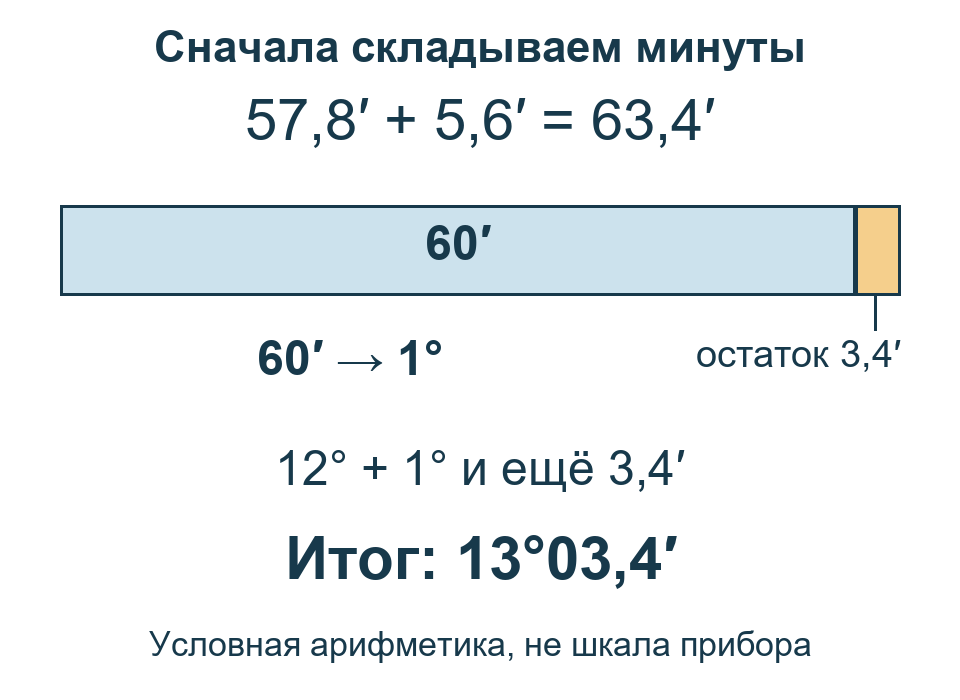

# Перед расчётом: семь маленьких навыков

**Для игры и учёбы, не для реального судовождения.** Здесь только условные бумажные примеры, не показания игры. Не смотрите на настоящее Солнце через незащищённую оптику.

Хотите просто получить первый отсчёт? [Начните с прибора](START.html): эту страницу проходить заранее не нужно.

Если готовитесь к расчётам, выберите знакомую и незнакомую тему. Можно пользоваться карандашом, калькулятором для арифметики и текстом объяснения. Настоящие навигационные таблицы позже будем читать вручную.

**Как пользоваться:** попробуйте один вопрос ниже → при затруднении откройте указанную тему → выполните её короткое задание → сверьтесь с отдельным ключом. Баллы считать не нужно.

## С чего начать: шесть коротких вопросов

Запишите ответы на бумаге. Все числа здесь заданы для тренировки. [Ключ диагностики](ANSWERS.html#basics-diagnostic) открывайте после своей попытки.

1. **Д0.1 — запись.** Прочитайте `16°42,7′`: что стоит до знака °, что — перед ′? Это то же самое, что `16,427°`? [Разобраться с записью](#angle-reading).
2. **Д0.2 — единицы.** В записи `08:09:10` и в записи `11′` речь о времени или об угле? В первой записи используем формат часы:минуты:секунды. [Различить минуты](#time).
3. **Д0.3 — сложение.** Найдите `18°56,8′ + 7,5′`. Что делать, если минут получилось больше 60? [Переход через 60](#angle-arithmetic).
4. **Д0.4 — клетка.** По сетке ниже выпишите значение на пересечении строки **32°** и столбца **6 м**. [Читать сетку](#table).
5. **Д0.5 — промежуток.** В условной таблице для 3 м дано 11′, для 5 м — 9′. Только в этом задании изменение между ними считаем равномерным. Найдите значение для 3,5 м. [Найти долю](#between).
6. **Д0.6 — направление.** На нашей сетке север сверху, восток справа. В какой четверти окажется направление 135°, отсчитанное от севера по часовой стрелке? [Разобрать направление](#direction).

Сетка для Д0.4 — только учебная, не выписка из морской таблицы:

| Угол | 4 м | 6 м |
|---|---:|---:|
| 30° | 9,8′ | 9,4′ |
| 32° | 10,2′ | 9,8′ |

Затруднение означает, что полезно разобрать соответствующую мини-тему. Если всё знакомо, переходите к [практикуму](TRAINING.html).

## 1. Измеряем поворот взгляда

**Что получим:** сможем объяснить, почему высота Солнца — угол, а не метры.

Представьте две линии от глаза. Одна направлена к видимому морскому горизонту, другая — к нижнему краю Солнца. Чтобы перевести взгляд с первой на вторую, нужно повернуть его вверх. Секстант измеряет этот угол.

На этой учебной схеме размеры условные. Различие видимого горизонта и строго горизонтального направления разберём позже, в поправках высоты.

**Образец объяснения:** «Я измеряю, на какой угол нужно повернуть взгляд от горизонта к нижнему краю Солнца. Расстояние до Солнца я так не измеряю».

**Б1 — попробуйте:** высота глаза над водой записана в метрах. Может ли она заменить угол, прочитанный по секстанту? Объясните одним предложением. [Проверить Б1](ANSWERS.html#basics-turn).

[Вернуться к первому отсчёту](START.html) или [разобрать полный урок 1](GUIDE.html#lesson-1).

## 2. Как прочитать запись угла

**Что получим:** прочитаем градусы и угловые минуты, не смешав их с десятичными градусами.

**Нужно только одно правило: в одном градусе 60 угловых минут.** Градусы обозначают знаком **°**, угловые минуты — знаком **′**. Минуты здесь делят угол, а не час.

### Посмотрите на запись

В этой записи **39°** — целые градусы, **13,4′** — минуты и доли минуты. Десятичная запятая относится к минутам: `13,4′ = 13′ + 0,4′`.

### Прочитайте по частям

1. Найдите знак °. Слева от него — **39 градусов**.
2. Найдите знак ′. Между ° и ′ записано **13,4 угловой минуты**.
3. Соедините: «тридцать девять градусов, тринадцать целых четыре десятых угловой минуты».

Это **не 39,134°**: градусы и минуты нельзя склеивать в одно десятичное число. Сейчас сохраняйте запись с двумя единицами; перевод не требуется.

**Если запутались:** сначала подпишите под каждым знаком его единицу. Число после запятой — часть той единицы, рядом с которой оно записано.

### Б2 — теперь сами

Прочитайте `27°46,2′`. Выпишите отдельно градусы и минуты. Что означает `0,2′`: часть минуты или часть градуса? [Ключ Б2](ANSWERS.html#basics-reading).

**Результат:** вы можете прочитать обе части записи и назвать их единицы. Следующий шаг — [сложить минуты](#angle-arithmetic). Для собственного отсчёта — [шаг записи Hs в START](START.html#lesson-1).

## 3. Что делать, когда минут больше 60

**Что получим:** сложим углы и заменим полные 60′ одним градусом. Вычитание разберём отдельно следующим шагом.

Уже известно: `60′ = 1°`. Значит, каждые полные 60′ можно заменить одним градусом. Нельзя переносить десятку, как при обычном десятичном сложении.

### Разобранный пример

Нужно найти **12°57,8′ + 5,6′**. Это условная арифметика, не поправка к вашему наблюдению.

1. Складываем минуты: `57,8′ + 5,6′ = 63,4′`.
2. Отделяем полный градус: `63,4′ = 60′ + 3,4′ = 1°03,4′`.
3. Прибавляем его к прежним 12°: **13°03,4′**. Нуль перед 3,4 помогает видеть запись минут; `3,4′` означает то же число.

Проверка смысла: добавили немного больше 5′, поэтому результат чуть больше 13°, а не 18°.

### Б3а — закончите сложение

`6°58,6′ + 3,7′`. Минуты дают `62,3′`; отделите 60′ и запишите итог. [Ключ Б3а](ANSWERS.html#basics-arithmetic).

**Результат:** после переноса минуты меньше 60′. Теперь попробуйте обратное действие — [вычитание](#angle-subtraction).

## 3б. Если минут не хватает для вычитания

**Что получим:** заменим один градус минутами, не изменив сам угол.

Нужно найти **9°02,0′ − 4,5′**. Из 2,0′ нельзя вычесть 4,5′ и оставить прежние 9°. Но один из девяти градусов можно записать как 60′.

### Разберите обмен по шагам

1. Отделите один градус: `9°02,0′ = 8° + 1° + 2,0′`.
2. Замените его минутами: `8° + 60′ + 2,0′ = 8°62,0′`. Угол остался прежним: изменился только способ записи.
3. Вычтите минуты: `62,0′ − 4,5′ = 57,5′`.
4. Соедините оставшиеся градусы и минуты: **8°57,5′**.

Запись `8°62,0′` — промежуточная, для вычисления. В итоговой записи минуты должны быть меньше 60′.

**Проверьте обратным действием:** `8°57,5′ + 4,5′ = 8°62,0′ = 9°02,0′`. Получили исходный угол — обмен выполнен верно.

### Б3б — закончите с подсказкой

`14°03,0′ − 7,0′`. Один градус уже обменяли: `13°63,0′ − 7,0′`. Вычтите минуты и сохраните оставшиеся градусы.

### Б3в — теперь самостоятельно

`21°04,2′ − 8,6′`. Запишите обмен одного градуса на 60′, выполните вычитание и проверьте обратным сложением. [Ключи Б3б и Б3в](ANSWERS.html#basics-arithmetic).

**Если запутались:** после обмена градусов станет на один меньше, минут — на 60 больше. Общая величина не меняется.

**Результат:** можете показать промежуточный обмен и проверить ответ. Дальше — [время](#time) или [поправки в уроке 3](GUIDE.html#lesson-3).

## 4. Минуты на часах и минуты угла

**Что получим:** различим единицы и не потеряем дату при переходе через полночь.

В записи **07:12:30** используем формат часы:минуты:секунды. В записи **7°12,3′** — градусы и угловые минуты. Одинаковое слово «минута» не делает их одной величиной.

| Запись | Что измеряем |
|---|---|
| 2 ч 15 мин | Длительность |
| 2°15′ | Угол |

Один час содержит 60 минут **времени**. Когда понадобится выразить длительность в часах, `1 ч 30 мин = 1 + 30 ÷ 60 = 1,5 ч`. В навигационных таблицах встретится ещё часовая мера **угла**; её отдельно объясняет урок 5. Здесь не переводим любые минуты часов напрямую в минуты угла.

**Разбор образца:** от 3 мая 23:50 до 4 мая 00:10 прошло 10 минут до полуночи и 10 после — всего **20 минут**, а не отрицательное время. Обе отметки заданы в одной шкале.

**Б4 — попробуйте:** сколько времени прошло от 5 мая 23:45 до 6 мая 00:20 в той же шкале? Запишите длительность в минутах. [Ключ Б4](ANSWERS.html#basics-time).

Если запутались, разбейте промежуток в полночь. Условная задача не подтверждает доступность GMT и паузы в игре: для своих данных используйте [урок 2](GUIDE.html#lesson-2).

## 5. Строка, столбец, клетка

**Что получим:** выпишем число по двум заголовкам.

Строка идёт поперёк таблицы, столбец — сверху вниз. Клетка на их пересечении соответствует сразу обоим заголовкам. Сначала читаем названия и единицы, потом число.

Учебная сетка ниже показывает **заданную добавку в угловых минутах** для условных угла и высоты. Это не морская поправка и не выписка из F-Tafel.

| Угол | Высота 2 м | Высота 4 м |
|---|---:|---:|
| 20° | +6,0′ | +5,0′ |
| 22° | +6,4′ | +5,4′ |

**Разобранный поиск:** для угла 20° и высоты 4 м найдите строку 20°, ведите по ней до столбца 4 м: **+5,0′**. Перепишите вместе со знаком и единицей, не только цифру 5.

**Б5 — попробуйте:** найдите добавку для угла 22° и высоты 2 м. Укажите строку, столбец и прочитанную клетку. [Ключ Б5](ANSWERS.html#basics-table).

Если число не находится, вернитесь к двум заголовкам. Не переставляйте аргументы ради знакомого ответа. В настоящих таблицах вид записи и правила чтения могут быть другими: продолжение — [урок 3, F VIII](GUIDE.html#lesson-3) и [урок 5, F I/F II](GUIDE.html#lesson-5). Учебная сетка их не заменяет.

## 6. Между двумя строками

**Что получим:** найдём нужную долю промежутка, а не будем всегда брать половину.

Половина пути от 5 до 6 — 5,5. Но от 7 до 7,2 пройдена только пятая часть пути до 8: `0,2 ÷ 1 = 0,2`.

**Условный пример:** для 7 м дана добавка 12′, для 8 м — 10′. Только на этом интервале примем равномерное изменение. Нужно значение для 7,2 м.

1. Доля пути: `(7,2 − 7) ÷ (8 − 7) = 0,2`.
2. Изменение добавки на всём промежутке: `10′ − 12′ = −2′`.
3. Нужная часть изменения: `−2′ × 0,2 = −0,4′`.
4. От нижнего аргумента 7 м: `12′ − 0,4′ = 11,6′`.

Такой поиск промежуточного числа называется **линейной интерполяцией**. Наш результат лежит между 10′ и 12′ и ближе к 12′, как 7,2 м ближе к 7 м.

**Б6 — попробуйте:** в другой условной сетке для 4 м дано 14′, для 6 м — 10′. При равномерном изменении найдите значение для 4,5 м. Сначала запишите долю, потом ответ. [Ключ Б6](ANSWERS.html#basics-between).

Если запутались, сравните пройденную часть с **полным интервалом**, не с верхним числом. За его границы не продолжайте. Для настоящих таблиц действуют правила выбранной страницы: [поправки, урок 3](GUIDE.html#lesson-3), [F XI, урок 6](GUIDE.html#lesson-6).

## 7. Направление и масштаб

**Что получим:** отличим направление от расстояния на учебной сетке.

На нашей сетке истинный север специально направлен вверх. Направления считаем от него по часовой стрелке: север 0°, восток 90°, юг 180°, запад 270°. Направление 360° совпадает с 0°.

**Образец:** направление 90° ведёт вправо, на восток. Но длина линии из числа 90° не следует. Если **масштаб** задан как `1 см = 2 морские мили`, расстоянию 6 миль соответствует `6 ÷ 2 = 3 см`.

**Перпендикуляр** — линия под прямым углом, 90°, к другой линии, как две соседние стороны листа. Само слово не задаёт, через какую точку её нужно провести: точку укажет условие построения.

**Б7 — попробуйте:** от точки проведите отрезок на юг длиной 4 морские мили при масштабе `1 см = 2 морские мили`. Какой угол направления и какую длину на бумаге выберете? [Ключ Б7](ANSWERS.html#basics-direction).

На произвольной карте верх не обязательно означает истинный север. Угловую минуту долготы нельзя автоматически считать морской милей: её длина зависит от широты. Масштаб и север проверяйте отдельно. Подробная прокладка — в [уроке 6](GUIDE.html#lesson-6).

## Что дальше

Выберите только нужное продолжение: [первый отсчёт](START.html), [бумажный практикум](TRAINING.html) или [условия собственного расчёта](GUIDE.html#readiness). Эти задания готовят к работе, но не подтверждают игровые источники данных и не заменяют наблюдения.
