

# Секстант и Солнце

**Практическое пособие для начинающих · RadioNavigation / UBOAT**  
Рабочая редакция · 24 октября 2026 года

Это путь от первого взгляда на морской горизонт до линии положения и определения места по двум наблюдениям. Предварительное знание астрономии не требуется. Каждое новое понятие вводится перед действием, для которого оно понадобится.

**Рабочая редакция.** Понятность начинающему читателю и обычный игровой проход ещё требуют проверки; [статус и ограничения](QA-STATUS.html) приведены отдельно.

**Только для игрового и учебного применения.** Пособие не предназначено для реального судовождения. Не смотрите на настоящее Солнце через незащищённую оптику; игровой подбор фильтров нельзя переносить на реальный прибор.

## Какой результат мы ищем

Секстант не показывает координаты. Он измеряет угол между двумя направлениями: на морской горизонт и на край Солнца. После поправок и ручного расчёта этот угол позволяет построить **одну линию возможных мест** на карте.

Одной линии недостаточно, чтобы выбрать единственную точку. Для места нужны ещё одно независимое наблюдение и известный либо явно оценённый путь лодки между наблюдениями. Принятая точка расчёта, конец отложенной стрелки и готовый маркер лодки — разные вещи; дальше разберём каждую отдельно.

## Перед первой попыткой

- **На бумаге:** условие задачи, [расчётный лист](PAPER-WORKSHEET.html), оригинальные таблицы, карандаш, линейка и транспортир. Игра не требуется.
- **С прибором в UBOAT:** RadioNavigation, учебная копия сохранения и резервная копия настроек, день, видимые Солнце и морской горизонт. [Подготовка сцены](GUIDE.html#scene-preparation) отделена от навигации и ещё требует игровой проверки; готовое сохранение к пособию не приложено. Выход и команды разобраны в уроке 1.
- В расчёте нужны четыре арифметических действия и десятичные дроби. Градусы, минуты и интерполяция объясняются на месте; [базовые темы](BASICS.html) доступны по необходимости.

Выберите маршрут: [изучение метода на бумаге](#walkthrough) — связный разбор от двух высот до места без запуска игры; [только прибор](START.html) — первый отсчёт; [собственное наблюдение](#practice) — расчёт при известных входах. Их источники перечислены в [реестре данных](#data-sources). При затруднении откройте [разбор ошибок](#troubleshooting).

После разобранного примера переходите к [практикуму](TRAINING.html): отдельным трудным действиям и новой полной задаче. Для собственных игровых данных есть [лист наблюдений](WORKSHEET.html) с полями источников времени, поправок и пути.

## Как работать с пособием

Следите за связью операций: **измерение → поправки → положение Солнца → расчётная высота → линия → перенос → место**. Сохраняйте исходные числа и промежуточные строки: они показывают не только ответ, но и причину возможной ошибки.

**Самостоятельно — не значит наизусть.** Текст действий и оригинальные таблицы можно держать открытыми. В повторной попытке закрывают готовый числовой ответ или законченный рисунок, а не инструкцию.

## Три вида материала

| Обозначение в тексте | Что это | Как использовать |
|---|---|---|
| Практика | Ваши действия, отсчёты, время и источники | Записывать только реально полученные данные |
| Разбор образца — не ваши измерения | Сохранённые исходные числа и ручная арифметика | Разобрать метод; не выставлять прибор на готовый ответ |
| Условная схема или упражнение | Рисунок без масштаба либо отдельно заданный путь | Понять связь величин; не выдавать за ещё одно наблюдение |

Все рисунки в пособии — объяснения, **не скриншоты игры и не новые измерения**. Страницы исторических таблиц не перерисовываются: схемы клеток объясняют их чтение, а ссылки ведут к оригиналам. По изображению на экране не измеряют морские мили.

## Маршрут из семи уроков

| Урок | Что появляется в записи | Чего пока не получаем |
|---|---|---|
| 1. Секстант | Собственный отсчёт высоты нижнего края | Полноценное наблюдение без времени |
| 2. Время | Дата, GMT и высота одного момента | Линию или место |
| 3. Поправки | Исправленная высота центра Солнца | Координаты лодки |
| 4. Альманах | Часовой угол и склонение Солнца | Положение лодки |
| 5. Принятая точка | Расчётная высота, расстояние и сторона сдвига | Готовое место |
| 6. Карта | Одна подписанная линия положения | Единственную точку |
| 7. Два наблюдения | Пересечение независимых линий на одно время | Гарантию истинных координат без ошибок |
| Сквозной пример | Две условные линии, перенос и координаты | Игровое наблюдение или точность прибора |

**Первое знакомство не требует всех расчётных входов.** Для маршрута А достаточно вида на Солнце и горизонт. Поправка нуля, высота глаза, начальное место и путь нужны только тогда, когда вы переходите к собственной полной задаче.

## Когда нужно остановиться

Неизвестное значение не заменяют удобным нулём или числом из образца. Если не установлен момент измерения, источник высоты глаза, сохранённая поправка нуля, счислимое место или путь лодки, запишите, чего именно не хватает. Продолжать можно разбор на бумаге по заданным условиям, но не объявлять собственный навигационный расчёт выполненным.

Сохранённый разбор и новая задача — разные наборы исходных данных. В уроках разбираются прежние условия; в практикуме используются только его условные карточки. Не переносите числа между задачами. Ограничения старого альманаха и его временной привязки изложены в [уроке 4](#lesson-4) и [приложении об источниках](#limits).

**Для первого бумажного прохода:** [от двух высот к месту](#walkthrough).

---

## Оглавление

- [Перед началом](#start)
- [1. Секстант и касание](#lesson-1)
- [2. Время наблюдения](#lesson-2)
- [3. Поправки высоты](#lesson-3)
- [4. Положение Солнца](#lesson-4)
- [5. Принятая точка и расчёт](#lesson-5)
- [6. Линия положения](#lesson-6)
- [7. Перенос и место](#lesson-7)
- [Выберите подходящую работу](#readiness)
- [Своё наблюдение: маршрут](#practice)
- [Откуда брать исходные числа](#data-sources)
- [Лист записей](#worksheet)
- [Управление прибором](#controls)
- [Если не получается](#troubleshooting)
- [Условие сквозного примера](#full-example)
- [От двух высот к месту: разбор](#walkthrough)
- [Упражнения](#exercises)
- [Качество результата](#quality)
- [Обозначения](#terms)
- [Самопроверка](#self-check)
- [Реальные факты и контекст](#facts)
- [Статус и границы проверки](#qa-status)
- [Источники и ограничения](#limits)
- [Короткая версия](START.html)
- [Полевая карточка](FIELD.html)
- [Практикум: самостоятельная работа](TRAINING.html)
- [Перед расчётом: базовые навыки](BASICS.html)
- [Решения и ключи](ANSWERS.html)

---

## Урок 1. Что измеряет секстант

Секстант измеряет угол между направлениями на горизонт и Солнце. Здесь разберём измерение и получим исходный отсчёт Hs; поправки и расчёт места следуют в следующих уроках.

**Для практики с прибором:** UBOAT с RadioNavigation, бумага и карандаш или [короткий лист записи](STARTER-WORKSHEET.html), учебная копия сохранения и резервная копия настроек. Для изучения метода без игры используйте [бумажный разбор](#walkthrough): отсчёты там заданы условием.

**Маршрут ещё не проверен новичком.** Если инструкция не помогает выполнить шаг, запишите место остановки. Известные ограничения — в [статусе проверки](#qa-status).

### Сначала поймём, на что смотрим

**Горизонт** — далёкая граница моря и неба. Это не край палубы, не берег и не полоса облаков.

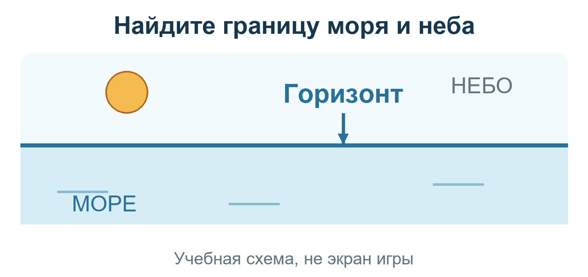

Теперь представьте два направления от глаза: одно — к горизонту, другое — к нижнему краю Солнца. Чтобы перевести взгляд с первого на второе, его нужно повернуть вверх. Этот поворот и есть **высота Солнца — угол**, не метры и не расстояние до Солнца. Пока считаем по **видимому морскому горизонту**; небольшое отличие от строго горизонтальной плоскости разберём в уроке 3.

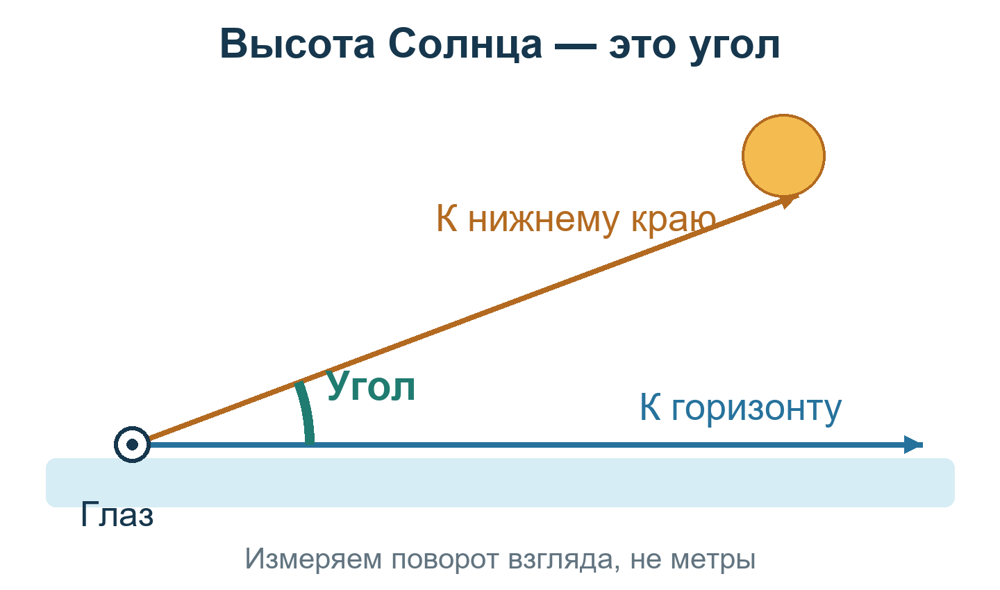

Секстант позволяет видеть горизонт прямо, а Солнце — через отражение. В игре это два вида в одном окуляре; называем их «прямым» и «отражённым» по аналогии с прибором. Ручкой прибора можно перемещать **изображение** Солнца до горизонта. Само Солнце от этого не опускается. Шкала показывает измеренный угол. Эта ручка называется **барабаном (регулятором отсчёта угла)**; в игре её заменяют клавиши.

### Практика: одно действие за раз

**Клавиши ниже — назначения по умолчанию.** Если вы их меняли, используйте свои. Полный список — в [карточке управления](CONTROLS.html); назначения — в настройках игры и справке `P`.

#### 1. Загрузите учебную сцену

Сначала прочитайте [подготовку учебной сцены](GUIDE.html#scene-preparation): проверенного готового сохранения к пособию нет, копию вашего сохранения и откат готовят отдельно с оператором. Если подходящей копии пока нет, используйте [бумажный маршрут](#walkthrough). Загрузите только подготовленную учебную копию сохранения.

**Проверьте:** лодка на поверхности моря, сейчас день. Если подходящей сцены нет, практическая попытка ещё не началась. Не меняйте условия скрытыми командами.

#### 2. Найдите свои команды и выберите наблюдателя

В настройках найдите свои команды **вида от первого лица, перемещения и показа интерфейса/курсора**. Перепишите их, чтобы не искать во время упражнения.

Выберите доступного офицера и включите вид от его лица. В обычном режиме управления экипажем для этого дважды щёлкните **левой** кнопкой по его портрету. Другие режимы и затруднения разобраны в [справке по выходу](GUIDE.html#exit-help).

**Готово, если** смотрите с уровня глаз наблюдателя и можете повернуть взгляд. Секстант пока закрыт. Если остался общий вид лодки, воспользуйтесь справкой по выходу.

#### 3. Пройдите наружу к морскому горизонту

Если вы внутри, пройдите к центральному посту под рубкой и найдите лестницу на мостик. Встаньте лицом к подъёму и двигайтесь вперёд до начала перехода. Дождитесь конца анимации. Расположение лестницы зависит от лодки. Если вы уже на открытом мостике, этот переход не нужен.

Для закрытого люка используйте показанную игрой подсказку. Если проход или поворот взгляда не получается, откройте [разбор затруднений](GUIDE.html#exit-help).

**Проверьте:** видны открытые небо и море, над наблюдателем нет потолка; взгляд остаётся от лица, а не из свободной внешней камеры. Если видите только интерьер, внешний маршрут ещё не завершён. Автоматический перенос персонажа не засчитывается.

#### 4. Покажите горизонт без прибора

Найдите глазами границу моря и неба.

**Проверьте:** можете проследить эту границу в стороны. Если она скрыта волной, берегом или дымкой, для упражнения нужно другое положение или более ясная сцена. Не дорисовывайте невидимую линию.

#### 5. Найдите Солнце

Поверните обычный игровой взгляд к видимому солнечному диску.

**Проверьте:** нашли сам диск в небе, не блик на воде. Не ищите Солнце по готовому числу на карточке: найдите диск глазами.

#### 5.1. Верните взгляд к морю под Солнцем

Запомните направление Солнца влево-вправо. Обычным взглядом опуститесь к участку горизонта под ним, не поворачиваясь в другую сторону. Сейчас само Солнце может уйти вверх за край экрана — это нормально.

**Проверьте:** горизонт находится в поле зрения. Прибором будем опускать отражённое изображение Солнца, а не поднимать морской горизонт к Солнцу. Если обычный взгляд не удаётся перевести, остановитесь на этом переходе.

#### 6. Откройте секстант

Один раз нажмите `Z` (по умолчанию).

**Проверьте:** появилось круглое окно прибора — **окуляр (окошко, в которое смотрят)** — и можно прочитать число на шкале. Если прибор не открылся, не нажимайте подряд другие команды: запишите «остановка при открытии».

#### 6.1. Подготовьте барабан к поиску

Если нужно сохранить прежний отсчёт, сначала перепишите его. В учебной копии нажмите `R` (по умолчанию): это возвращает барабан к нулю и убирает добавочный поворот влево-вправо.

**Проверьте:** число на шкале стало нулевым. Это только исходная настройка для поиска, **не измерение и не проверка ошибки прибора**. Нажатие `R` не доказывает, что у секстанта нет ошибки нуля.

#### 7. Сделайте край Солнца хорошо видимым

У прибора две половины: **слева прямой вид на горизонт, справа отражённый вид в сторону Солнца**. Пока барабан не подведён к нужному углу, Солнца справа может вообще не быть. Это ещё не означает неисправность.

Нажмите `3` (по умолчанию): справа включается сильное затемнение. Если найденный позже диск слишком тёмный, попробуйте `2`, затем `1`. Слева пока оставьте горизонт без дополнительного затемнения. Остальные фильтры — в [карточке управления](CONTROLS.html).

**Проверьте сейчас:** слева виден горизонт. Чёткость солнечного края проверим, когда изображение появится справа. Белое пятно с неясной границей для касания не подходит. Это только игровая операция: не смотрите на реальное Солнце через незащищённую оптику и не пробуйте на ней игровой подбор фильтров.

#### 8. Подведите отражение к горизонту

Оставляйте прямой морской горизонт слева на месте. Нажимая `↑`, увеличивайте угол барабана: правое окно смотрит всё выше, а попавшее в него изображение Солнца опускается внутри окна. При большом расстоянии **удерживайте** `↑`; `Shift+↑` движет быстрее. У горизонта отпустите клавишу, чтобы не проскочить. `↓` уменьшает угол и двигает изображение обратно вверх. Одиночное нажатие `↑` даёт грубый шаг в несколько минут; для последних мелких поправок используйте `Ctrl+↑`, а не обычные стрелки.

Если диск всё время отсутствует, проверьте исходное направление обычным взглядом после закрытия прибора. Не перебирайте углы вслепую и не выставляйте число контрольного образца.

**Готово, если** отражение движется, а число на шкале меняется. Если реакции нет, остановитесь и проверьте назначение клавиш управления. `←` и `→` поворачивают направление взгляда, это не настройка высоты.

#### 9. Сделайте точное касание

Пользуйтесь короткими нажатиями `Ctrl+↑` и `Ctrl+↓`. Это точная настройка с самым маленьким шагом. Не держите клавишу: удержание включает повтор.

Нужен **нижний край круга**, то есть край, ближайший к горизонту. Мысленно продолжите левый горизонт вправо: нижний край отражённого Солнца должен коснуться этого уровня. На схеме продолжение показано пунктиром; это не дополнительная линия интерфейса игры.

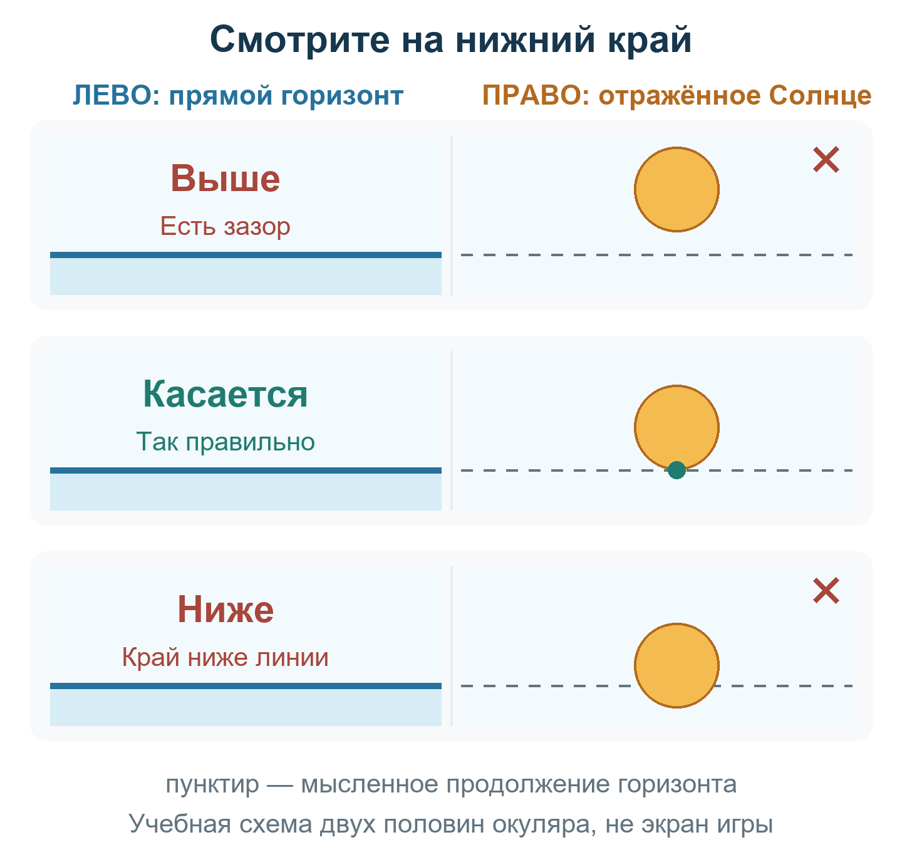

Дополнительная иллюстрация без числового ответа

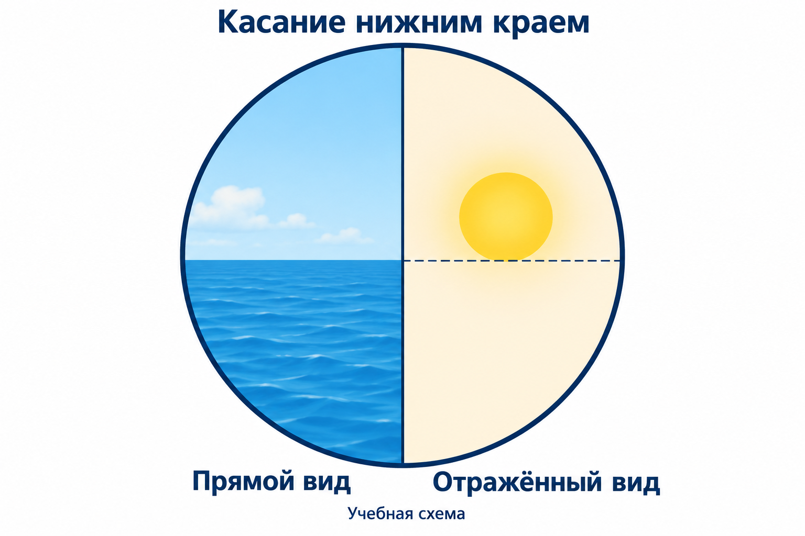

Слева — прямой горизонт, справа — отражённое Солнце. Пунктир — мысленное продолжение уровня, не линия интерфейса игры. Касается нижний край, не центр диска.

<!-- nav-diagram:contact -->

**Проверьте:** небольшое движение в одну сторону даёт зазор над этим уровнем, в другую — опускает нижний край ниже него. Вернитесь к касанию. Если мешает слишком мелкое изображение, увеличьте его клавишей `+`, заново проверив видимость обеих границ. Увеличение изображения не умножает измеренный угол.

#### 10. Перепишите отсчёт

На шкале знак **° означает градусы**, а **′ — угловые минуты**. Это деления угла. В одном градусе 60 угловых минут; с минутами на часах их не смешиваем.

Не вращая барабан, прочитайте число градусов и число минут. Запишите их вместе, добавив слова «нижний край Солнца».

Исходное показание обозначают **Hs (высота нижнего края Солнца по секстанту, до поправок)**. Читайте шкалу барабана, не готовый результат вычисления. Если неизвестно, что именно показывает доступное поле, запишите «исходный отсчёт не установлен» — не подменяйте его вычисленным числом.

Кнопки `I` (встроенная запись наблюдения), `C` (служебная калибровка по известному светилу) и `O` (сброс серии) для этой работы не нужны.

### Как прочитать собственную запись

Образец записи: **Hs = 39°13,4′**. Это сохранённый отсчёт, не угол, который нужно выставить на приборе.

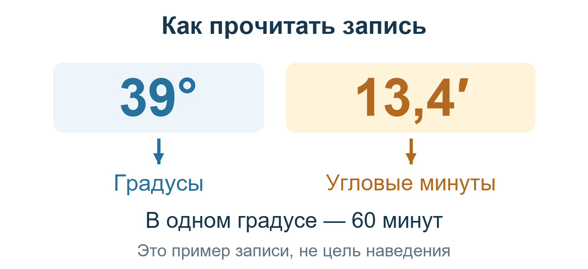

Читается: «тридцать девять градусов, тринадцать целых четыре десятых минуты». Запись не равна 39,134°: в градусе 60 угловых минут, не 100. Угловую минуту также нельзя смешивать с минутой времени.

Один короткий шаг `Ctrl+↑` или `Ctrl+↓` меняет отсчёт на **0,1′ (одну десятую угловой минуты)**. Теперь понятно, какое деление мы использовали для точного касания.

Десятичная запятая делит минуту на части: **13,4′ = 13′ + 0,4′**. Десять маленьких шагов по 0,1′ составляют одну угловую минуту, а не один градус.

Солнце движется, поэтому новое касание позднее не обязано дать прежнее число. Без учёта времени разность отсчётов не отделяет движение Солнца от ошибки наведения.

### Самостоятельная попытка

Сохраните первый отсчёт. Немного сместите барабан, чтобы касание исчезло. Затем, пользуясь текстом урока, но без подсказки ведущего, заново найдите контакт и прочитайте шкалу. Не возвращайте число по памяти: ориентир — видимый край. Запишите новый отсчёт, нижний край, фильтры и увеличение. Никаких поправок не прибавляйте.

Просто закрыть и открыть прибор для такой проверки недостаточно: **барабан сохраняет прежнее положение**, а фильтры при открытии сбрасываются. Первое число нужно записать до любого сброса или нового наведения.

### Один проверяемый результат

**На бумаге есть собственный отсчёт высоты; вы можете показать, какие две границы совместили, и правильно прочитать запись.**

Отсчёт без привязанного времени — упражнение с прибором, не полноценное навигационное наблюдение. Для бумажной задачи измерение заменено явно заданным Hs; игровой проход не требуется.

[Урок 2 — время наблюдения](#lesson-2). [К началу курса](#start).

---

## Урок 2. Когда была измерена высота

**Вход:** вы понимаете, что означает Hs из [урока 1](#lesson-1). В бумажной задаче Hs и момент берутся из условия; выполнять игровое измерение перед чтением не нужно.

Высота и время должны относиться к одному положению Солнца — к моменту касания кромки с горизонтом.

### Зачем нужны часы

Солнце движется по небу. Поэтому нельзя взять высоту сейчас, посмотреть на часы позднее и соединить эти числа как будто они получены вместе.

У разных мест могут быть разные местные часы. Чтобы не путать их, навигатор использует общую шкалу: **GMT (время по Гринвичу)**. Не нужно пока знать географические расчёты; нужно отличать этот источник от других часов.

Название строки «Лондон» ниже относится к часам **в этой игре**. Оно не означает, что любые реальные лондонские часы в любую дату показывают гринвичское время: гражданские часы могут переводить на летнее время.

**Нужно:** секстант, судовой журнал с видимыми секундами, бумага. Последовательность с часами и паузой ещё должна быть подтверждена обычным игровым управлением.

*Число на часах — образец, не ваши новые показания.*

Дополнительная иллюстрация без числового ответа

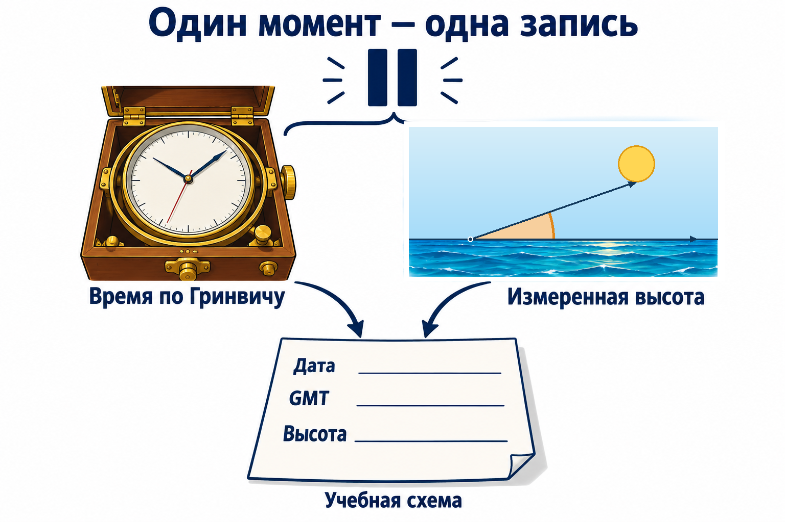

Высота и время относятся к одному остановленному моменту. Хронометр здесь условный: из его стрелок не берут GMT. В игре читают установленный источник времени; строки собственного листа заполняют своими данными.

### Практика: сначала установим источник

В игровой попытке заранее найдите в настройках команды **«Судовой журнал»** и **«Пауза»**. Ниже описан учебный способ связать время с высотой на остановленной сцене; его обычный игровой проход пока не подтверждён. В бумажном разборе оба момента уже заданы.

#### 1. Найдите гринвичские часы

При закрытом секстанте откройте судовой журнал. Найдите строку **GMT**; в русской подписи она может называться **«Лондон»**. Это штатная строка игры, а RadioNavigation добавляет к ней секунды. Не выбирайте «Берлин», местные часы или секундомер `F7`.

**Проверьте:** видите, как сменяются несколько последовательных секунд. Если строки или секунд нет, запишите, чего не хватает; точного времени наблюдения пока нет.

#### 2. Установите дату

Запишите день, месяц и год, соответствующие этим часам. Около полуночи гринвичская дата может отличаться от даты других часов. Если на панели с часами даты нет, возьмите её с игрового календаря и запишите, откуда именно.

**Проверьте:** известно происхождение даты, а не только удобное число из соседней строки.

#### 3. Остановите игровое время для упражнения

Закройте журнал. Включите паузу своей штатной командой, указанной в настройках игры. Снова откройте журнал.

**Проверьте:** два чтения с промежутком не менее двух реальных секунд совпадают до секунды. Если время продолжает меняться, пауза не подтверждена. Не считайте надпись или доставку клавиши доказательством остановки часов.

#### 4. Запишите остановленное время

Перепишите дату и часы полностью: часы, минуты, секунды. Рядом напишите **GMT (время по Гринвичу)**. Закройте журнал, не снимая паузу.

#### 5. Сделайте новое касание

Повторите упражнение с секстантом из урока 1. Запишите **Hs (высоту нижнего края Солнца по секстанту до поправок)**. Отсчёт предыдущего урока не приписывайте этому новому времени.

#### 6. Замкните проверку

Закройте секстант, снова откройте журнал и прочитайте дату и секунды.

**Проверьте:** они остались теми же, что перед наведением. Тогда время и высота связаны одной остановленной сценой. Если время изменилось, свяжите новое снятие с его действительным моментом; не исправляйте дату задним числом.

### Как выглядит законченная запись

#### Три стадии вместо одной длинной попытки

В записи различайте **источник** времени и **способ связи** с высотой. Название часов устанавливает шкалу, но не доказывает, что секунды относятся к касанию. Для связи нужны показания остановленного времени до и после наведения либо чтение непосредственно в момент контакта. Если связь не установлена, время наблюдения остаётся неизвестным.

**Попробуйте сначала на бумаге:** [П1 — выбрать время контакта](TRAINING.html#step-time). Там временные отметки заданы условием; игра и работающая пауза для задания не нужны. Если запутались в формате, вернитесь к [минутам времени](BASICS.html#time).

На вашем листе должны быть: **дата; GMT (время по Гринвичу); Hs (высота до поправок); нижний край; источник часов**.

#### Разбор образца — не ваши измерения

**Исторический образец · 2 сентября.** Сохранённый пример имеет запись: **2 сентября 1939 года; метка времени 10:03:07Z; Hs (высота до поправок) = 39°13,4′; нижний край Солнца**.

*Это исторический разбор с неустановленной связью исходной метки и табличных данных; ограничение разобрано в [уроке 4](#lesson-4). Для полного бумажного прохода используется другая, явно условная [пара 3 сентября](#walkthrough).*

### Если приходится работать без паузы

Время снимается непосредственно в момент контакта кромки с горизонтом. Помощник может читать часы вслух, пока наблюдатель держит касание. Если не можете связать секунду с контактом, отметьте «время измерения не установлено». Это ограничение способа работы, не приглашение получить время скрытой командой.

### Самостоятельная попытка

На бумаге выполните [П1](TRAINING.html#step-time): выберите время, действительно относящееся к контакту. В игре для повторной записи сначала снимите паузу и проверьте ход секунд, затем получите новую связанную пару времени и высоты. Прежние показания сохраняются как отдельное наблюдение.

### Один проверяемый результат

**Есть одна собственная запись «дата — время — измеренная высота», и можно объяснить, как доказана их одновременность.**

Если в игре время не удалось установить, собственное наблюдение пока неполно. Это не мешает изучать поправки на заданных бумажных данных.

[Урок 3 — исправление высоты](#lesson-3). [К началу курса](#start).

---

## Урок 3. Превращаем отсчёт в исправленную высоту

**Вход:** Hs, край диска, месяц, поправка нуля и высота глаза. В бумажной задаче берите их из условия; для собственного наблюдения — из установленных источников. Связь высоты со временем объяснена в [уроке 2](#lesson-2).

Получим **Ho — исправленную высоту центра Солнца**, которую затем можно сравнивать с расчётной.

### Почему прежнего числа недостаточно

Мы измерили положение **нижнего края** Солнца. Дальше понадобится положение его **центра**. На реальном приборе секстант может ещё немного завышать или занижать число. Поэтому отсчёт нужно исправить. В этой игре отдельной механической ошибки зеркал нет; это меняет только способ получить поправку нуля.

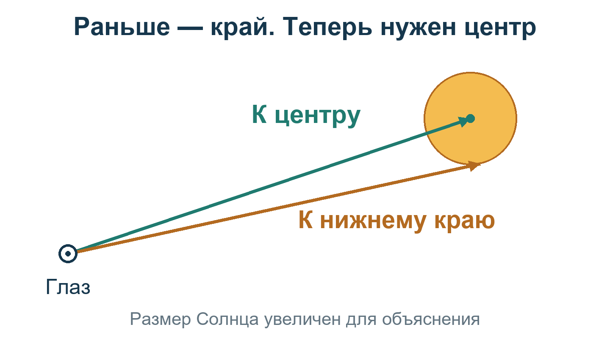

Помимо перехода от края к центру, нужны поправки за положение видимого горизонта и преломление света в атмосфере — рефракцию. Таблица объединит эти исправления.

Меняется не только край диска. В первом уроке угол отсчитывали от **видимого края моря**. В расчёте нужна высота относительно **горизонтальной плоскости**, а видимый морской горизонт из-за кривизны Земли находится ниже неё. Поэтому нельзя считать общую поправку просто добавлением половины солнечного диаметра.

**Нужно:** секстант, записанная Hs (высота нижнего края до поправок), известная высота глаза и книга [F-Tafel, страница PDF 98](source-tables/%5B2%5D%20F-Tafel.pdf#page=98). Если ссылка открывает файл с первой страницы, введите **98** в поле номера страницы PDF, а не ищите печатную 98.

### Практика: установите свои входы

#### 1. Запишите поправку нуля

**ИП — индексная поправка**, исправляющая постоянное смещение отсчёта. Если прибор завышает угол на 0,4′, поправка равна −0,4′; если занижает на 0,4′ — +0,4′. Ошибка и исправляющая её поправка имеют противоположные знаки.

**Для бумажного расчёта** используйте ИП из условия. В разбираемом ниже образце задано **0,0′**. **В UBOAT** текущая сохранённая ИП должна иметь подтверждённый источник; независимая поверка по горизонту здесь её не устанавливает. Если ИП неизвестна, собственный расчёт остановлен: нуль по умолчанию не подставляем. Причина и условия нулевой поправки — в [ограничениях реализации](GUIDE.html#limits).

Для понимания реального прибора: совмещают прямое и отражённое изображения **одного далёкого горизонта**, затем остаточное показание берут с противоположным знаком. Именно так обнаруживают смещение начала шкалы.

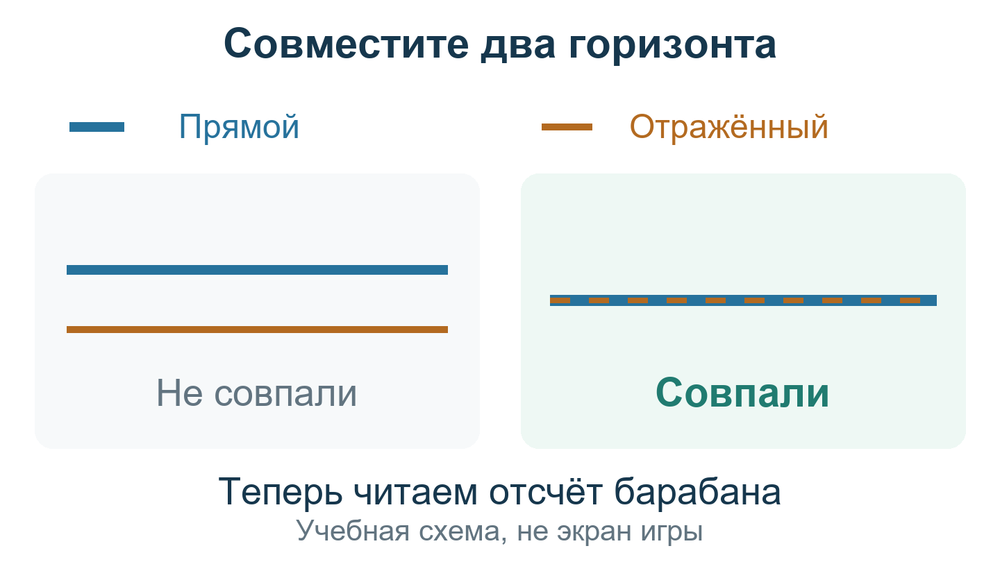

Кнопка `C` — служебная калибровка по известному светилу; в ручном методе её не используйте. Предел хранения и остальные свойства реализации — в [статусе проверки](#qa-status).

**Проверьте:** записано, откуда взято значение поправки. Формулировка «совместил горизонты и получил нуль» здесь не является источником: оптический нуль точен по построению.

#### 2. Запишите высоту глаза

Это другая высота: **от воды до глаза, в метрах**. Не путайте её с углом Солнца из первого урока. С высокой рубки и с низкой палубы горизонт виден немного по-разному, поэтому таблица просит это число.

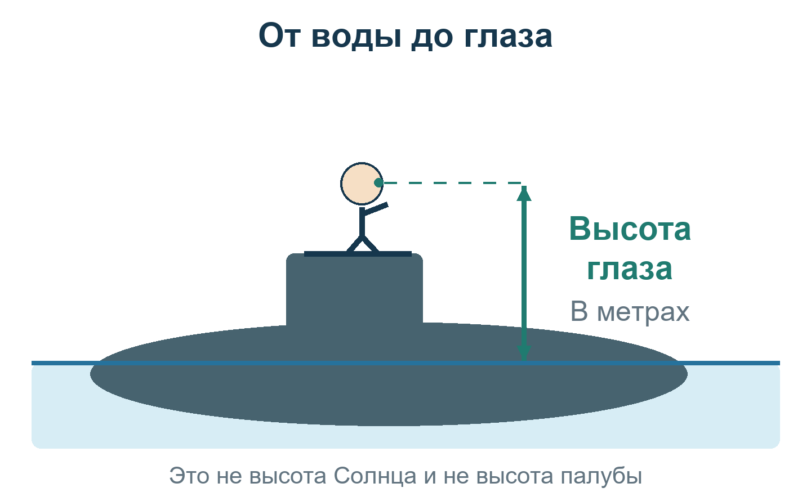

**На бумаге** высота глаза задана условием. **Для собственного наблюдения** нужен подтверждённый источник высоты именно текущей точки над водой. Возможная строка «Глаз … м» и получение числа по размерам лодки описаны в [реестре источников](#data-sources); доступность строки в обычной сцене ещё не подтверждена. Если числа нет или его происхождение неизвестно, остановите собственный расчёт. После смены места прежнюю высоту автоматически не переносите.

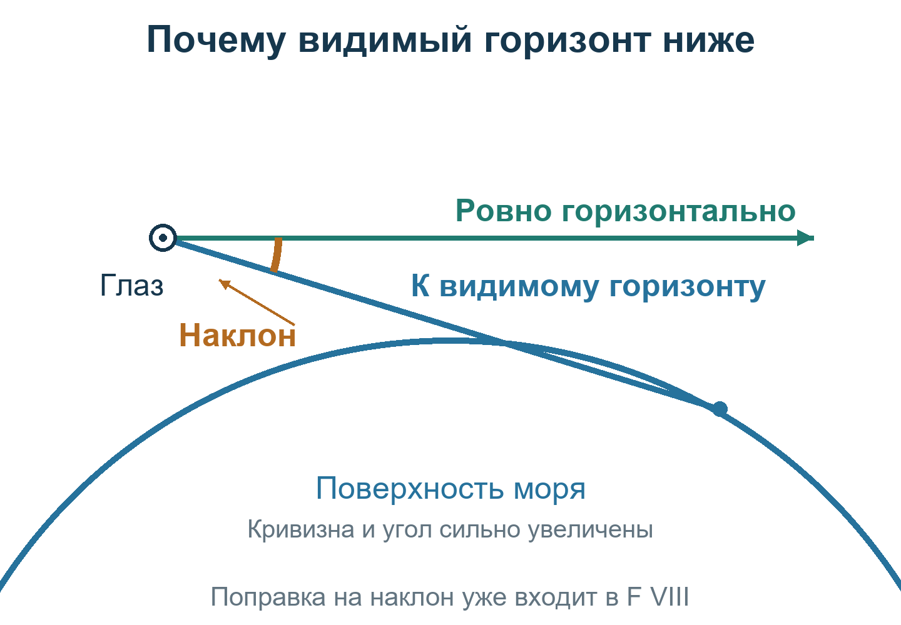

На этой схеме синяя линия — направление к далёкому видимому краю моря. Зелёная — «ровно горизонтально» от глаза. Разница между ними называется **наклоном горизонта**. На рисунке она сильно увеличена для объяснения. Чем выше глаз над водой, тем больше эта разница; её исправление уже входит в выбранную таблицу.

**Проверьте:** известен источник числа. Оценка по виду из окуляра или чтение скрытых координат камеры не подходят. При отсутствии данных остановитесь: поправку по высоте глаза пока получить нельзя. Рабочая область курса — 1–14 м; историческая таблица продолжается до 30 м.

#### 3. Исправьте только нуль

Сложите Hs (отсчёт нижнего края до поправок) и поправку нуля. Назовите результат **h (высота нижнего края после исправления нуля)**.

**Проверьте знак:** положительная поправка увеличивает высоту, отрицательная уменьшает. Исходную запись не стирайте.

### Разбор образца — не ваши измерения

Дальше на бумаге используем сохранённые данные: нижний край, сентябрь, высота глаза **5,5 м**, Hs (отсчёт до поправок) **39°13,4′**, поправка нуля **0,0′ — заданное условие примера**. Это не поверка вашего прибора и не измерение вашей точки наблюдения.

После исправления нуля h (промежуточная высота) = **39°13,4′ + 0,0′ = 39°13,4′**.

#### 4. Откройте нужную таблицу

Найдите в F-Tafel **F VIII (таблицу общей поправки нижнего края Солнца), печатная 72 / PDF 98**. Номер PDF считается от первой страницы файла. Заголовок содержит *Sonnen-Unterrandes* — нижний край Солнца.

Наша высота между строками **38° и 40°**, глаз — между столбцами **5 м и 6 м**. Перепишите четыре пересечения:

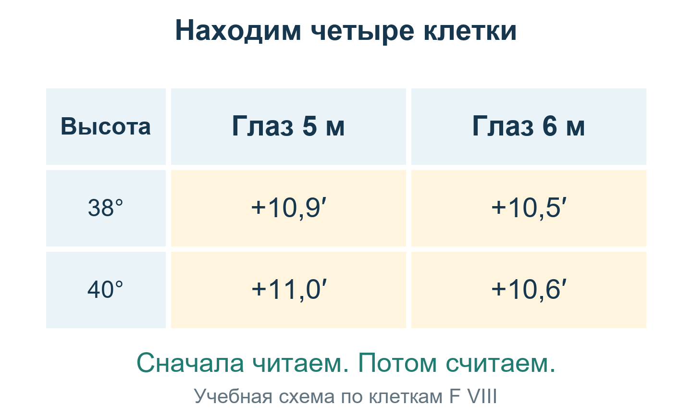

*Это учебная схема четырёх клеток, не заменяющая оригинальную страницу книги.*

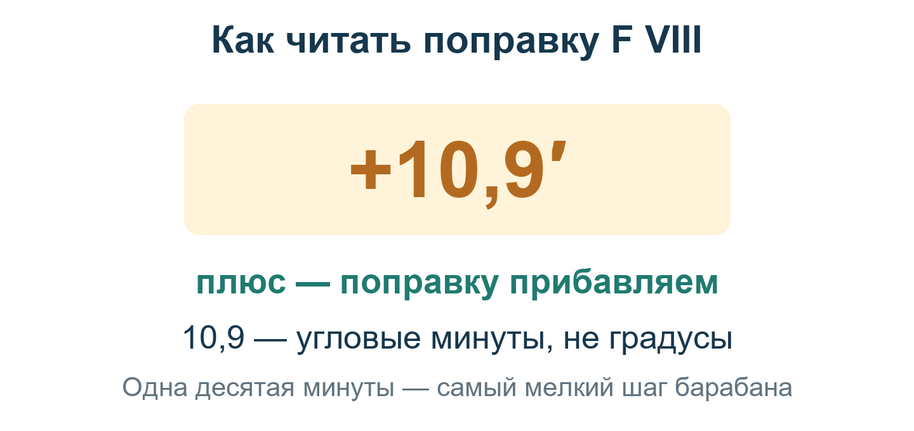

| Высота | Глаз 5 м | Глаз 6 м |
|---|---:|---:|
| 38° | +10,9′ | +10,5′ |
| 40° | +11,0′ | +10,6′ |

**Проверьте:** названия строк и столбцов совпали. Для другого наблюдения выбираются его соседние строки и столбцы; шаг строк не всегда одинаков. За напечатанные границы не выходите.

#### 5. Учтите половину метра

Доля расстояния между столбцами равна `(высота глаза − нижний столбец) / (верхний столбец − нижний столбец)`. Для 5,5 м между 5 и 6 м это 0,5; для 7,2 м между 7 и 8 м — 0,2.

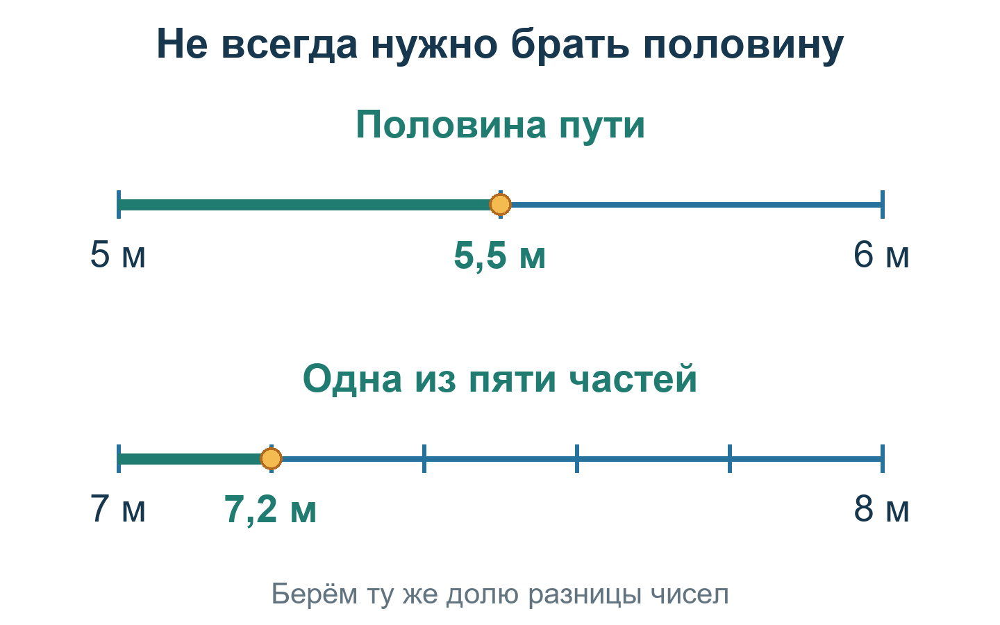

5,5 м находятся посередине между 5 и 6 м. Поэтому возьмите половину разницы клеток:

- Для 38°: 10,9 + (10,5 − 10,9) × 0,5 = **10,7′**.
- Для 40°: 11,0 + (10,6 − 11,0) × 0,5 = **10,8′**.

Такое нахождение промежуточного числа называется **интерполяцией**. Результат должен лежать между исходными клетками.

Для своего глаза не всегда берите половину: у 7,2 м доля от столбца 7 к 8 равна **0,2**, не 0,5. При ровных 7 м берётся только столбец 7, при 14 м — только 14.

#### 6. Учтите промежуточную высоту

От строки 38° до нашей высоты прошло **1°13,4′ = 73,4′**. Между строками 38° и 40° — **2° = 120′**.

- Доля: 73,4 ÷ 120 ≈ **0,612**.
- Разница поправок: 10,8 − 10,7 = **0,1′**.
- Промежуточная поправка: 10,7 + 0,1 × 0,612 ≈ **10,76′**.

Перевод минут здесь не спрятан: **1°13,4′ = 60′ + 13,4′ = 73,4′**, а **2° = 2 × 60′**. Долю берём от всего промежутка между строками, не от числа 40°.

**Проверьте:** число между 10,7′ и 10,8′. Сравнивать нужно с прочитанными клетками, не с придуманным общим диапазоном поправок.

#### 7. Учтите месяц

Внизу той же страницы найдите добавку **для нижнего края**, столбец **Sept. (сентябрь)**. Прочитайте **−0,1′**.

Общая поправка: 10,76′ − 0,1′ = **10,66′**.

**Проверьте:** не взята строка добавок верхнего края. Таблица уже включает остальные необходимые здесь поправки; отдельно полудиаметр, наклон горизонта и рефракцию повторно не прибавляйте.

#### 8. Получите итоговую высоту

39°13,4′ + 10,66′ = **39°24,06′**, или **39°24,1′** до десятой минуты.

Это **Ho (измеренная высота центра Солнца после всех поправок)**. Дополнительные цифры нужны для промежуточной арифметики, а не для заявления большей точности наблюдения.

### Самостоятельная попытка

#### Остановки: сначала входы, затем две доли, затем Ho

**Почему две доли:** столбцы меняются по высоте глаза, строки — по углу. Одна и та же половина для обоих направлений обычно не подходит. [П2](TRAINING.html#step-correction) даёт промежуточную попытку с одной подсказкой, затем новые условия без ответа рядом.

**Если не сошлось:** сначала сравните четыре исходные клетки, потом долю глаза, потом долю высоты. Не исправляйте Hs ради Ho. Неизвестные ИП или глаз останавливают собственный расчёт ещё до таблицы.

Для новой задачи без ответов рядом откройте [П2](TRAINING.html#step-correction) или У2 в [упражнениях](#exercises). Пособие и таблицу оставьте открытыми. Для своих данных заново выберите строки и столбцы по известным h и высоте глаза.

### Один проверяемый результат

**Есть Ho (высота центра Солнца после поправок), а по записи можно повторить каждое сложение и каждую интерполяцию.**

[Урок 4 — положение Солнца](#lesson-4). [К началу курса](#start).

---

## Урок 4. Где находится Солнце

**Вход:** дата, время и известная шкала времени из наблюдения или бумажного условия. Ho из [урока 3](#lesson-3) сохраните для урока 5; для чтения альманаха нужна не высота, а момент.

Найдём два числа, описывающие положение Солнца: гринвичский часовой угол GHA и склонение δ. Вместе со временем и принятой точкой они позволят вычислить ожидаемую высоту.

### Сначала Земля, потом числа

В прошлом уроке мы исправили высоту. Теперь узнаем из книги, где было Солнце в записанный момент. Эта книга называется **альманахом (сборником чисел для разных дат и часов)**. Нам нужны два числа, но сначала разберём их смысл по одному.

Представьте на глобусе линию от Северного полюса к Южному. Такая линия называется **меридианом**. Один из меридианов проходит через Гринвич — место, по которому названы наши общие часы.

#### Первое число: поворот вокруг Земли

Смотрим на Землю со стороны Северного полюса. Начинаем с меридиана Гринвича и поворачиваемся **к западу**, пока не дойдём до меридиана Солнца. Величина поворота — первое нужное число. Полный оборот равен 360°.

Альманах даёт **GHA (гринвичский часовой угол Солнца)**: насколько направление Солнца повернулось к западу от гринвичского меридиана.

#### Второе число: севернее или южнее экватора

**Экватор** — окружность на поверхности Земли посередине между полюсами. Представьте плоский лист, который разрезает Землю пополам по этой окружности и продолжается далеко в пространство. Это **плоскость экватора**. Направление на Солнце может находиться с её северной или южной стороны.

Дополнительная иллюстрация без числового ответа

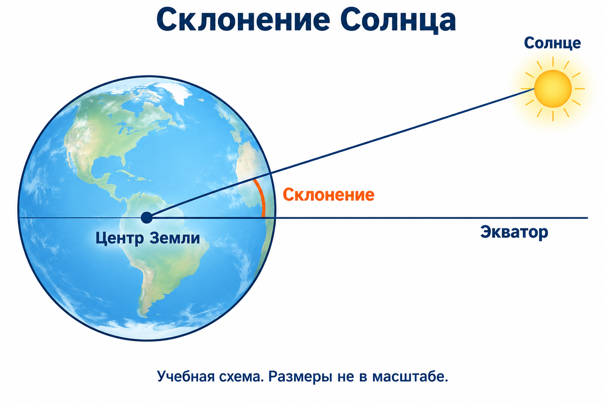

Горизонтальная линия показывает плоскость экватора, а не морской горизонт. Угол относится к направлению на Солнце из центра Земли. Размеры и угол условные; данных альманаха на рисунке нет.

Второе число — **δ (склонение Солнца)**. Оно показывает угол к северу или к югу от плоскости экватора. Знак «плюс» означает северное склонение, «минус» — южное. **На этом рисунке синяя линия показывает плоскость экватора сбоку, не морской горизонт.** Угол на схеме увеличен: в примере склонение около 8°, а не треть прямого угла.

Оба числа описывают **Солнце**, не положение вашей лодки.

<!-- nav-diagram:gha -->

Для исторического разбора ниже нужны бумага и [альманах SH5, страница PDF 57](source-tables/%5B1%5D%20Nautical%20Almanac%20SH5%201939-1945.pdf#page=57). Если файл открылся с начала, введите 57 в поле страницы PDF. В [полном бумажном примере](#walkthrough) используется отдельная карточка с явной шкалой времени; поиск в SH5 — самостоятельное упражнение чтения источника, не обязательный этап перед той карточкой.

### Разбор образца — не ваши измерения

**Исторический образец · 2 сентября.** Разбираем сохранённые условия на **2 сентября 1939 года**, с меткой **10:03:07Z**. Это упражнение на чтение книги и арифметику, не новое наблюдение. Для новой условной задачи [практикума](TRAINING.html) нужна только её собственная карточка, не числа этого разбора. Если открыли урок из полного разбора 3 сентября ради геометрии GHA/δ, после объяснения [вернитесь к своей карточке](GUIDE.html#walkthrough).

#### 1. Найдите день, год и нужную таблицу

Откройте **PDF 57**, найдите блок **2-Sep** и под заголовком **1939** — пару столбцов **GHA** и **δ**. На странице **одна непрерывная числовая сетка**. Над ней напечатано **Time = GMT-1** с одним перечнем портов отправления; под ней — **Time = GMT** с другим перечнем портов. Это не две разные таблицы, между которыми можно выбрать готовый ответ.

**Ограничение образца:** соответствие метки времени строкам книги для новой игровой сцены не установлено, солнечные числа не полностью согласованы с независимым расчётом. Поэтому здесь учимся читать заданные клетки, но не объявляем результат проверенным наблюдением. Метку не сдвигаем на час по подписи GMT-1; подробное расследование и величины расхождений — в [источниках и ограничениях](GUIDE.html#limits).

**Для собственного наблюдения** сначала установите, как часы игры связаны со строками выбранного альманаха. Совпадения слов GMT в заголовках недостаточно. Если соответствие неизвестно, остановитесь: нельзя добавлять или вычитать час по удобному ответу. Сборник покрывает 1939–1945 годы; для другой даты этих страниц недостаточно.

**Проверьте:** выбран нужный день, пара столбцов своего года и нужная строка времени; верхняя и нижняя портовые подписи не приняты за два набора чисел.

#### 2. Возьмите ближайшую предыдущую строку времени

В заданном образце метка находится между строками **08:00 и 12:00**. Перепишите:

- в 08:00 GHA (гринвичский часовой угол) = **300°01,1′**;
- в 08:00 δ (склонение) = **+8°11,1′**;
- в 12:00 δ (склонение) = **+8°07,5′**.

**Проверьте:** оба склонения северные, они немного уменьшаются.

#### 3. Найдите изменение часового угла

От строки 08:00 до заданной метки 10:03:07 прошло **2 часа 3 минуты 7 секунд**.

Откройте [**PDF 73**](source-tables/%5B1%5D%20Nautical%20Almanac%20SH5%201939-1945.pdf#page=73), *GHA increments* (приращения гринвичского часового угла), колонку **Sun (Солнце)**, не Aries (Овен).

Перед секундной строкой познакомьтесь с новым знаком: **″ — угловые секунды**. В одной угловой минуте 60 угловых секунд. Это деления угла, не секунды на часах. Для Солнца в этой таблице одна секунда времени даёт 15″ угла.

- Два часа: верхняя строка hour = 2 → **30°00,0′**.
- Три минуты: нижняя строка 3, Sun → **0°45,0′**.
- Семь секунд времени: по секундной шкале → **1′45″** дуги. Проверка: 7 × 15″ = 105″ = **1,75′**.

Сложите: 30°00′ + 45′ + 1,75′ = **30°46,75′**.

**Проверьте:** за немного больше двух часов получилось немного больше 30°. Минуты времени и минуты дуги — разные единицы.

#### 4. Получите часовой угол на момент наблюдения

300°01,1′ + 30°46,75′ = **330°47,85′**.

Получено **GHA (гринвичский часовой угол Солнца) = 330°47,85′** по заданным клеткам образца. При переходе через 360° вычитают полный оборот; здесь он не понадобился.

**Предел этого правила:** 15°/ч — ровный шаг таблицы приращений, но реальный GHA Солнца меняется не строго равномерно. Для этого упражнения оставляем заданные 330°47,85′; для собственного наблюдения нужен согласованный с источником способ приращений, а не предположение, что 15°/ч всегда точно. Числовое сравнение с независимой эфемеридой — в [статусе проверки](#qa-status).

#### 5. Найдите изменение склонения

За весь интервал от 08:00 до 12:00 изменение равно:

8°07,5′ − 8°11,1′ = **−3,6′**.

Это **d (изменение склонения за четыре часа)**; оно также напечатано в крайнем столбце. Не применяйте −3,6′ за каждый час.

#### 6. Возьмите только прошедшую долю интервала

В уроке 3 мы находили число между соседними клетками. Здесь та же мысль: между 08:00 и 12:00 прошло чуть больше половины времени. Значит, берём чуть больше половины изменения склонения.

- Прошло: 2 × 3600 + 3 × 60 + 7 = **7387 секунд**.
- Четыре часа: 4 × 3600 = **14 400 секунд**.
- Доля: 7387 ÷ 14 400 ≈ **0,513**.
- Поправка: −3,6′ × 0,513 ≈ **−1,85′**.
- Склонение: +8°11,1′ − 1,85′ = **+8°09,25′**.

Запишите **δ (склонение Солнца) ≈ 8°09,25′ N (северное)**.

**Проверьте:** итог между двумя исходными склонениями; взята чуть больше половины четырёхчасового изменения. Долю сохраняйте до дальнейших вычислений. Склонение в расчётном листе записываем до **0,01′**, но сотые после интерполяции не означают точность исходной таблицы до сотой: её клетки напечатаны до **0,1′**. Hc и интерсепт считайте по сохранённой доле, окончательные округления выполняйте на стадии прокладки.

### Самостоятельная попытка

#### Заполняйте по одной строке

В расчётном листе сохраните **адрес исходных чисел** — книгу, страницу, день, год, время строки и заголовок столбца — вместе с самими клетками. Тогда ошибку чтения можно отличить от ошибки приращения. Согласование шкалы часов и источника нужно установить отдельно.

**Следующая попытка:** [П3 — от строки к моменту](TRAINING.html#step-almanac). В нём другая, явно условная карточка: сначала заполните пропуски с подсказкой, затем решите для нового времени. Для тренировки адреса **на настоящем SH5**, отдельно от условной карточки, остаётся [У10](#exercises).

В самостоятельном задании сохраните исходные клетки, прошедшее время и арифметику. Альманах и инструкцию держите открытыми, ключ задания — отдельно. Для собственных данных используйте свою дату и подтверждённое соответствие времени строкам книги.

### Один проверяемый результат

**Получена пара «гринвичский часовой угол — склонение» для записанного времени, с указанными страницей, днём, годом и исходными строками.**

Пока исходная шкала времени не подтверждена, бумажный образец можно разбирать, но собственное навигационное наблюдение не объявляется проверенным.

[Урок 5 — расчёт для принятой точки](#lesson-5). [К началу курса](#start).

---

## Урок 5. Какую высоту ожидаем в выбранной точке

**Вход:** есть Ho (измеренная высота центра Солнца после поправок) и положение Солнца из [урока 4](#lesson-4).

Сначала выберем удобную точку расчёта AP, затем найдём ожидаемую высоту Hc и сравним её с измеренной Ho. Разность задаст расстояние и сторону сдвига линии. Полный проход на одной паре данных — в [разобранном бумажном примере](#walkthrough).

### Сначала разберёмся с точкой на карте

Представьте клетчатый лист: одной строки мало, чтобы указать клетку. Нужен ещё столбец. На морской карте у точки тоже есть две части «адреса».

**Широта** показывает, насколько место севернее или южнее экватора. Линии одинаковой широты называются **параллелями**. **Долгота** показывает положение к востоку или западу от гринвичского меридиана. Меридианы идут в направлении север—юг. На нашей небольшой учебной сетке параллель рисуем поперёк листа, меридиан — сверху вниз.

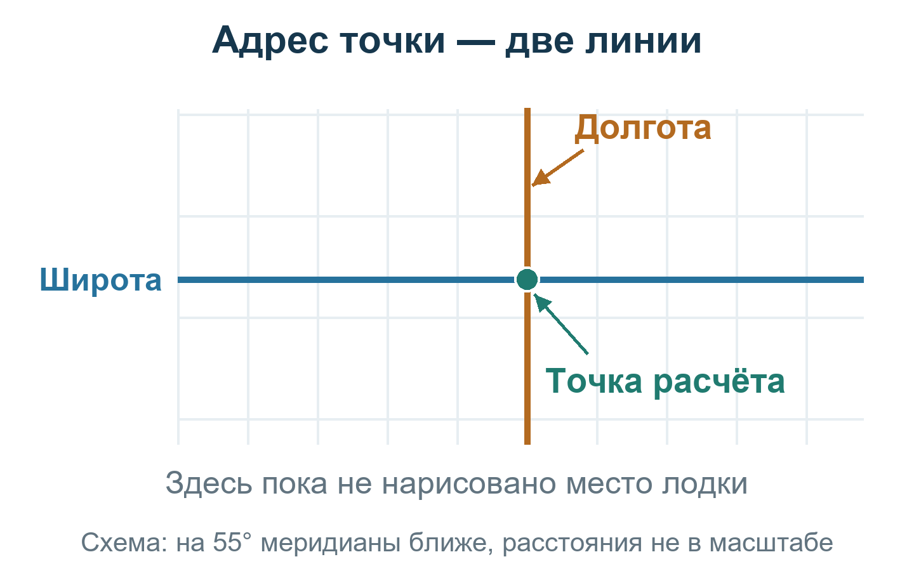

**Покажите:** какую точку выбирают две выделенные линии? Почему одной линии недостаточно?

Координаты пишутся парой: сначала широта, затем долгота. Например, **55°00′ N (северной широты), 6°12,15′ E (восточной долготы)**. Минуты здесь угловые, как в записи секстанта. Другие обозначения: S (южная широта), W (западная долгота).

Навигатор сначала имеет **DR (счислимое место — оценку положения по начальному известному месту и пройденному пути)**. Для удобного чтения таблицы он выбирает рядом **AP (принятую точку расчёта)**. Она не обязана совпадать с оценкой положения и **не является найденным местом лодки**.

**Какое начальное место допустимо:** установленное положение **самой лодки** у известного причала, прошлое определённое место либо отдельное обоснованное определение по берегу. Координаты видимого маяка или мыса — координаты **ориентира, не лодки**. Названия порта недостаточно: нужны точка, время и основание, почему лодка была именно там. После отхода добавляется записанный путь. **Текущий точный маркер лодки** как DR не используйте: это готовая истина, а не счисление. Подробно — [откуда брать данные](#data-sources).

Задача таблиц: «Какой была бы **исправленная высота центра Солнца**, если бы мы находились в выбранной точке в момент наблюдения?» Это не сырое показание барабана. Сравнивать будем две одинаково определённые величины: высоту после поправок и расчётную высоту центра, а не нижний край с центром.

Почему сравнение полезно? На Земле есть точка, над которой Солнце в этот момент находится прямо над головой. При движении к этой точке высота Солнца растёт, при движении от неё — уменьшается. Поэтому превышение или нехватка высоты подсказывает сторону сдвига будущей линии. Само место лодки это ещё не даёт.

Если нужны отдельные тренировки: У1–У4 в [упражнениях](#exercises) разбирают углы и выбор AP, У5 — чтение таблицы, У6 — знак разности. Они не являются обязательным входом в урок.

**Нужно:** карта, известное счислимое место, бумага и [F-Tafel, страница PDF 34 (F I)](source-tables/%5B2%5D%20F-Tafel.pdf#page=34), затем [страница PDF 79 (F II)](source-tables/%5B2%5D%20F-Tafel.pdf#page=79). Неизвестное начальное место нельзя заменить скрытыми истинными координатами игры. Без него самостоятельная близкая точка расчёта не обоснована; возможен только бумажный пример.

### Разбор образца — не ваши измерения

Здесь продолжается отдельный исторический разбор 2 сентября с ограничениями временной привязки из урока 4. Его числа не смешиваются с учебной парой 3 сентября. Для этого разбора даны:

**Исторический образец · 2 сентября.** Если вы пришли сюда за объяснением из бумажного разбора 3 сентября, используйте только метод; свой расчёт продолжайте в [полном разборе](GUIDE.html#walkthrough). Числа этого урока относятся к другой задаче.

- Ho (высота после поправок) ≈ **39°24,06′**;
- GHA (гринвичский часовой угол Солнца) = **330°47,85′**;
- δ (склонение Солнца) ≈ **8°09,25′ N (северное)**;
- счислимое место **54°53′ N (северной широты), 5°45′ E (восточной долготы)**.

### Часть A. Выберите принятую точку

#### 1. Выберите близкую целую широту

Ближайшая целая широта — **55°00′ N (северная)**. Запишите её как широту принятой точки.

**Проверьте:** это выбор удобной точки, не новое измерение координат.

#### 2. Найдите угол Солнца относительно местного меридиана

К гринвичскому часовому углу прибавьте восточную долготу счислимого места:

330°47,85′ + 5°45′ = **336°32,85′**.

Это **LHA (местный часовой угол Солнца, отсчитанный к западу)**. Наш угол больше 180°, поэтому Солнце восточнее местного меридиана. Удобный меньший угол с восточной стороны:

360°00′ − 336°32,85′ = **23°27,15′**.

**Как вычесть минуты, если сверху нуль:** займём один градус. Поскольку в нём 60′, запись **360°00′ = 359°60′**. Теперь отдельно вычитаем градусы и минуты: 359 − 336 = 23; 60 − 32,85 = 27,15. Получается тот же ответ. Обычное правило десятичных чисел «занять десять» к градусам и минутам здесь не подходит.

Запишите **tE (восточный часовой угол) = 23°27,15′**. При местном угле от 0° до 180° использовали бы tW (западный часовой угол), равный самому местному углу. Западная долгота при сложении берётся с минусом; результат сначала приводят к полному обороту.

#### 3. Выберите угол, который напечатан в таблице

В F I (таблице вспомогательных величин) углы подписаны в часовой мере. **Это не показание часов наблюдения.** Один час угла равен 15°, одна минута угла в часовой мере — 15′ дуги.

23°27,15′ соответствуют примерно **1 ч 33 мин 49 с** угла. Заголовки F I идут через 4 минуты. Ближайший напечатанный снизу — **1h32m**, то есть **23°**: 15° + 32 × 15′ = 23°. Следующий, 1h36m, уже дальше.

Запишите выбранные **1h32m = 23°**, сохранив восточную сторону.

#### 4. Подберите долготу принятой точки

Для восточного случая долгота принятой точки равна:

360° − выбранный угол − гринвичский часовой угол.

В образце: 360° − 23° − 330°47,85′ = **6°12,15′ E (восточной долготы)**.

Проведите вычитание двумя маленькими шагами: **360° − 23° = 337°**; затем **337°00′ = 336°60′** и вычитаем 330°47,85′. Так получаются 6° и 12,15′, а не десятичные 6,1215°.

Получилась **AP (принятая точка расчёта) = 55°00′ N, 6°12,15′ E**.

**Мы не двигаем лодку.** Мы выбираем удобную точку на карте, для которой таблица читается ровно. Полученная позже линия пройдёт рядом с этой точкой; расстояние до неё и покажет поправка `a`.

**Проверьте:** 330°47,85′ + 6°12,15′ = 337°; 360° − 337° = **23° точно**. Для западного случая долгота получается как выбранный западный угол минус гринвичский угол, с приведением к −180…+180°.

Принятая точка должна оставаться близкой к счислимому месту. Ориентир **до 60 морских миль** здесь — учебное ограничение, не универсальная граница точности: важны также высота светила и удаление вдоль линии. Если близость не установлена, не выдавайте местное прямолинейное построение за надёжную прокладку.

На листе сохраните DR, выбранную AP и обратную проверку угла. Если проверка не сошлась, исправляйте долготу AP, а не подбирайте U. В F I дальше нужна широта AP: расчёт выполняется именно для выбранной точки.

### Часть B. Найдите расчётную высоту

#### 5. Прочитайте три числа из F I

Откройте **печатную 8 / PDF 34**, группу **1h32m**, строку широты **55°**:

- U (вспомогательный угол) = **32°48,2′**;
- V (вспомогательное логарифмическое число) = **9,98881**;
- Gr.δ (граничное склонение для выбора стороны азимута) = **52,7°**.

**Как читать сокращённую клетку:** полная запись V имеет общую начальную часть **`9,`**, напечатанную не на каждой строке. К клетке **`98 881`** восстанавливаем именно эту часть: **`9,98 881` = `9,98881`**. Нельзя просто вставить запятую в сырые цифры `98881`: получилось бы другое число. U напечатано как **`32 48,2`**: здесь пробел разделяет градусы и минуты. Сначала выясняйте заголовок и общую часть своего столбца.

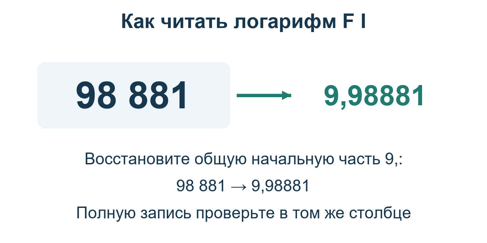

**Проверьте:** V переписано со всеми цифрами, не как 0,98881. В книге общая начальная часть числа может не повторяться на каждой строке.

Текущая учебная ветвь: широта и склонение северные, часовой угол меньше 6 часов. В ней складываем вспомогательный угол и склонение. Другие полушария и ветви здесь не угадываем. Шесть часов угла означают 90° от меридиана, не обязательный заход Солнца.

#### 6. Сложите углы

32°48,2′ + 8°09,25′ = **40°57,45′**.

Назовите сумму **q (угол для следующего чтения таблицы)**. Это угол, не логарифмическое число. Данный подробный проход использует q между 0° и 90°; при иной ветви остановитесь, а не меняйте сумму по догадке.

#### 7. Прочитайте F II для этой суммы

Откройте [**F II (таблицу логарифмов синуса), печатная 53 / PDF 79**](source-tables/%5B2%5D%20F-Tafel.pdf#page=79). Логарифм здесь — готовое вспомогательное число; вычислять синус самостоятельно не требуется. Смысл таблицы простой: она заранее переводит углы в числа так, чтобы **умножение заменить сложением**. Поэтому дальше мы складываем два табличных числа и вычитаем 10.

Столбец **40°**:

Три кадра ниже — **отдельные производные фрагменты оригинала F II**, не перерисованные клетки. Верхняя полоса содержит заголовки, нижняя — строки 55′–59′; промежуток страницы пропущен, числовые соответствия не менялись. Это показ одного прямого чтения, а не готовое решение П4.

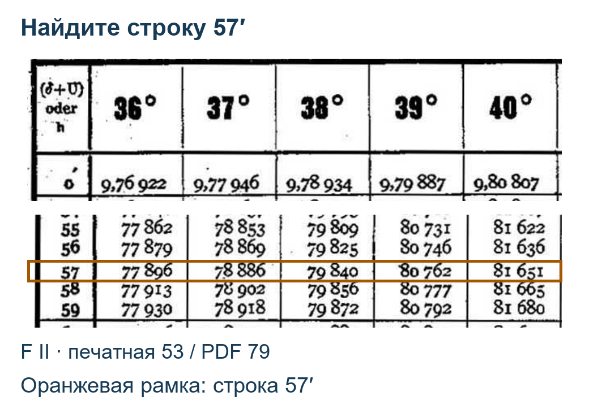

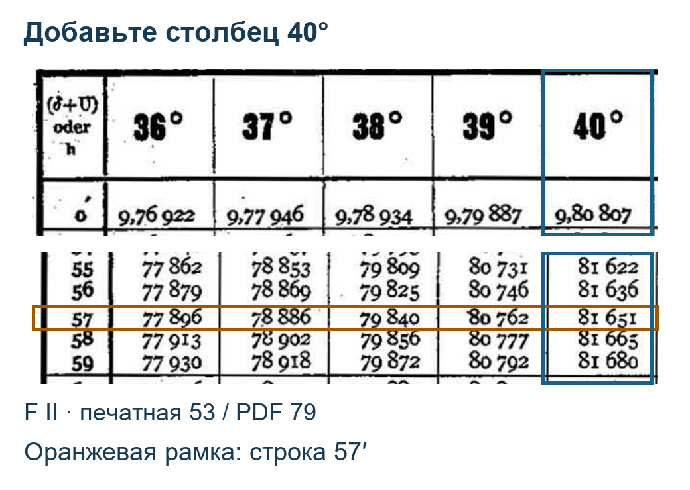

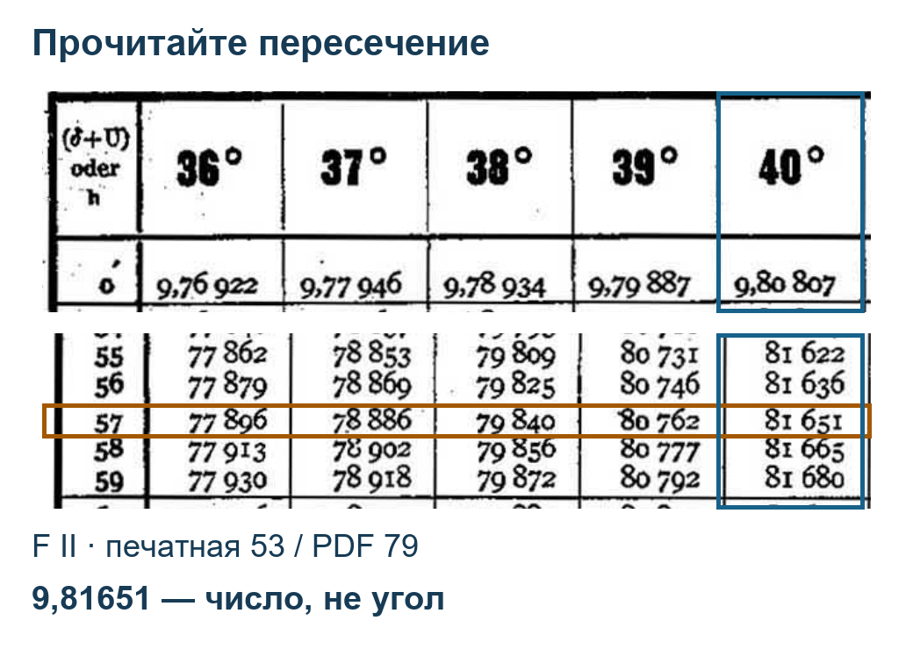

- строка **57′** → **9,81651**;
- строка **58′** → **9,81665**.

У нас 57,45′, то есть доля между строками **0,45**:

9,81651 + (9,81665 − 9,81651) × 0,45 ≈ **9,81657**.

**Проверьте:** число между обеими клетками. Не берите колонку соседнего целого градуса.

Числа в следующей строке читаются тем же способом: сначала остаёмся в столбце 40°, затем переходим от 57′ к 58′. Если заголовок потерялся при прокрутке, вернитесь к нему, а не угадывайте соседство по похожим цифрам.

#### 8. Выполните одно сложение

К числу из F II прибавьте V (логарифмическое число из F I), затем вычтите 10:

9,81657 + 9,98881 = **19,80538**;

19,80538 − 10 = **9,80538**.

Десятка нужна из-за принятой положительной записи табличных логарифмов. Это правило работы с таблицей, не градусы и не минуты. Числа ниже 9 на малых углах сами по себе не являются ошибкой.

**Зачем эти промежуточные величины.** Широта и часовой угол определяют ориентацию наблюдателя относительно Солнца. F I заменяет две части этой геометрии одним углом U и одним множителем R. Склонение меняет угол q; F II переводит угол в число, удобное для применения R. Обратный поиск возвращает высоту. Поэтому U — не высота и V — не угол: они лишь передают геометрию между двумя таблицами.

Почему складываем числа и вычитаем 10 — необязательная математика

В сферической модели `sin Hc = sin φ × sin δ + cos φ × cos δ × cos t`, где φ — широта AP, t — меньший часовой угол. В нашей северной ветви с t < 90° можно записать `R = √(sin²φ + cos²φ × cos²t)` и выбрать U так, что `R cos U = sin φ`, `R sin U = cos φ cos t`. Тогда формула превращается в `sin Hc = R × sin(U + δ)`.

F I заранее даёт U и `V = 10 + log₁₀ R`. F II даёт `Lq = 10 + log₁₀ sin q`. Значит, `Lq + V − 10 = 10 + log₁₀(R × sin q)` — ровно число, по которому F II возвращает Hc. Дополнительная десятка введена в каждое табличное число, поэтому после сложения одну десятку убирают. Для ручного пути формулы считать не нужно: их уже вычислили составители таблиц. Округление печатных клеток сохраняется.

**Округление этого исторического образца:** здесь промежуточное число F II округлено до пяти десятичных знаков, как в сохранённом контроле; числа контроля не меняем. В полной бумажной паре и новых упражнениях сохраняйте выражения с долями или значения в памяти калькулятора до вычитания Ho − Hc. Округлённые записи Ho/Hc до 0,01′ служат для чтения, не для повторной подстановки; рабочий a округляйте один раз до 0,1 NM, Zn — до 0,1°. Дополнительные цифры арифметики не означают большей точности наблюдения.

#### 9. Найдите высоту обратным чтением

Теперь известен результат **9,80538**, а угол неизвестен. В этой острой ветви F II градусы читаем сверху, минуты слева. Сначала просмотрите строку **0′**: под **39°** стоит **9,79887**, под **40°** — **9,80807**. Искомое число между ними; значит, угол находится между 39° и 40°. Продолжаем в столбце **39°**, добавляя минуты к 39°.

Если охвата на странице нет, переходите по градусным заголовкам к соседней. В этой ветви число растёт с углом. Совпадение с клеткой даёт угол без интерполяции; нижние градусные заголовки относятся к другой ветви.

В выбранном столбце удобно просмотреть строки через десять минут, затем искать внутри найденного интервала. Внутри него найдите первую клетку больше искомого и предыдущую:

- столбец **39°**, строка **42′** → **9,80534**;
- там же строка **43′** → **9,80550**.

Доля: (9,80538 − 9,80534) ÷ (9,80550 − 9,80534) = **0,25**.

Высота: 39°42′ + 0,25′ = **39°42,25′**, примерно **39°42,3′**.

Это **Hc (расчётная высота центра Солнца для принятой точки)**. Сохраните 42,25′ для следующего вычитания.

**Не перепутайте:** Hc — расчётная высота центра, Ho — измеренная высота центра после поправок, Hs — исходный отсчёт нижнего края. Для сравнения нужны **Ho и Hc**; исходная Hs здесь уже не подходит.

**Проверьте:** высота между 39°42′ и 39°43′. Если число попало в соседнюю строку или столбец, вернитесь к чтению клеток. Для этой ветви q остаётся между 0° и 90°; при другом результате остановитесь, а не подбирайте ответ.

На листе сохраните q, обе пары клеток, доли и число после сложения. Углы записывайте с ° и ′, логарифмы — без угловых знаков. [П4](TRAINING.html#step-fii) тренирует арифметику на знакомых клетках; [Т1](TRAINING.html#step-fii-search) — поиск другого диапазона без готовых адресов.

### Часть C. Сравните две высоты

#### 10. Вычтите расчётную высоту из измеренной

На рисунке высоты округлены для чтения. В вычитании сохраним дополнительные цифры.

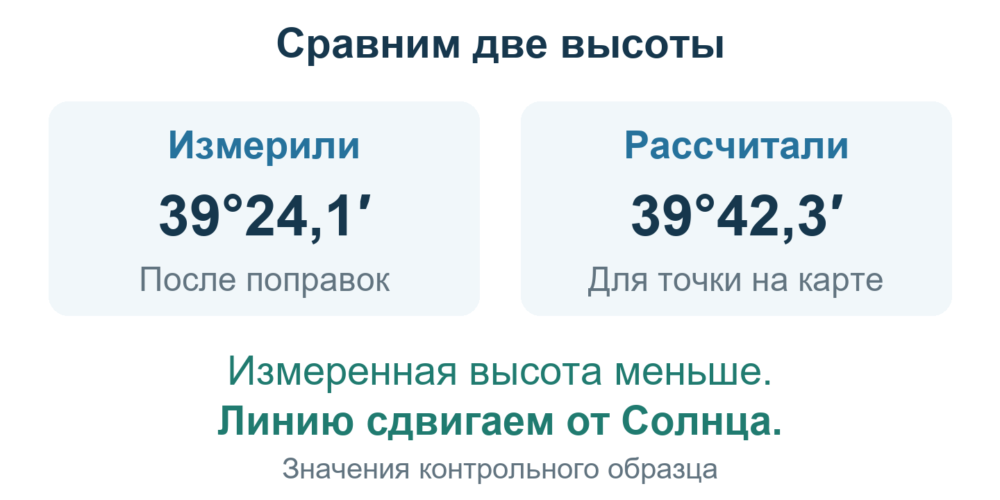

Дополнительная иллюстрация без числового ответа

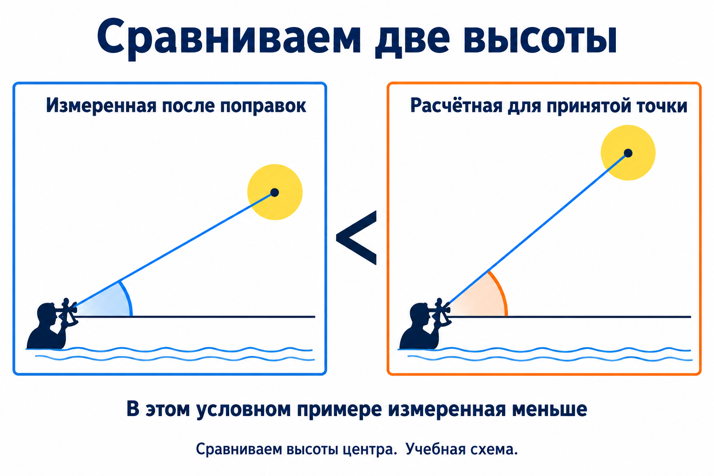

Сравниваются две одинаково определённые высоты центра: измеренная после поправок и расчётная. Рисунок качественный, без градусов и готового расстояния сдвига.

Градусы одинаковы, поэтому достаточно вычесть минуты:

24,06′ − 42,25′ = **−18,19′**, примерно **−18,2′**.

Если отрицательные числа ещё непривычны, сначала найдите положительную нехватку: **42,25 − 24,06 = 18,19**. Измеренная высота меньше ожидаемой на 18,19′. Минус в записи сообщает именно «меньше», а не отрицательную физическую длину.

Это **a (интерсепт — расстояние сдвига линии от принятой точки)**. Одна минута высотной разницы соответствует одной **NM (морской миле)**; морская миля равна 1852 м. Поэтому для карты запишите **−18,2 морской мили**.

Связь угла с расстоянием относится именно к этому построению на поверхности Земли: перемещение примерно на одну морскую милю к точке под Солнцем изменяет исправленную высоту примерно на одну угловую минуту. Это не правило «любая угловая минута равна миле»: минуту долготы на карте мы уже отличали от минуты широты.

Отрицательный результат означает **от Солнца**: измеренная высота ниже расчётной. Положительный означал бы **к Солнцу**. Если вычитаются уже минуты, ещё раз умножать их на 60 нельзя.

Сохраните Ho, Hc и a со стороной сдвига. Если знак вызывает сомнение, сравните высоты до вычитания или выполните [У6](#exercises). Координаты места из одной разности ещё не получены.

### Самостоятельная попытка

В [практикуме](TRAINING.html#task) выполните расчёт для нового условия. Урок и таблицы оставьте открытыми, ключ новой задачи — отдельно. Объясните отличие DR от AP и Hs от Ho. Для собственного наблюдения нужны установленные исходные данные и подходящая ветвь таблиц.

### Один проверяемый результат

**Записаны расстояние сдвига и сторона «к Солнцу» или «от Солнца», а весь расчёт относится к одной подписанной принятой точке.**

Направление и построение линии — в [уроке 6](#lesson-6). [К началу курса](#start).

---

## Урок 6. Первая линия на карте

**Вход:** из [урока 5](#lesson-5) известны принятая точка, расчётная высота, расстояние сдвига с его знаком, а также склонение δ и часовой угол t, по которым считали.

Построим одну линию возможных мест лодки. Для полного бумажного прохода на одной паре условий используйте [разбор от высот до места](#walkthrough); здесь продолжается исторический образец предыдущих уроков.

### Почему одна высота не даёт одну точку

В используемой **сферической модели Земли** представьте точку, над которой Солнце сейчас прямо над головой. В ней расчётная высота центра Солнца равна 90°. По мере удаления по поверхности высота уменьшается. Мест на одинаковом удалении много: они образуют **окружность одинаковой высоты** вокруг этой точки. Рефракция, видимый горизонт и край диска уже учтены при получении Ho.

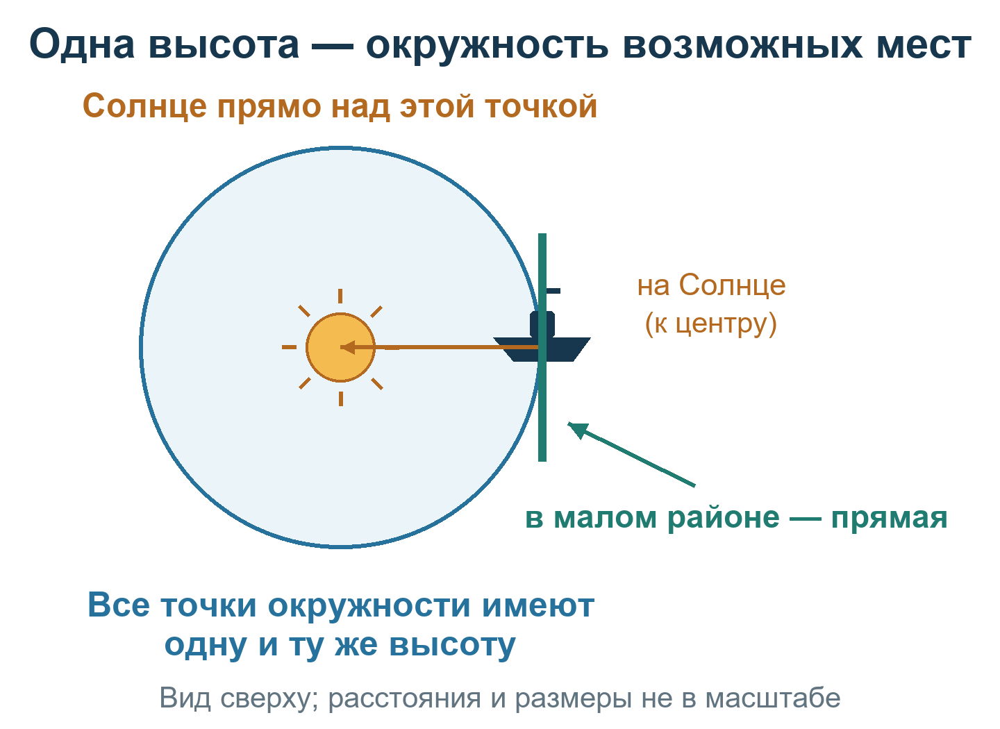

Одна измеренная высота выбирает такую окружность, но не говорит, в какой её точке находится лодка. Около предполагаемого места берём только небольшой участок окружности. Он выглядит почти прямым — эту короткую прямую и построим. **Это местное приближение, не прямая через весь океан.**

### Сначала нужно направление

Расстояние сдвига ещё не задаёт направление на карте. Для построения нужен азимут Солнца.

Начинаем с севера. Поворачиваемся по ходу стрелок обычных часов: **север → восток → юг → запад**. Полный круг — 360°. Восток — четверть круга, 90°. Юг — половина, 180°.

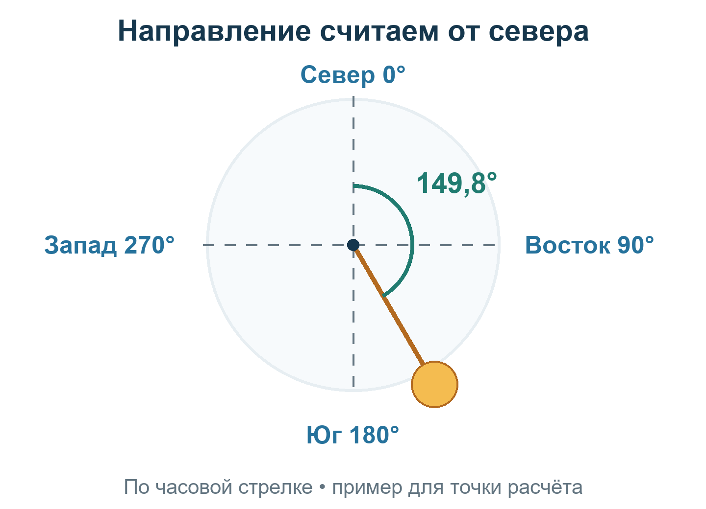

Такое направление называется **Zn (истинный азимут — угол от истинного севера по часовой стрелке)**. Западу соответствует 270°.

**Истинный, не магнитный.** На карте истинный север задаётся направлением меридиана. Верх нашей учебной сетки специально совмещён с ним; верх произвольной карты или координатной сетки не обязательно является истинным севером. Компас может показывать магнитный север; без известной поправки его нельзя подставлять вместо истинного. Если на доступной карте не установлено, где истинный север, прокладку остановите.

Это направление на Солнце, не направление носа лодки. Получим его вручную из таблицы; готовое число с карточки не подставляем.

**Нужно:** [F-Tafel, страницы PDF 104–105 (F XI)](source-tables/%5B2%5D%20F-Tafel.pdf#page=104), карта или бумажная сетка, линейка и транспортир. Для сетки понадобится [Fulst, страница PDF 200 (Tafel 13)](source-tables/Fulst%27s%20Nautische%20Tafeln.pdf#page=200).

### Разбор образца — не ваши измерения

**Исторический образец · 2 сентября.** Сохраняем данные предыдущих уроков: **AP (принятая точка расчёта) = 55°00′ N, 6°12,15′ E**; восточный часовой угол **1h32m = 23°**; склонение **8°09,25′ N (северное)**; **Hc (расчётная высота) = 39°42,25′**; сдвиг **18,2 NM (морской мили) от Солнца**. Если пришли из пары 3 сентября, изучайте здесь метод и кадры, но возвращайтесь к [своим числам](GUIDE.html#walkthrough).

#### 1. Найдите вспомогательный угол

Откройте **F XI (таблицу вспомогательного угла для азимута), печатная 78 / PDF 104**.

Сверху выберите группу **1h32m**. Слева сейчас читается **склонение**, не широта лодки:

- склонение **8°** → **P (вспомогательный угол) = 67°14′**;
- склонение **9°** → **P (вспомогательный угол) = 67°18′**.

**Основной способ для первого прохода — интерполяция между полными соседними строками.** Здесь доля `9,25/60`, разность `4′`; получаем `67°14′ + 4′ × 9,25/60 ≈ 67°14,62′`. Проверьте: результат между 67°14′ и 67°18′. В полном разборе 3 сентября применяется именно этот способ.

Как сохранить старый числовой образец и читать малое число .06

Рядом с клеткой напечатано малое число **0,06** — локальная поправка P на **1′ склонения**. Исторический образец ниже сохраняет этот способ и прежние результаты. Для его воспроизведения:

У нас 8°09,25′, то есть от строки 8° прошло **9,25′**. По малому числу:

9,25 × 0,06 ≈ **0,56′**;

P = 67°14′ + 0,56′ = **67°14,56′**.

Линейно между строками 8° (67°14′) и 9° (67°18′) за долю 9,25 ÷ 60 получается **67°14,62′**. Разница с локальной поправкой всего 0,06′ и на итоговый азимут до сотых не влияет, поэтому в этом образце оставляем **67°14,56′**.

**Правило для длинной доли.** Если от строки прошло больше примерно **18′** (0,3°), малое число уже нельзя растягивать на весь интервал: интерполируйте **линейно между двумя соседними строками**. Малое число используйте как проверку. В сквозном примере доля около 49′, поэтому там применена линейная интерполяция.

Порог 18′ — консервативное **учебное правило этого пособия**, а не напечатанный универсальный предел F XI. И при меньшей доле проверяйте результат по соседней строке: округлённая локальная поправка не задаёт точность на любом интервале.

Для первого знакомства достаточно полного интервала строк. Если продолжаете с 67°14,62′, а не сохранённым 67°14,56′, доля A немного изменится, но рабочий Zn этого примера останется **149,8°**. Не выбирайте способ по совпадению последних цифр ключа.

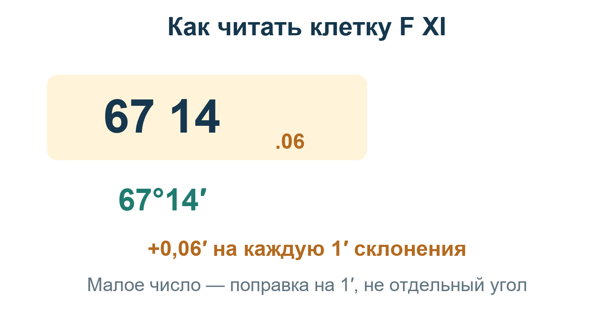

**Проверьте:** число между 67°14′ и 67°18′. Угол, прочитанный при широте 55° вместо склонения, для этой операции не подходит. Малое число — локальная поправка, а не ещё один независимый отсчёт.

#### 2. Прочитайте ту же таблицу в обратную сторону

В уроке 5 мы читали таблицу в обе стороны. Здесь поиск сложнее: в каждой пробной колонке сначала учитываем свою Hc, затем сравниваем результат с P. Нужно найти охватывающую пару колонок и только после этого искать долю между ними. Названия искомых колонок напечатаны внизу страницы.

Перейдите на [**печатную 79 / PDF 105**](source-tables/%5B2%5D%20F-Tafel.pdf#page=105). Теперь слева аргументом служит **расчётная высота**, а названия колонок читайте **снизу, в строке Azimut (азимут)**. Верхние часовые заголовки здесь не являются новым временем наблюдения.

Колонки выбирают по охвату P, а не по ожидаемому азимуту. Для пробной колонки сначала найдите значение при своей Hc между соседними строками высоты. Сравните его с P, затем переходите к соседним колонкам, пока два результата не окажутся по разные стороны P. Проверка только на целой строке высоты недостаточна: минутная доля может изменить охват.

Например, проба **32°**: при Hc между 39° и 40° клетки **65°41′ / 66°03′** дают около **65°56,49′**, меньше нужного P. По соседним клеткам видно, что в этой области при уменьшении A значение P растёт. Поэтому идём к 31°, затем к 30°; после учёта Hc в 31° ещё меньше P, а в 30° уже больше. Для нового условия проверяйте направление изменения по своим соседним клеткам. В нашем образце подходящая пара — **30° и 31°**:

| Расчётная высота | Колонка 30° | Колонка 31° |
|---|---:|---:|
| 39° | 67°08′ (0,34) | 66°24′ (0,35) |
| 40° | 67°29′ (0,35) | 66°46′ (0,36) |

В скобках стоит изменение на **1′ высоты**. Ниже проверим обе колонки при нашей Hc. Если после интерполяции охвата нет, продолжайте поиск пары, а не расчёт за её пределами.

#### 3. Учтите минуты расчётной высоты

Наша высота 39°42,25′ лежит между 39° и 40°. От строки 39° прошло **42,25′**. Основным способом интерполируем **линейно между строками**, а число в скобках при желании используем как дополнительную проверку:

- Для колонки 30°: 67°08′ + (42,25 ÷ 60) × 21′ ≈ 67°08′ + 14,79′ = **67°22,79′**.
- Для колонки 31°: 66°24′ + (42,25 ÷ 60) × 22′ ≈ 66°24′ + 15,49′ = **66°39,49′**.

**Проверьте:** найденные 67°14,56′ находятся между этими результатами. Значит, искомое направление находится между колонками 30° и 31°.

#### 4. Найдите промежуточный угол направления

Для удобства вычитания переведите три значения целиком в угловые минуты:

- 67°22,79′ → 67 × 60 + 22,79 = **4042,79′**;
- 67°14,56′ → 67 × 60 + 14,56 = **4034,56′**;
- 66°39,49′ → 66 × 60 + 39,49 = **3999,49′**.

Доля от колонки 30° к 31°:

(4042,79 − 4034,56) ÷ (4042,79 − 3999,49) = 8,23 ÷ 43,30 ≈ **0,190**.

Получаем **A (угол направления от выбранного полюса) ≈ 30° + 0,190° = 30,19°**.

#### 5. Выберите правильную сторону света

В образце широта и склонение северные, часовой угол меньше 6 часов, склонение меньше прочитанного ранее граничного **52,7°**. Правило внизу F I указывает считать **от юга**. Восточный часовой угол указывает восточную сторону.

Значит, направление — **от юга на 30,19° к востоку**. От истинного севера:

180° − 30,19° = **149,81°**, то есть **149,8°**.

Запишите **Zn (истинный азимут Солнца) ≈ 149,8°, источник F XI**. Для той же южной отсчётной стороны при западном часовом угле было бы 180° + A (угол от полюса).

**Проверьте:** Солнце получилось на юго-востоке, не на северо-востоке. При другом отношении склонения к граничному нужна другая ветвь выбора полюса; это не повод переносить южное правило автоматически. Высоты выше 70° и иные неописанные ветви в этом коротком уроке не ведутся. Готовое число азимута на карточке не заменяет эту цепочку.

Дополнительная иллюстрация без числового ответа

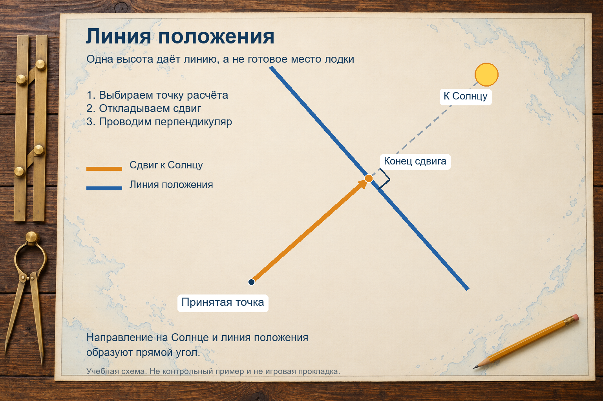

Показан условный положительный сдвиг к Солнцу и перпендикуляр через его конец. В числовом разборе этого урока сдвиг отрицательный — от Солнца. Сторону выбирают по своему знаку, не копируют с иллюстрации.

### Практика на карте: теперь построим линию

#### 6. Поставьте принятую точку

На карте найдите параллель **55°00′ N (северной широты)** и меридиан **6°12,15′ E (восточной долготы)**. Отметьте их пересечение как принятую точку расчёта.

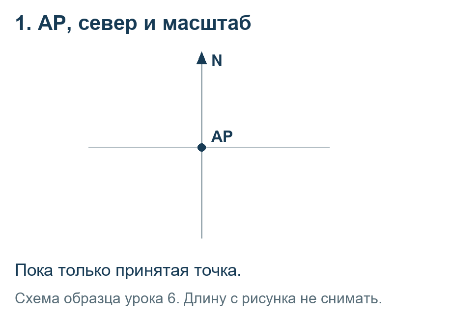

**Проверьте:** это не маркер истинного положения лодки. Найдите истинный север и масштаб морских миль. **1′ широты примерно равна 1 морской миле**. На карте Меркатора расстояния снимают по шкале широты вблизи широты построения; масштаб всей большой карты не обязан быть постоянным. Для другой проекции используйте её собственный масштаб, а не произвольный промежуток между параллелями. Если обычными инструментами нельзя установить координаты, направление и расстояние, игровая прокладка пока недоступна; можно выполнить бумажное упражнение.

#### 7. Подготовьте бумажную сетку, если она нужна

Через принятую точку проведите вертикаль «север—юг» и горизонталь «восток—запад». Возьмите одинаковый масштаб по осям: **1 см = 2 морские мили**.

По вертикали 2 мили соответствуют **2′ широты**. По горизонтали 2 мили **не равны** 2′ долготы: на этой широте меридианы расположены ближе друг к другу.

Для подписей долготы откройте **Fulst, Tafel 13 (перевод восточно-западного расстояния в разность долгот), печатная 183 / PDF 200**, строка **55°00′**:

- столбец **2 sm (морские мили)** → **3,49′ долготы**;
- столбец **5 sm (морских миль)** → **8,72′ долготы**.

Поэтому горизонтальный сантиметр этой сетки соответствует примерно 3,49′ долготы. При другой широте нужна её строка таблицы; сетка предназначена для небольшого района около выбранной широты, не всего океана.

#### 8. Отложите расстояние от Солнца

От принятой точки проведите вспомогательное направление **149,8°** по транспортиру от истинного севера. Это луч на Солнце.

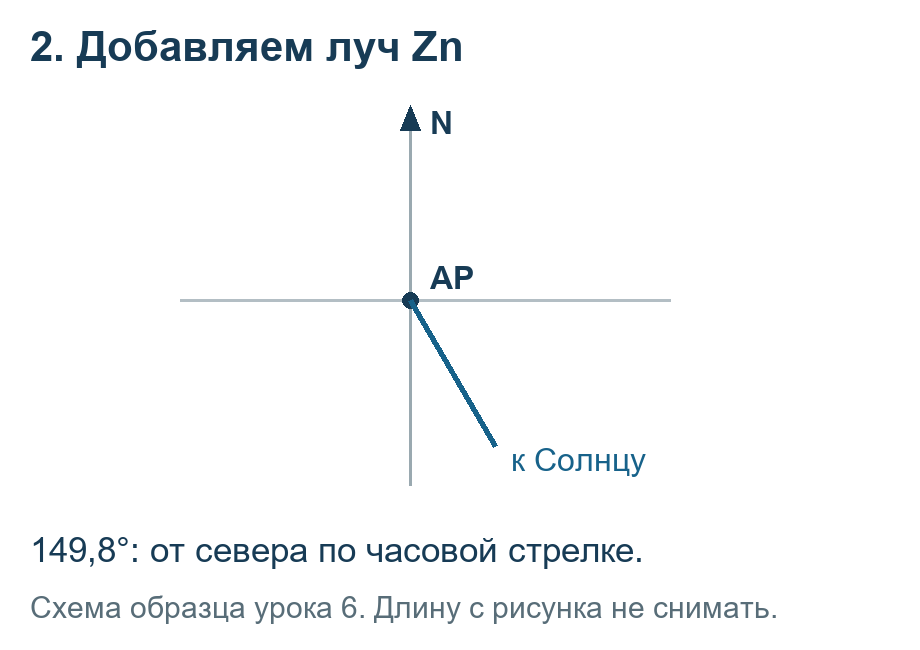

**Как пользоваться транспортиром:** положите центр на принятую точку. Для азимута 149,8° совместите нулевой луч с севером, а полукруг расположите с восточной стороны; выберите шкалу, которая возрастает от северного нуля к востоку. Отметьте 149,8° и проведите луч. Для обычного полукруглого транспортира не нужно искать деление 210,2° — его там нет. Если измеряете направление больше 180°, совместите нуль с югом и отложите азимут минус 180° в западной половине круга. Ось север—юг и сторону поворота проверяйте отдельно.

Сдвиг отрицательный, поэтому откладываем **в противоположную сторону**: 149,8° + 180° = **329,8°**. Для этого просто продлите уже построенную прямую через принятую точку назад; полного транспортира на 360° не требуется.

По направлению 329,8° отложите **18,2 морской мили**. На бумажной сетке это 18,2 ÷ 2 = **9,1 см**. Конец отметьте как точку прокладки. Это ещё не место лодки.

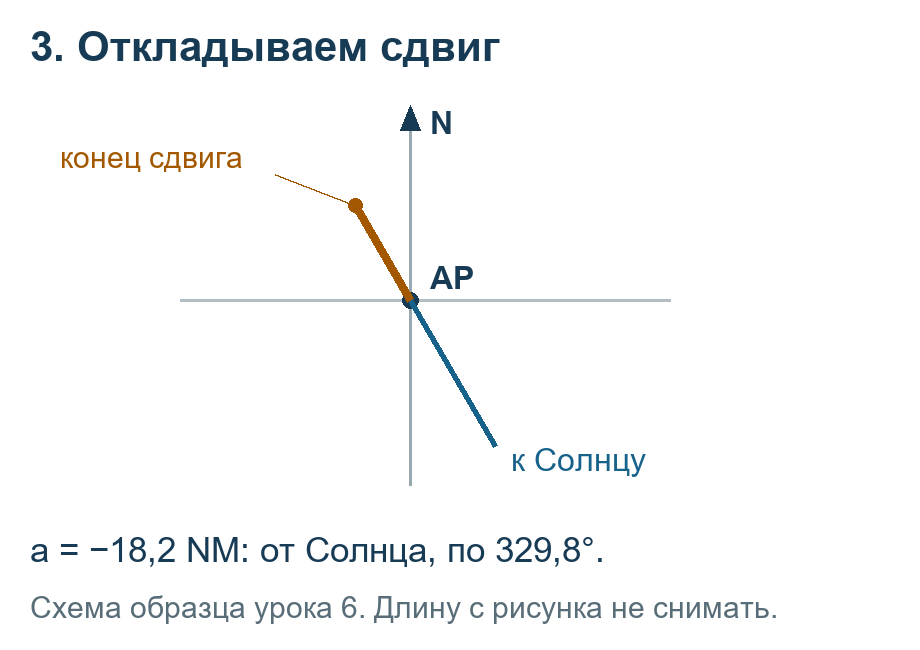

#### 9. Проведите перпендикуляр

Провести линию **перпендикулярно** — значит поперёк другой линии под прямым углом, как угол тетрадного листа. Это **90°**. На бумаге удобно отложить от луча ещё 90° транспортиром или приложить угольник.

Почему именно поперёк? Движение к точке под Солнцем или от неё меняет высоту. Направление с неизменной высотой идёт вдоль окружности, то есть поперёк её радиуса. В нашем малом районе это и даёт линию под прямым углом к направлению на Солнце. Не нужно запоминать поворот на 90° без этого смысла.

Через точку прокладки проведите такую прямую к лучу на Солнце. Её направления: 149,8° − 90° = **59,8°**, обратное — **239,8°**.

Это **LOP (линия положения — линия возможных мест лодки)**. Два направления обозначают одну прямую.

На сайте можно [пройти построение по шагам](GUIDE.html#diagram-lop). Анимация относится к паре **3 сентября**, а числа этого урока — к историческому образцу **2 сентября**; берите оттуда движение и смысл, не переносите числовые сдвиги между примерами.

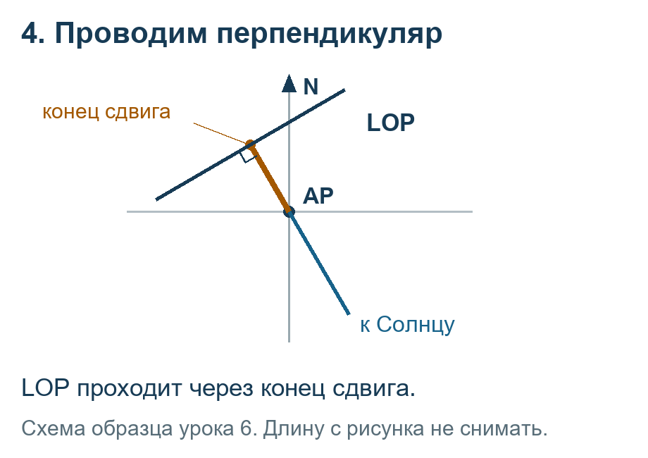

#### 10. Подпишите наблюдение

Укажите номер, дату и время по Гринвичу, принятую точку, сдвиг и источник направления. Для бумажного образца: **№1; 02.09.1939, исходная метка 10:03:07Z; сдвиг −18,2 морской мили; азимут 149,8° по F XI**. Рядом отметьте: «Временная привязка табличных чисел не подтверждена» — это ограничение образца из урока 4, не новая запись наблюдения.

**Проверьте:** линия перпендикулярна лучу, её точка прокладки на северо-западе от принятой точки, расстояние отложено по масштабу. Не приравнивайте игровые единицы или пиксели к морским милям без подтверждения.

### Самостоятельная попытка

#### Сначала получите Zn, затем стройте по четырём кадрам

Для проверки табличного направления сохраните P, обе колонки при Hc, долю A и выбранный полюс. В новом условии сначала получите свой Zn, затем стройте по четырём стадиям выше.

**П5 — попробуйте:** [сначала с подсказкой знака, затем без неё](TRAINING.html#step-line). Там Zn задан только для отдельной геометрической тренировки. Это не разрешение пропускать F XI в полном наблюдении.

**Если линия оказалась с другой стороны:** проверьте знак a и направление луча отдельно. Если угол линии неверен, вернитесь только к перпендикуляру; Hs из-за ошибки транспортира не меняют.

Для полной самостоятельной цепочки возьмите [новую задачу](TRAINING.html#task), а не повторяйте законченный рисунок с теми же числами. Для своих данных укажите установленный источник направления.

### Один проверяемый результат

**Есть подписанная линия положения; вы объясняете, почему она проведена поперёк направления на Солнце и почему это ещё не координаты лодки.**

Прибор, время, поправки и местное прямолинейное приближение имеют ошибки. Поэтому линия — **оценка положения**: истинное место может лежать рядом с чертой, а не точно на ней.

[Урок 7 — место по двум наблюдениям](#lesson-7). [К началу курса](#start).

---

## Урок 7. Определяем место по двум наблюдениям

**Вход:** две линии положения с их моментами и путь между ними. В бумажной задаче все исходные данные заданы; собственная игровая пара перед чтением не требуется. Построение одной линии объяснено в [уроке 6](#lesson-6).

Получим оценку места на время второго наблюдения. [Полный разбор учебной пары](#walkthrough) показывает все расчёты и конечные координаты в одной последовательности.

### Почему просто подождать недостаточно

Вспомним прошлый урок. Одна линия ещё не выбирает единственную точку: лодка может быть в разных местах этой линии. Нарисованные ниже лодки — разные возможные места **одной** лодки, а не три судна сразу.

Одна высота не выделяет середину линии. Счисление и другие сведения могут ограничить вероятный участок, но произвольная точка этого участка не становится определённым местом.

Новая высота даёт новую **LOP (линию положения)**. Если направления линий заметно различаются, пересечение позволяет выбрать точку.

Но первая линия описывает, где лодка могла быть **раньше**. Если за время ожидания лодка прошла несколько миль, она уже не обязана находиться на старой линии. Первую линию нужно передвинуть вместе с пройденным путём.

Для построения нужны оба расчётных листа, карта или сетка и журнал пути. Для получения собственных линий дополнительно нужны прибор, часы и таблицы. В бумажном маршруте используйте путь из условия.

Не берите два случайных отсчёта, сделанных во время предыдущих уроков, если путь между ними не записан. Для практической задачи начните новую пару наблюдений и ведите путь с самого первого.

### Практика: приготовьте два независимых листа

#### 1. Выполните первое полное наблюдение

Повторите освоенный путь уроков 2–6. На листе №1 сохраните дату, GMT (время по Гринвичу), Hs (высоту нижнего края Солнца до поправок), поправки, таблицы, принятую точку и построенную линию.

Подпишите время первой линии и основание данных: собственное наблюдение или условие задачи.

#### 2. Начните запись пути сразу

От момента первого наблюдения записывайте начало и конец каждого участка, направление движения и скорость. При смене курса или скорости начинайте новую строку. Рядом укажите источник курса и скорости: игровой прибор, ходовой журнал или ваша оценка.

**Поймите различие:** компас показывает направление носа, а лаг может показывать скорость относительно воды. Для переноса нужен путь относительно неподвижного морского дна. Встречаются обозначения **COG (направление пути над грунтом)** и **SOG (скорость над грунтом)**. Курс, азимут и линия на карте должны быть в одной системе — истинной. Если компас магнитный, а поправка неизвестна, перенос не выдавайте за точный.

Если известны только компас и лаг, это счислимая оценка. Запишите неизвестное течение и возможный снос, не подставляйте нуль. Если путь совсем не установлен, перенос и определение места по двум разновременным линиям пока невозможны. Чтение скрытых координат игры не считается ведением пути.

#### Между наблюдениями: верните ход игрового времени

Если в игре первое наблюдение делалось на паузе, **снимите её своей обычной командой** и проверьте ход секунд. Реальное время чтения урока не заменяет прошедшее игровое время. В бумажной задаче используйте два заданных момента; ожидать в игре не нужно.

#### 3. Выполните второе полное наблюдение

Дождитесь заметного изменения направления Солнца и повторите уроки 2–6 на листе №2. Снимите новую высоту и новое время. Постройте вторую линию по её собственным данным.

**Сколько ждать.** Точное число часов заранее не задано: направление Солнца меняется неравномерно. **Смещение относительно мачты или палубы ненадёжно: лодка могла повернуть.** После второго полного расчёта сравните истинные азимуты или направления построенных линий. Не нужно заранее ловить ровно 30° в окуляре: меньший угол вы измерите на карте. Почти параллельные линии дадут неустойчивое пересечение; тогда нужно более позднее независимое наблюдение, а не поворот лодки ради другого вида Солнца.

**Можно предварительно выбрать момент на бумаге.** Если источник солнечных данных и ожидаемый путь уже известны, для двух возможных будущих моментов рассчитайте ожидаемые Hc и Zn по урокам 5–6, без Hs и поправок наблюдения. Сравните направления с первой линией. Это прогноз для выбора времени, не второе измерение; после настоящего касания всё пересчитывается для фактического момента и пути. Без согласованных исходных данных такой прогноз тоже недоступен.

Для нового касания снова установите время порядком урока 2: вернитесь к обычному ходу, если пользовались ускорением, включите проверенную паузу и свяжите новую высоту с новым моментом. Первое время к ней не переносите.

**Проверьте независимость:** вторая линия получена новым измерением, не скопирована с первой и не является её переносом. Показания высоты могут случайно совпасть — сами по себе одинаковые цифры не доказывают зависимость. Два касания одного Солнца в одной неподвижной сцене не создают разных направлений для определения места.

Здесь «независимые» означает **отдельные наблюдения**, а не доказанную статистическую независимость их ошибок. Общая ошибка часов, нуля или горизонта может влиять на обе линии.

#### 4. Проверьте угол между линиями

Возьмите меньший угол между их направлениями, от 0° до 90°. Обратные направления одной прямой считаются одной ориентацией.

**Как измерить:** продлите обе линии до пересечения, поставьте центр транспортира в точку пересечения и совместите нуль с одной линией. Отсчитайте угол до второй линии. Если получилось больше 90°, возьмите дополнение до 180°: например, 150° означает тот же меньший угол 30°.

При угле примерно **30–90°** пересечение удобнее. Почти параллельные линии дают ненадёжную точку: небольшая ошибка высоты сильно сдвигает пересечение. Фиксированное ожидание в часах нужного угла не гарантирует — направление Солнца меняется неравномерно. Если угол слишком мал, лучше подождать и сделать третье наблюдение, чем объявлять ненадёжное пересечение местом.

### Научимся переносить линию

#### 5. Посчитайте путь каждого участка

Из времени конца участка вычтите время начала с учётом даты. Переведите результат в часы: часы + минуты ÷ 60 + секунды ÷ 3600.

**Путь в морских милях = скорость в узлах × время в часах.** Узел — одна морская миля за час.

#### Упражнение только на арифметику, не новые наблюдения

В сохранённом учебном примере переноса заданы **08:03:07 → 11:03:07**, движение **на восток, 090°**, скорость **10 узлов**.

- Прошло **3 часа**.
- Путь: 10 × 3 = **30 морских миль на восток**.
- На бумаге при масштабе 1 см = 2 мили длина переноса равна **15 см**.

**Отдельная репетиция пути.** Это не продолжение исторической метки 10:03:07Z и не путь бумажной пары 3 сентября (там 10:00 → 13:04). Здесь тренируется только скорость × время; после примера вернитесь к своему условию.

#### 6. Передвиньте первую линию вперёд

Каждая точка ранней линии — возможное положение лодки в первый момент. Отложив от каждой один и тот же известный путь до второго момента, получим множество возможных поздних мест. В местном плоском построении это **параллельный перенос** линии: все её точки сдвигаются на один вектор, наклон сохраняется.

Представьте линию на прозрачном листе: весь лист перемещается по пути лодки **без поворота**. Поворот лодки меняет направление следующего участка пути, но не наклон переносимой линии.

[Пошаговая анимация переноса](GUIDE.html#diagram-transfer) показывает эту геометрию на условной паре 3 сентября: ранняя линия движется, поздняя остаётся неподвижной. Можно вернуться к любому шагу; проигрывание само не начинается.

Дополнительная иллюстрация без числового ответа

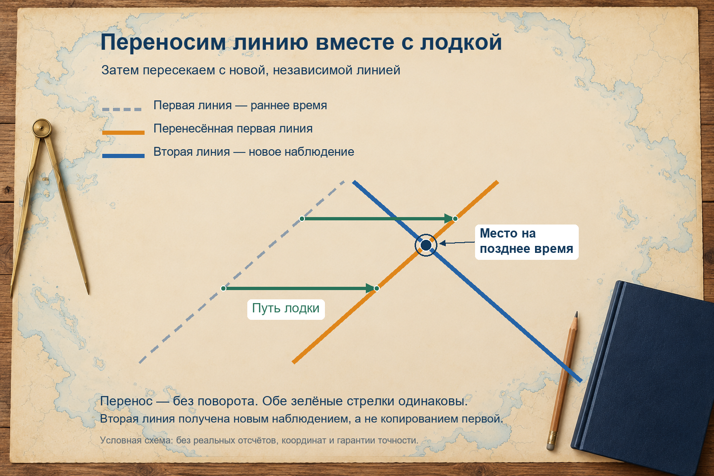

Серая линия относится к раннему времени. Оранжевая — её параллельный перенос по пути лодки. Синяя получена новым независимым наблюдением. Место относится к позднему времени; реальной второй высоты и точности координат эта схема не доказывает.

Направление вправо на схеме — пример; на карте берём путь из журнала или условия задачи.

Выберите любую удобную точку первой линии. От неё отложите по карте **направление пути лодки** и вычисленное расстояние вперёд — от первого времени ко второму.

Если участков несколько, отложите их последовательно: конец первого становится началом следующего. Через окончательную точку проведите прямую **параллельно первой линии**. Подпишите: «Первая линия перенесена ко времени второго наблюдения».

**Как провести параллель без специальной линейки:** приложите один катет угольника к первой линии, а второй — к обычной линейке. Передвигайте угольник вдоль линейки, пока его край не пройдёт через окончательную точку; проведите линию. Второй способ — отложить одинаковое перпендикулярное расстояние в двух местах и соединить полученные точки. Проверка на глаз здесь недостаточна.

**Проверьте:** использован путь лодки, не направление на Солнце; перенос выполнен вперёд, а не назад; новая линия параллельна исходной. Одного последнего курса на весь промежуток недостаточно, если лодка поворачивала.

**Если нет уверенности в знаке или масштабе:** выполните У8 в [коротких упражнениях](#exercises); ключ отдельно, в [ANSWERS.html](ANSWERS.html).

#### 7. Оставьте вторую линию на месте

Вторая линия уже относится ко второму времени. Теперь пересекаться должны **перенесённая первая** и **самостоятельно измеренная вторая**.

Перенос одной линии не делает её новым наблюдением. Если независимой второй линии нет, места по-прежнему нет. Если лодка достоверно не перемещалась, перенос нулевой; остановленная машина сама по себе не доказывает отсутствие дрейфа.

### Прочитаем место с карты

#### 8. Отметьте пересечение

Теперь наложим на перенесённую первую линию **вторую, полученную новым измерением**. Ищем точку, которая лежит на обеих линиях сразу.

Продлите две линии до пересечения и отметьте точку. При разновременных наблюдениях с переносом это **running fix (счислимо-обсервованное место)** на время второго наблюдения. В пособии кратко — «место» или fix; это не одновременная засечка, и результат зависит от ошибок измерений **и счисленного переноса**.

**Проверьте:** точка принадлежит обеим использованным линиям. Не заменяйте её принятой точкой расчёта или видимым маркером истинного положения лодки.

#### 9. Считайте широту и долготу

По параллелям карты прочитайте широту пересечения, по меридианам — долготу. Запишите градусы и минуты, добавив N (северная) или S (южная) для широты и E (восточная) или W (западная) для долготы.

Правило сложения ниже дано **для нашей небольшой сетки с северной широтой и восточной долготой**, без перехода через экватор или нулевой меридиан. Оно не переносится без изменения знаков в другие полушария.

На бумажной сетке сначала измерьте северное и восточное смещения пересечения от подписанного начала сетки в морских милях. Северное смещение прибавьте к широте как минуты, южное вычтите. Восточно-западное смещение переведите в минуты долготы по [**Fulst, Tafel 13** (таблице перевода отхода в долготу)](source-tables/Fulst%27s%20Nautische%20Tafeln.pdf#page=200), строке вашей широты. При широте 55° нужна печатная 183 / PDF 200. Прибавьте долготу на восток, вычтите на запад. Всю наклонную длину от начала сетки до пересечения в долготу не переводите.

**Сетка должна покрывать весь путь и оба принятых места.** Если 30 морских миль не помещаются на лист, возьмите лист больше или мельче масштаб. Начало сетки подпишите координатами той точки, от которой считаете; не смешивайте AP первого и второго наблюдения.

Если AP различаются, сначала разместите обе на одной сетке: разность широт переведите в северное смещение, разность долгот — в восточное по Fulst. Затем стройте каждую линию от своей AP. [Репетиция косого пути и двух AP](TRAINING.html#prep-different-ap) показывает эти переходы на отдельных числах до полной самостоятельной задачи.

#### 10. Запишите время и качество результата

Под координатами поставьте **дату и время второго наблюдения по Гринвичу**. Добавьте угол между линиями, использованный путь и сведения о течении. Сравнивайте результат со счислимым местом на это же время.

**Проверьте:** большое расхождение не исправляется подгонкой высоты или удалением неудобной линии. Сначала перепроверьте исходные записи, знаки и путь. Неизвестный снос остаётся частью ошибки результата.

### Если есть возможность сделать третье наблюдение

Постройте третью независимую линию и приведите обе предыдущие к её времени. Перенос **двух разных** старых наблюдений допустим; считать две копии одного наблюдения независимыми нельзя.

Небольшой треугольник показывает взаимную невязку, но истинное место не обязано находиться внутри. Общая ошибка часов или поправки нуля может сдвинуть все линии вместе. Третье наблюдение помогает проверять, а не гарантирует точные координаты.

### Самостоятельная попытка

#### Четыре остановки переноса

В новом задании сохраните исходные линии, последовательные стрелки пути, перенесённую первую линию и пересечение. По этим четырём стадиям можно проверить, на каком шаге возникла ошибка.

**П6 — бумажная репетиция:** [два участка и две заданные линии](TRAINING.html#step-transfer). Сначала найдите длины с подсказкой, затем самостоятельно выполните перенос на другой сетке. Условные линии заменяют только геометрическую часть упражнения, не реальные наблюдения.

**Если пересечение не получилось:** сначала проверьте время линий и полноту пути. При неизвестном пути остановитесь; не поворачивайте раннюю линию ради пересечения и не считывайте скрытое место лодки.

После геометрической тренировки выполните [новую полную задачу](TRAINING.html#task), затем при известных входах — построение по собственному ходовому журналу. Урок и таблицы можно читать. Объясните, к какому времени относится место и как неизвестная ошибка пути повлияет на результат.

У сохранённого контрольного наблюдения 2 сентября 1939 года с исходной меткой 10:03:07Z нет второго реального отсчёта и пути до него. Поэтому **готовые координаты места для этой единственной записи не выдаются**. Если своей второй линии нет, честный результат — «место не определено».

### Один проверяемый результат

**Есть координаты пересечения двух независимых линий, приведённых к одному времени, и запись того, как учтён путь лодки.**

Для самостоятельной бумажной проверки достаточно заданной пары: игра не нужна. Для собственного определения места требуются установленные наблюдения и путь; при их отсутствии результат остаётся «место не определено».

[К началу курса](#start). Подробности и длинная контрольная арифметика — в [справочнике](reference/TEXT-MANUAL.md).

---

## Выберите подходящую работу

Не нужно собирать все числа перед первым знакомством с секстантом. Выберите один из трёх маршрутов.

### А. Только прибор

**Нужно:** учебная копия сохранения, лодка на поверхности, видимый солнечный диск и отчётливый морской горизонт. Обычный маршрут выхода наружу и к виду от первого лица описан в [уроке 1](#lesson-1); его игровой проход ещё предстоит проверить.

**Что получите:** собственное касание и исходный угол Hs. Пока это упражнение с прибором, не определение места. Альманах, высота глаза и счислимое место для этого маршрута не нужны.

**Время для А не обязательно.** Если его источник ещё неизвестен, подпишите «упражнение; время не установлено». Это не блокер наведения; блокером полного наблюдения оно станет при переходе к уроку 2.

**Где взять учебную сцену.** Готовое проверенное сохранение к пособию не приложено. Предполагается установленная UBOAT с RadioNavigation и ваше доступное сохранение; если игры или мода нет, сейчас выбирайте бумажный маршрут Б. Установка мода не является шагом навигационного расчёта.

До отдельной игровой попытки оператор должен подготовить учебную копию вашего сохранения и свежую резервную копию затрагиваемых настроек, проверить возможность возврата к ним и отметить, что именно скопировано. Рабочее сохранение не перезаписывают. Точные действия копирования зависят от установки и здесь ещё не проверены; если копия и откат не установлены, игровую попытку не начинайте. Не сбрасывайте профиль ради неизвестной ИП.

При загрузке учебной копии нужно обычным управлением проверить: лодка на поверхности, день, Солнце видно отдельным диском, морской горизонт не закрыт берегом или дымкой, доступен офицер для вида от первого лица. Если условий нет, выберите другое уже имеющееся сохранение с оператором; скрытые команды для изменения сцены не используйте. Проход подготовки и выхода наружу ещё не принят в игре. Для LIVE нужны отдельное разрешение, оператор и начинающий участник; чтение этой инструкции не является таким разрешением.

**Готовность к уроку 1:** известно, какую учебную копию открыть, где находится резервная копия и как вернуться; видимые условия подходят. Если это пока не так, можно полностью изучать метод [на бумаге](#walkthrough).

### Б. Бумажная задача от начала до конца

**Нужно:** [полный бумажный разбор](#walkthrough), [лист расчёта](PAPER-WORKSHEET.html), оригинальные таблицы, линейка и транспортир. Все исходные данные явно заданы; включать игру не нужно.

**Что получите:** понимание каждой стадии, две рассчитанные линии, перенос и координаты пересечения на второе время. Разобранный пример содержит заполненные строки; у следующей самостоятельной задачи ключ отдельно.

**Учебный порядок:** разбор одной пары → нужные короткие упражнения → [новая полная задача](TRAINING.html#task). Проходить все упражнения перед первым расчётом не требуется.

Если непривычны градусы и минуты или поиск клетки, начните с [шести вопросов подготовки](BASICS.html#check-in). Каждый ведёт к короткому объяснению. После него возвращайтесь в практикум; прямое и обратное чтение настоящих таблиц тренируют [упражнения У1–У10](#exercises).

### В. Собственное навигационное наблюдение

**В этой редакции маршрут В ограничен.** Полный собственный расчёт возможен, только если известны **текущая поправка нуля** и **высота глаза над водой**. Штатный показ текущей ИП без встроенной записи не подтверждён; число в строке «Глаз … м» требует открытого прибора, действительной позиции и готовой солнечной оптики. При неготовой оптике выводится тире, при отсутствии позиции блок может быть пустым. Это ограничение источников, а не ошибка читателя.

Если хотя бы один обязательный вход неизвестен, полный расчёт **остановлен**; используйте маршрут Б. Не сбрасывайте рабочий профиль и не читайте скрытые координаты ради продолжения.

До начала проверьте по [реестру источников](#data-sources):

- [ ] Известны дата, шкала времени и способ привязки секунды к касанию.
- [ ] Понятно, какое поле показывает Hs, а не уже исправленную высоту.
- [ ] Известны текущая поправка нуля и её источник.
- [ ] Есть высота глаза **над водой** в текущей точке наблюдения.
- [ ] Есть начальное известное **место лодки**, его время и записанный путь до наблюдения.
- [ ] Есть карта/сетка с истинным севером и проверенным масштабом.
- [ ] Для определения места по двум наблюдениям будет записан весь путь между ними.

Неподтверждённое поле означает: **можно продолжить маршрут А или Б, но полный собственный расчёт пока остановлен**. Нуль, число из образца и координаты видимого маяка недостающее значение не заменяют.

#### Что доступно при ваших данных

| Известно | Маршрут | Результат |
|---|---|---|
| Только прибор, Солнце и горизонт | **А** | Собственный Hs, упражнение |
| Есть заданные бумажные условия | **Б** | Две линии и место на бумаге |
| Есть текущая ИП, высота глаза, начальное место лодки, путь и карта | **В** | Собственное наблюдение и расчёт |
| Хотя бы один вход из строки В неизвестен | **Б** или остановка | Не выдавать неполный расчёт за полный |

Если сомневаетесь между В и Б, выбирайте Б: бумажная задача проверяет метод без риска выдать догадку за измерение.

**Про строку В:** «текущая ИП» означает значение из подтверждённого источника, а не свежий сброс профиля. Штатный показ текущей ИП без встроенной записи не подтверждён; если её происхождение неизвестно, строка В не выполнена.

### Где заканчивается подробно разобранная ветвь

Для **расчётных уроков**, а не для первого знакомства с прибором:

| Условие | Подробно разобрано |
|---|---|
| Светило и край | Солнце, нижний край, видимый морской горизонт |
| Календарь старого сборника SH5 | 1939–1945; соответствие шкалы книги игровым часам проверяется отдельно |
| Широта и склонение | Северная широта, северное склонение; экватор и полюс отдельно не ведутся |
| Часовой угол от местного меридиана | Восточный или западный, меньше 6 часов угла, то есть 90° |
| Вспомогательная сумма q | Между 0° и 90° |
| Выбор полюса для азимута | Склонение меньше Gr.δ из F I; отсчёт A от юга |
| Расчётная высота Hc | Выше 0°, не выше 70°; не выходить за клетки выбранных таблиц |
| Промежуточная высота h для F VIII | В напечатанном диапазоне; в игровой реализации солнечной цепочки 3–90° |
| Высота глаза в этом курсе | 1–14 м; существование дальнейших колонок книги не расширяет игровую ветвь |
| Близость принятой точки | Около счислимого места; до 60 морских миль — учебный ориентир, не универсальная гарантия точности прямолинейного приближения |
| Бумажная сетка | Небольшой район, северная широта и восточная долгота, без перехода экватора и нулевого меридиана |

Часть условий, например q и Hc, получится проверить только при расчёте. Они перечислены **заранее**, чтобы вы знали границы метода. Если условие не выполнено, ваше наблюдение не обязательно ошибочно — эта ветвь пособия просто не объясняет его решение.

Начните [с бумажного разбора](#walkthrough), [с прибора](START.html) или откройте [памятку собственного наблюдения](#practice). Подготовительные темы нужны только при затруднении с конкретным навыком.

---

## Маршрут собственного наблюдения

**Памятка после знакомства с уроками, не замена объяснениям.** Для первого подхода начните с [урока 1](#lesson-1). Здесь нет готовых высот, времени, азимута или координат: в каждое поле попадают только ваши данные и их источники.

Для двух наблюдений используйте **два отдельных [листа записей](#worksheet)** и один общий ходовой журнал между ними. Не копируйте первую высоту, время или принятую точку на второй лист автоматически.

### До наведения: проверьте готовность

- [ ] Есть учебная копия сохранения, резервная копия настроек и обычные команды управления.
- [ ] Наблюдатель снаружи; видны сам солнечный диск и морской горизонт.
- [ ] Известны источник часов и даты, источник высоты глаза и поправки нуля.
- [ ] Для полного расчёта есть обоснованное счислимое место, карта с истинным севером и масштабом, нужные таблицы.

**Если часть входов неизвестна:** можно отдельно упражняться в наведении или разбирать заданный пример на бумаге. Но нельзя объявлять собственный полный расчёт выполненным и подставлять недостающие числа из образца.

### 1. Сначала свяжите момент с измерением

**Откройте [урок 2 — время](#lesson-2).** При закрытом секстанте найдите установленные гринвичские часы с секундами и соответствующую дату. Остановите игровое время своей обычной командой. Проверьте по двум чтениям, что секунды действительно не меняются.

**Запишите:** номер наблюдения, дату, часы, минуты, секунды и источник. Закройте журнал, не снимая паузу.

Если дата или шкала неизвестна, точного момента пока нет. При неподтверждённой паузе можно работать только с чтением секунды непосредственно при контакте, как описано в уроке 2; само нажатие клавиши остановку времени не доказывает.

### 2. Выполните новое касание и замкните проверку времени

**Действуйте по [уроку 1 — секстант](#lesson-1).** Откройте прибор, сохраните горизонт в прямом виде, подведите отражённое Солнце и добейтесь касания его **нижним краем**. Прочитайте собственный исходный отсчёт Hs до поправок. Не выставляйте число из учебного образца.

**Запишите:** Hs в градусах и угловых минутах, нижний край, фильтры, увеличение и замечания о касании. Закройте секстант и снова прочитайте дату и секунды. Они должны совпасть с записью до наведения.

**Результат:** собственная пара «момент — высота». Без подтверждённого общего момента это ещё не полноценное навигационное наблюдение.

Если после первой высоты продолжаете движение до окончания расчёта, начните журнал пути **от момента наблюдения**, не от момента готовой прокладки. Пока проверенная пауза сохраняется, игровое время не добавляется.

Если работаете без паузы, используйте только описанную в уроке 2 процедуру чтения секунды непосредственно при касании. Позднее время к старому отсчёту не приписывают.

### 3. Получите измеренную высоту центра

**Откройте [урок 3 — поправки](#lesson-3).** Сохраните Hs, запишите поправку нуля с её источником и высоту глаза над водой. Исправьте нуль; прочитайте F VIII для нижнего края, своих строк высоты и столбцов высоты глаза; выполните обе интерполяции и месячную добавку.

**Запишите:** выбранные клетки, доли интерполяции, каждую добавку и Ho — высоту центра после поправок.

**Проверьте:** промежуточные поправки лежат между своими клетками, знак сохранён, состав общей поправки не учтён второй раз. Нажатие R не измеряет ошибку нуля; C не является шагом ручного решения.

### 4. Прочитайте данные Солнца на тот же момент

**Откройте [урок 4 — альманах](#lesson-4).** Установите соответствие строк книги своей шкале времени. Выберите год и день; прочитайте опорную строку, приращение GHA и изменение склонения δ за нужную долю интервала.

**Запишите:** книгу, страницу, подписи шкалы, опорный момент, исходные клетки, интервал и полученные GHA и δ.

**Проверьте:** эти числа описывают Солнце, не лодку. Если смысл временной подписи не установлен, не добавляйте час ради совпадения с готовым ответом. Две подписи у одной сетки не делают её двумя таблицами.

### 5. Выберите принятую точку и найдите сдвиг

**Откройте [урок 5 — расчёт](#lesson-5).** От обоснованного счислимого места выберите близкую принятую точку AP для удобного табличного угла. Проверьте её часовой угол обратной суммой. По F I и F II получите расчётную высоту Hc именно для этой точки.

**Запишите:** источники DR и AP, табличный угол, U, V, q, клетки прямого и обратного чтения F II, затем **a = Ho − Hc**.

**Проверьте сторону:** положительная разность — к Солнцу; отрицательная — от Солнца. Вычитаются две высоты центра, не Hs и Hc. Принятая точка — выбор для расчёта, не найденное место лодки.

### 6. Постройте одну подписанную линию

**Откройте [урок 6 — карта](#lesson-6).** По F XI получите истинный азимут Zn и проверьте сторону отсчёта. От AP проведите направление на Солнце, отложите расстояние с нужным знаком по масштабу и через конец сдвига постройте перпендикуляр.

**Запишите на карте:** номер и время наблюдения, AP, сдвиг, азимут и его источник. Вся прокладка использует истинные направления.

**Результат:** одна линия возможных мест. Ни AP, ни конец стрелки не являются определёнными координатами лодки. Если обычные инструменты карты не позволяют выполнить действие, используйте бумажную сетку и явно отметьте ограничение игры.

### 7. Сохраните весь путь между наблюдениями

**Продолжение — [урок 7](#lesson-7).** От момента первого наблюдения сохраняйте каждый участок движения: начало, конец, направление, скорость, их источники и известный снос. При повороте или изменении скорости начинайте новую строку. Снимите паузу обычной командой и проверьте, что игровое время пошло.

**Проверьте источник:** компас даёт направление носа, лаг может давать скорость относительно воды. Перенос нужен по пути относительно грунта. Если есть только оценка по компасу и лагу, так её и подпишите; неизвестное течение не становится нулевым.

Не переносите всю первую линию по одному последнему курсу, если лодка поворачивала. Реальные минуты чтения пособия не заменяют прошедшее игровое время.

### 8. Выполните второе независимое наблюдение

Когда направление Солнца заметно изменилось, на новом листе повторите **полную цепочку 1–6** с новым моментом и своими данными. Фиксированное ожидание само по себе не гарантирует хорошего угла пересечения.

Перенесите первую линию **вперёд по записанному пути**, без поворота, ко времени второго наблюдения. Вторая линия уже относится к этому времени и остаётся на месте. Пересеките перенесённую первую и самостоятельно полученную вторую; проверьте меньший угол между ними.

**Запишите:** координаты пересечения, дату и время второго наблюдения, угол линий, использованный путь и оставшиеся неопределённости. Перенос первой линии не создаёт второго наблюдения.

### Чем заканчивается работа

| Что действительно получено | Как подписать результат |
|---|---|
| Только касание и исходный угол | Упражнение с прибором; время не установлено |
| Высота и момент, но неизвестен обязательный вход | Наблюдение записано; расчёт остановлен, указана причина |
| Полный расчёт одного наблюдения | Одна линия положения на своё время |
| Две независимые линии, но путь между ними неизвестен | Место по разновременным линиям не установлено |
| Две линии приведены к общему времени с учётом пути | Оценка места на позднее время с указанными ошибками |

Сохраняйте исходные отсчёты и причины незаполненных полей: это позволяет проверить расчёт, не подгоняя его под ожидаемую точку.

Перед записью итога сверьтесь с [критериями качества](#quality): шаг шкалы, повторяемость наведения, округление таблиц и точность прокладки — разные вещи.

---

## Откуда брать исходные числа

Для каждой записи нужны **значение, единицы, момент и источник**. Этот реестр относится к собственным игровым наблюдениям. В [бумажном разборе](#walkthrough) исходные значения заданы условием; получать их в игре не требуется. Назначение поля по исходникам не доказывает его видимость и работу в конкретной сцене.

### Реестр входов

| Что нужно | Где искать и что записывать | Что подтверждено / что ещё проверить |
|---|---|---|
| Hs — исходная высота нижнего края | Отсчёт барабана рядом с окуляром после своего касания; градусы и угловые минуты | Управление и квант 0,1′ установлены по реализации. Первый самостоятельный игровой проход ещё не принят |
| Дата и GMT с секундами | Судовой журнал, строка GMT / «Лондон»; дата должна относиться к этой шкале. Проверка паузы — в уроке 2 | Код добавляет секунды именно к гринвичской строке. Видимость, дата и связь с новым касанием требуют отдельной игровой проверки |
| Высота глаза, м | При открытом секстанте в блоке светил искать строку **«Глаз … м»**. Число требует действительной позиции и готовой солнечной оптики. При неготовой оптике выводится тире; при отсутствии позиции блок может быть пустым. Ни тире, ни пустой блок не означают нуль. Прочитать при том же месте наблюдения | Название, единицы, вывод тире и очистка блока подтверждены по исходникам. Читаемость и фактическое значение в обычной практике, включая переходы внутрь лодки и на карту, ещё не подтверждены |
| Поправка нуля, угловые минуты | Достоверно известное состояние чистого профиля или доступная запись **ИП** с установленным происхождением и моментом. Штатный показ текущего значения без встроенной записи **не подтверждён** | По реализации значение по умолчанию 0,0′, сохраняется между сеансами и ограничено ±5′. Не сбрасывайте рабочий профиль ради удобного нуля |
| Начальное известное место лодки | Координаты фактической стоянки у известного причала, прошлое определённое место либо отдельное обоснованное определение по берегу; записать время | Это должно быть **место лодки**, не координаты видимого объекта. Универсальный обычный игровой маршрут получения такого начала в курсе ещё не проверен |
| DR — счислимое место на момент наблюдения | Начальное место плюс записанные участки пути: даты/время, направление, скорость, источники, известный снос | Истинный текущий маркер лодки не заменяет счисление. Если путь не сохранился, DR нельзя восстановить выдумкой |
| GHA и δ — положение Солнца | Согласованный с моментом источник. Для бумажной задачи источник и шкала указаны в условии; старый образец SH5 имеет отдельную оговорку | Чтение книги и проверка эфемериды — разные проверки. Не переносить в игру солнечные данные нового бумажного упражнения |
| Направление и скорость пути | Из собственных записей; подписать: истинное/магнитное, над грунтом/относительно воды | Компас и лаг сами по себе не устанавливают течение. Неизвестную поправку или снос не заменять нулём |
| Истинный север и масштаб | Меридианы/подписанная сетка и широтная шкала подходящей карты либо явно заданная бумажная сетка | Милю нельзя получить из пикселей без масштаба. Доступность обычных инструментов игровой карты пока не принята |

### Что считать чистым профилем

«В этом походе я не нажимал C» недостаточно: поправка могла сохраниться раньше. Чистое состояние должно быть известно из подготовки учебной копии и происхождения настроек. Не сбрасывайте настройки рабочего профиля ради получения удобного нуля.

R возвращает барабан к исходной настройке, но **не измеряет и не удостоверяет** сохранённую поправку нуля. C — служебная калибровка по известному светилу; в ручной задаче её не используем. Старое ИП на карточке нельзя автоматически объявлять текущим, если состояние с тех пор менялось. Встроенная запись I и готовый расчёт не требуются для первого урока.

### Ориентир и место лодки — не одно и то же

Если вы видите маяк с известными координатами, вы знаете положение **маяка**. Для места лодки нужен ещё обоснованный способ: например, пересечение независимых береговых линий положения или известная точка стоянки. Один видимый ориентир без достаточных направлений/расстояний точку не определяет.

Название порта тоже не задаёт точные координаты стоянки. Запишите, почему принято именно это начальное место и какова его неопределённость. После отхода считайте путь от его времени до момента солнечного наблюдения.

### Если вход недоступен

Запишите: «нет высоты глаза», «неизвестно ИП», «не установлена гринвичская дата» или другую конкретную причину. Собственный полный расчёт остановлен. При этом можно отдельно тренировать прибор или решать задачу по **явно заданным бумажным условиям**.

Точные ссылки на проверенные исходники и оставшиеся игровые пробелы собраны в [техническом приложении](#limits). Это не разрешение читать скрытые координаты камеры или лодки.

---

## Лист наблюдений и прокладки

**Не для реального судовождения.** Лист собственного наблюдения в игре. Для заданной бумажной пары используйте [отдельный расчётный лист](PAPER-WORKSHEET.html), без игровых полей.

Распечатайте или перепишите на чистый лист. Заполняйте **только то, что действительно измерили или прочитали**. Неизвестное поле оставляйте пустым и записывайте причину: «нет данных», «не читается», «остановка». Не подставляйте число из образца.

**Учебная копия:** ____________________  
**Дата занятия:** ____________________  
**Кто выполняет:** ____________________

**Номер наблюдения:** ____________________  
**Отдельный лист для второго наблюдения:** да / нет

Для пары наблюдений нужны два самостоятельных листа. Общим остаётся только журнал пути между ними. Начатую запись не стирайте: исправление подписывайте рядом.

### 1. Наблюдение

| Поле | Запись |
|---|---|
| Дата по Гринвичу | |
| Время GMT: часы, минуты, секунды | |
| Источник времени (GMT / «Лондон», пауза проверена) | |
| Дата и секунды до наведения | |
| Дата и секунды после наведения | |
| Если без паузы: как зафиксирована секунда касания | |
| Hs — высота нижнего края до поправок | |
| Взят нижний край Солнца | да / нет |
| Фильтры: левый / правый | |
| Увеличение | |
| Примечание о касании | |

### 2. Поправки высоты

| Поле | Запись |
|---|---|
| Поправка нуля и её источник | |
| Основание значения: доступное поле / известный чистый профиль / неизвестно | |
| h = Hs + поправка нуля | |
| Высота глаза над водой, м, и источник | |
| Клетки F VIII: строки / столбцы | |
| Поправка F VIII | |
| Месячная добавка | |
| Ho — высота центра после поправок | |

### 3. Альманах

| Поле | Запись |
|---|---|
| Книга, страница PDF и подписи шкалы на странице | |
| На каком основании строки книги согласованы с часами | |
| День, месяц, год | |
| Опорная строка времени | |
| GHA в опорной строке | |
| δ в опорной строке | |
| δ следующей строки; изменение за весь интервал | |
| Прошедшая доля интервала и изменение δ за неё | |
| Приращение GHA: часы / минуты / секунды | |
| GHA наблюдения | |
| δ наблюдения | |

### 4. Расчёт для принятой точки

| Поле | Запись |
|---|---|
| Счислимое место (DR) и его источник | |
| Исходное известное место, его время и путь до наблюдения | |
| Широта принятой точки (AP) | |
| Долгота принятой точки (AP) | |
| Выбранный табличный угол t | |
| U из F I | |
| V из F I | |
| Gr.δ из F I | |
| q = U + δ | |
| Число из F II для q | |
| V и выполненное сложение табличных чисел | |
| Две клетки обратного чтения F II и доля между ними | |
| Hc после обратного чтения F II | |
| a = Ho − Hc, в минутах и морских милях | |
| Сторона: к Солнцу / от Солнца | |

### 5. Азимут и линия положения

| Поле | Запись |
|---|---|
| P из F XI по δ и t | |
| P в двух соседних колонках A с поправкой за Hc | |
| A — угол от выбранного полюса | |
| Полюс: от юга / от севера | |
| Zn — истинный азимут Солнца | |
| Направление сдвига от AP | |
| Расстояние сдвига по масштабу | |
| Масштаб расстояния, источник истинного севера | |
| Для бумажной сетки: начало координат и широта строки Fulst | |
| Направления LOP | |
| Подпись наблюдения | |

### 6. Второе наблюдение и путь

| Поле | Запись |
|---|---|
| Время первого наблюдения | |
| Время второго наблюдения | |
| Направления: истинные / магнитные с известной поправкой / неизвестно | |
| Скорость: над грунтом / относительно воды / неизвестно | |
| Источники направления и скорости | |
| Известное течение или снос; что осталось неизвестным | |
| Если участок пересёк полночь: даты начала и конца | |

**Ходовой журнал между наблюдениями.** При смене курса или скорости начинайте новую строку. Для переноса нужен путь над грунтом. Если доступны только компас и лаг, подпишите счислимую оценку и её неопределённость; неизвестное течение не заменяйте нулём.

| Начало | Конец | Направление и система | Скорость и вид | Время, ч | Путь, NM |
|---|---|---|---|---|---|
| | | | | | |
| | | | | | |
| | | | | | |

**Источники и изменения по участкам:** ________________________________________  
**Как учтены повороты, течение и снос:** ______________________________________

### 7. Место по двум линиям

| Поле | Запись |
|---|---|
| Первая линия перенесена ко второму времени | да / нет |
| Вторая линия — новое измерение | да / нет |
| Широта пересечения | |
| Долгота пересечения | |
| Время, к которому относится место | |
| Угол между линиями | |
| Перенос первой линии выполнен вперёд по пути, без поворота | да / нет |
| Известное течение / снос | |
| Что осталось неизвестным | |

### Проверка перед переходом дальше

- [ ] Ни одно поле не заполнено числом «из головы» или из готовой карточки.
- [ ] Все исходные записи сохранены; исправления не затёрли старое значение.
- [ ] Неизвестные входы названы, а не заменены нулём.
- [ ] Для каждого числа можно показать страницу, клетку или действие, откуда оно взято.
- [ ] Если пришлось угадывать следующее действие, это записано как дефект урока.
- [ ] Результат подписан по смыслу: упражнение / одна линия / оценка места / остановка.

**Не заполняйте лист задним числом.** Если наблюдение не удалось, честный результат — «остановка» и причина, а не красивая координата.

---

## Управление прибором

Справочная карточка, не урок. Клавиши — **назначения по умолчанию**; если вы их меняли, используйте свои. Названия действий есть в настройках управления и в справке `P`.

### Самое необходимое

| Клавиша | Действие | Когда нужна |
|---|---|---|
| `Z` | открыть или закрыть секстант | начало и конец упражнения |
| `3` | сильный правый фильтр | первый выбор, чтобы увидеть диск |
| `2`, `1` | слабее затемнение справа | если диск слишком тёмный |
| `↑` | увеличить угол: отражение опускается | поиск горизонта |
| `Shift+↑` | то же быстрее | пока Солнце далеко |
| `↓` | уменьшить угол: отражение поднимается | если проскочили |
| `Ctrl+↑`, `Ctrl+↓` | точный шаг | последние десятые минуты |
| `R` | вернуть барабан к нулю | только как настройка поиска |

### Дополнительно

| Клавиша | Действие | Ограничение |
|---|---|---|
| `0` | снять правый фильтр | не влияет на левый |
| `Ctrl+1`, `Ctrl+2`, `Ctrl+3` | левый фильтр | нужен редко |
| `Ctrl+0` | снять левый фильтр | одна `Ctrl` фильтр не выбирает |
| `+`, `−` | увеличение изображения | не меняет измеренный угол |
| `←`, `→` | поворот взгляда | не настройка высоты |
| `P` | справка по прибору | — |
| `I` | встроенная запись наблюдения | для урока 1 не требуется |
| `C` | служебная калибровка по светилу | не ручная поверка нуля |
| `O` | сброс серии | для урока 1 не требуется |

### Три правила, чтобы не спутать

1. **`R` — не поверка.** Он возвращает барабан к исходной настройке, но не измеряет и не удостоверяет поправку нуля.
2. **`C` — не шаг ручного расчёта.** Это служебная калибровка по известному светилу.
3. **Увеличение не умножает угол.** Оно меняет только размер изображения.

Что именно проверено в реализации и что ещё нет — в [статусе проверки](QA-STATUS.html).

---

## Если результат не получается

Проверяйте сначала исходные данные и переход между действиями, а не сходство с готовым ответом. Сохраните исходную запись, отметьте место остановки и исправляйте причину по одному шагу.

### Найдите первый разрыв цепочки

Не пересчитывайте всё сразу. Пройдите по своей записи до **первой невыполненной проверки**:

1. **Наблюдение:** установлены ли Hs и, для полного наблюдения, его момент? Для упражнения с прибором неизвестное время не мешает записать Hs.
2. **Ho:** известны ли ИП и глаз, правильны ли клетки F VIII, доли и состав поправки? Короткая проверка — [П2](TRAINING.html#step-correction) и [доля между строками](BASICS.html#between).
3. **AP и Солнце:** из своих GHA и долготы обратной суммой получается выбранный табличный угол? Короткая проверка — [П3](TRAINING.html#step-almanac) и [У4](#exercises).
4. **Hc:** сохранены ли q, полное V, число прямого чтения, сумма и две клетки обратного чтения? Углы не смешаны с логарифмическими числами? Короткая проверка — [П4](TRAINING.html#step-fii).
5. **Линия:** совпали ли знак a, сторона Zn, масштаб и перпендикуляр? Короткая проверка — [П5](TRAINING.html#step-line) и [направление](BASICS.html#direction).
6. **Место:** использованы ли два разных наблюдения, все участки пути и одно конечное время? Короткая проверка — [П6](TRAINING.html#step-transfer) и [П1](TRAINING.html#step-time).

Если найден неверный вход, отметьте его и пересчитайте **зависимые от него** поля. Не меняйте независимые измерения ради ответа. Если все местные проверки сошлись, причина ещё не установлена: возможны неверный источник или общая ошибка. Сохраните лист для разбора. Потренироваться на чужой записи можно в [практикуме, Д1–Д3](TRAINING.html#diagnosis).

### Выход наружу: офицер, люк и курсор

Эти подсказки относятся к выходу в уроке 1. Маршрут описан по исходникам; обычный проход новичком ещё не проверен. Если подсказка не помогает, запишите место остановки, а не подбирайте команды вслепую.

- **Портрет только выделился.** В обычном режиме управления экипажем повторите двойной щелчок левой кнопкой по доступному офицеру. Первый щелчок мог только выбрать персонажа. Правый щелчок направляет общую камеру к нему, но не заменяет вид от его лица.
- **Режим «только капитан».** Используйте штатную команду вида от первого лица, найденную в настройках. Не переключайте режим похода ради упражнения.
- **Офицер недоступен или выбор заблокирован.** Переход через портрет сейчас использовать нельзя. Запишите это состояние.
- **Не узнаёте лестницу.** Её расположение зависит от лодки. Ищите подъём из центрального поста в рубку/на мостик, а не предполагаемый поворот «налево» или «направо».
- **Люк закрыт.** Используйте только взаимодействие и клавишу, которые показывает игра. Если подсказки нет, люк недоступен или подъём не начинается, остановитесь и запишите, что видно.
- **После меню взгляд не поворачивается.** Закройте меню и верните обзор своей командой показа интерфейса/курсора. Барабан секстанта этот переход не исправляет.

Выход завершён, когда видны море и открытое небо, а взгляд остаётся от лица наблюдателя. Если начали уже на мостике, отметьте это в записи. Телепорт и свободная внешняя камера не заменяют выход. Статус проверки маршрута — в [QA](QA-STATUS.html).

### Прибор и время

| Что заметили | Что проверить | Чего не делать |
|---|---|---|
| Окуляр не открылся | Обычный вид от первого лица, допустимое место наблюдения, реакцию на одно нажатие Z; [урок 1](#lesson-1) | Не заменять неизвестный переход телепортом или программным открытием |
| Горизонт не различим | Что перед вами граница моря и неба, а не палуба, берег или облака; видимость и левый фильтр | Не дорисовывать скрытый горизонт |
| Справа нет Солнца | Исходное направление обычного взгляда, диапазон поиска барабаном, затемнение правого вида; [урок 1](#lesson-1) | Не выставлять высоту контрольного примера вслепую |
| Есть зазор или диск ушёл ниже уровня | Нижний край относительно мысленного продолжения левого горизонта; точную настройку короткими нажатиями | Не совмещать с горизонтом центр Солнца |
| После R получился нуль | Что R только сбросил барабан; источник сохранённой поправки нуля; [урок 3](#lesson-3) | Не объявлять сброс независимой поверкой |
| Часы изменились между наведением и проверкой | Реальную остановку секунд, дату и способ привязки касания к моменту; [урок 2](#lesson-2) | Не приписывать старой высоте позднее время |
| Есть лишь местное время или секундомер | Происхождение шкалы и даты, наличие установленного GMT с секундами | Не подставлять название города или показание F7 как доказанный GMT |

### Поправки и таблицы

| Что заметили | Что проверить | Чего не делать |
|---|---|---|
| Неизвестна высота глаза | Доступный источник высоты над водой именно в текущем месте наблюдения | Не брать 5,5 м из образца и не считать по скрытым координатам камеры |
| Поправка оказалась вне исходных клеток | Выбранные строки и столбцы, их единицы, знак разницы и долю интерполяции; [урок 3](#lesson-3) | Не заменять её «обычным» значением на глаз |
| После общей поправки хочется добавить ещё полудиаметр или наклон горизонта | Что уже включено в выбранную F VIII | Не учитывать одну и ту же поправку дважды |
| Есть подписи GMT и GMT-1 | Полную разметку страницы и связь с часами игры; [урок 4](#lesson-4) | Не считать верхнюю и нижнюю подписи двумя таблицами и не прибавлять час без основания |
| Число из F II похоже на угол | Сокращённую печать, полный логарифм и прямое/обратное чтение; [урок 5](#lesson-5) | Не искать угол по цифрам логарифма как по градусам |
| Нужный аргумент не охвачен соседними клетками | Правильную пару строк/колонок и допустимую ветвь таблицы | Не продолжать за границы по догадке и не менять знак для удобного ответа |

### Сравнение высот и карта

| Что заметили | Что проверить | Чего не делать |
|---|---|---|
| Знак сдвига кажется неправильным | Что вычитается Ho − Hc, обе величины — высоты центра; [урок 5](#lesson-5) | Не сравнивать сырой нижний край Hs с расчётным центром Hc |
| Появилась «найденная точка» уже после одного наблюдения | Различие принятой точки, конца сдвига и всей линии положения | Не объявлять ни одну из этих точек местом лодки |
| Линия пошла не в ту сторону | Истинный север, отсчёт азимута по часовой стрелке, сторону сдвига и перпендикуляр; [урок 6](#lesson-6) | Не подставлять магнитный курс вместо истинного азимута Солнца |
| На сетке не сходится восточное расстояние | Свою широту и Fulst, Tafel 13; минуты долготы не равны минутам широты | Не считать горизонтальную минуту долготы морской милей на любой широте |
| Масштаб не помещает весь путь | Подходящий размер листа и одинаковый линейный масштаб расстояний по осям | Не сжимать одну ось и не измерять мили по иллюстрации без масштаба |

### Два наблюдения и перенос

| Что заметили | Что проверить | Чего не делать |
|---|---|---|
| За время чтения Солнце не сместилось | Пошло ли игровое время после снятия паузы; [урок 7](#lesson-7) | Не считать реальные минуты ожидания новыми игровыми условиями |
| Получились две копии одной линии | Есть ли второе собственное измерение и отдельный исходный лист | Не считать параллельный перенос вторым наблюдением |
| Лодка поворачивала | Все участки пути, их времена, направления и скорости | Не использовать последний курс для всего промежутка |
| Известны только компас и лаг | Систему направлений, скорость относительно воды, возможное течение и снос | Не выдавать эту оценку за точно известное движение над грунтом |
| Линии почти параллельны | Меньший угол между ними и чувствительность пересечения к небольшой ошибке | Не объявлять дальнее неустойчивое пересечение точным местом |
| Место сильно отличается от счислимого | Исходные записи, дату, шкалу времени, знаки поправок, AP, направление, масштаб и путь — по очереди | Не подгонять высоту и не удалять неудобную линию |

### Как записать остановку

Вместо общего «не работает» оставьте четыре короткие строки:

- **Действие:** что выполняли и в каком уроке.
- **Ожидалось:** какой результат описан в инструкции.
- **Получилось:** что видно или прочитано фактически.
- **Неизвестно:** какое поле нельзя обоснованно заполнить.

Сохраните собственную высоту и время, если они уже получены. Не дописывайте измерение задним числом. Остановка может указывать на ограничение текущей игры или пробел пособия, а не на вашу ошибку.

---

## Сквозной бумажный пример: два наблюдения и место

**Это синтетическое упражнение, а не игровые измерения.** Оба отсчёта Hs, оба момента, начальное счислимое место и путь заданы условием. Только синтетическое «истинное» место скрыто в ключе. Игра, сохранения и настройки не участвуют.

**Что получите:** две линии положения, перенос первой ко второму времени и координаты пересечения. Это обучающий пример с подсказками, не итоговая проверка самостоятельности. После него выполните новую задачу в [практикуме](TRAINING.html): там нет готовых строк, колонок и знаков сдвига.

**Нужно:** этот лист, [лист записей](#worksheet), оригинальные [F-Tafel, PDF 34 (F I)](source-tables/%5B2%5D%20F-Tafel.pdf#page=34), [PDF 79 (F II)](source-tables/%5B2%5D%20F-Tafel.pdf#page=79), [PDF 98 (F VIII)](source-tables/%5B2%5D%20F-Tafel.pdf#page=98), [PDF 104–105 (F XI)](source-tables/%5B2%5D%20F-Tafel.pdf#page=104), линейка, транспортир или угольник, бумага в клетку.

Для первого знакомства откройте [полный разбор от высот до места](#walkthrough): там объяснения и заполненные строки идут в одном порядке. Если хотите сначала решить эту пару сами, используйте условие ниже; [ключ](ANSWERS.html) открывайте после попытки. Разбор содержит ответы этой пары, но не ответы новой задачи практикума.

### Отдельное упражнение: настоящая страница альманаха

Пример ниже использует карточку условия, а не историческую страницу. Для отдельной тренировки чтения книги выполните **У10** в [упражнениях](#exercises): откройте PDF 57, найдите блок **2-Sep**, столбцы **1939** и выпишите строки 08:00 и 12:00. Это другой набор данных; его можно разобрать после бумажного примера. Ключ — в [ANSWERS.html](ANSWERS.html).

**Почему так.** На странице **одна непрерывная числовая сетка**; сверху и снизу у неё разные портовые подписи времени — **Time = GMT-1** и **Time = GMT**, каждая со своим перечнем портов. Это не две таблицы и не «половины», между которыми выбирают. Сопоставление подписи с конкретным портом по извлечённому тексту ненадёжно, поэтому исторический образец остаётся контролем чтения книги, а вычислительная цепочка тренируется на явно заданной карточке. Это не два равноправных источника: книга учит чтению и проверяется в У10, карточка задаёт числа примера.

### Условие

**Дата:** 3 сентября 1939 года. Время — GMT.

**Место наблюдения и высота глаза:** глаз **5,5 м** над водой; поправка нуля **0,0′** — заданное условие упражнения.

**Ход между наблюдениями:** с 10:00:00 до 13:04:00 лодка шла истинным курсом **090°** со скоростью **10 узлов**. Поворотов и течения в условии нет.

**Отсчёты секстанта, нижний край Солнца:**

| Наблюдение | Время GMT | Hs |
|---|---|---|
| №1 | 10:00:00 | 38°58,9′ |
| №2 | 13:04:00 | 39°07,8′ |

**Начальное счислимое место для выбора принятой точки:** 55°00′ N, 6°30′ E на 10:00. Это заданная точка упражнения, а не координаты ориентира.

### Карточка Солнца

Значения **δ** получены независимым расчётом по JPL DE421 и напечатаны здесь как **условие задачи**, с точностью до 0,1′. **GHA** округлён до 0,1′ и для упражнения приведён к строгому шагу **15°00,0′ в час**, чтобы правило приращений не расходилось с карточкой. Это не выписка из исторического альманаха и не игровые часы. Не подставляйте эти числа в урок 4 и не ищите их на странице SH5.

| Время GMT | GHA | δ |
|---|---|---|
| 08:00 | 300°05,9′ | +7°51,1′ |
| 12:00 | 0°05,9′ | +7°47,4′ |
| 16:00 | 60°05,9′ | +7°43,7′ |

Приращения берите из печатной таблицы: **1 час = 15°00,0′**, **1 минута = 15,0′**, **1 секунда = 15,0″**. Склонение между строками меняется равномерно за четыре часа; берите прошедшую долю.

**Округление для сверки с ключом:** клетки переписывайте со всеми знаками, а доли интерполяции сохраняйте до вычитания. Ho/Hc в ключе показаны также до 0,01′, но рабочий a округляется непосредственно из сохранённой разности до 0,1 NM; Zn — до 0,1°, путь — до 0,1 NM. Разное промежуточное округление способно изменить последнюю десятую интерсепта, а не только сотую.

### Часть 1. Приведите оба наблюдения к высоте центра

Для каждого наблюдения:

1. Исправьте нуль: h = Hs + 0,0′.
2. Прочитайте F VIII, печатная 72 / PDF 98, строки **38° и 40°**, столбцы глаза **5 и 6 м**, затем возьмите 5,5 м посередине. Месячная добавка — **Sept.**, нижний край.
3. Запишите Ho и общую поправку.

**Проверьте:** поправка лежит между значениями четырёх клеток; полудиаметр, наклон горизонта и рефракцию повторно не прибавляли.

### Часть 2. Найдите GHA и δ на каждый момент

1. Для №1 от строки 08:00 прибавьте 2 часа.
2. Для №2 от строки 12:00 прибавьте 1 час 4 минуты.
3. Для δ возьмите долю четырёхчасового изменения от своей опорной строки.

**Проверьте:** GHA №1 больше 300°, GHA №2 меньше 30°. δ немного уменьшается. Точные значения — в ключе.

### Часть 3. Выберите принятую точку для каждого наблюдения

Широту берите **55°00′ N**. Табличный часовой угол — **1h32m = 23°** (F I, печатная 8 / PDF 34, строка 55°).

- №1: Солнце восточнее меридиана. Долгота AP = 360° − 23° − GHA.
- №2: Солнце западнее меридиана. Долгота AP = 23° − GHA.

**Проверьте обратной суммой:** GHA + долгота AP даёт 337° для №1 и 23° для №2. Запишите обе AP: они могут оказаться близкими или совпасть, но это не обязательное правило.

### Часть 4. Найдите Hc для каждой AP

Из F I, строка 55°, группа 1h32m: **U = 32°48,2′**, **V = 9,98881**, **Gr.δ = 52,7°**. В этой ветви δ меньше Gr.δ, поэтому для азимута позже понадобится нижний полюс.

1. q = U + δ.
2. Найдите log sin q по F II (PDF 79) — прямым чтением по углу.
3. Сложите с V и вычтите 10.
4. Найдите Hc обратным чтением F II по числу.

**Проверьте:** q должно попасть между 40° и 42°. Hc — в столбец 39° для обоих наблюдений; если попало в 38° или 40°, проверьте q и V. Число после сложения лежит между табличными клетками обратного чтения.

### Часть 5. Сравните высоты

Для каждого наблюдения:

**a = Ho − Hc**, в угловых минутах, затем в морских милях.

**Проверьте знак сами:** сравните Ho и Hc и объясните, в какую сторону сдвигается каждая линия. Обе линии должны дать согласованную сторону; если знаки разные, проверьте вычитание.

### Часть 6. Получите истинный азимут по F XI

1. PDF 104, группа 1h32m, аргумент — **склонение**, а не широта. Прочитайте P для δ каждого наблюдения; малое число в клетке — поправка на 1′ склонения.
2. PDF 105, аргумент — **Hc**; названия колонок читайте внизу, в строке **Azimut**. Нужны колонки **30° и 31°**; в клетках — изменение на 1′ высоты.
3. Интерполируйте между колонками по P и получите A.
4. Сторона: №1 — восточный часовой угол, Zn = 180° − A; №2 — западный, Zn = 180° + A.

**Проверьте:** №1 — юго-восточное направление, №2 — юго-западное. Если наоборот, перепутана сторона часового угла. Точные азимуты — в ключе.

### Часть 7. Постройте линии и перенесите первую

Масштаб: **1 см = 2 морские мили**. Одинаковый масштаб по обеим осям. Для подписей долготы используйте [Fulst, Tafel 13, PDF 200](source-tables/Fulst%27s%20Nautische%20Tafeln.pdf#page=200), строку 55°.

1. Поставьте AP №1. Проведите луч на Солнце по Zn №1. Так как a отрицательный, отложите расстояние в противоположную сторону и проведите перпендикуляр — линию №1.
2. Поставьте AP №2 и постройте линию №2 так же.
3. Пересчитайте путь: 3 ч 04 мин при 10 узлах. Отложите его от линии №1 **вперёд** по курсу 090°, не поворачивая линию.
4. Пересеките перенесённую линию №1 с линией №2.

**Проверьте:** измерьте угол транспортиром. Он должен быть в диапазоне 30–90°; при меньшем пересечение ненадёжно. Перенос направлен на восток; вторая линия не сдвигалась. Точный угол — в ключе.

### Часть 8. Запишите результат

Укажите широту и долготу пересечения, время второго наблюдения, угол между линиями, использованный путь и оставшиеся допущения.

**Сверьтесь с ключом только после этого.** Отличие на несколько десятых мили само по себе не устанавливает ни ошибку, ни правильность цепочки. Сначала сравните клетки, AP, округления и построение; общего допуска по одному примеру не назначаем.

### Отметки о выполненной работе

- [ ] Оба Ho получены из F VIII без повторного учёта полудиаметра.
- [ ] Оба GHA и δ выведены из карточки и печатных приращений.
- [ ] Обе AP проверены обратной суммой.
- [ ] Hc получены прямым и обратным чтением F II.
- [ ] Знаки a объяснены, а не подобраны по рисунку.
- [ ] Азимуты получены по F XI с правильной стороной.
- [ ] Первая линия перенесена по пути, вторая оставлена на месте.
- [ ] Результат подписан как **условное упражнение**, не как игровое место.

---

## От двух высот к месту: полный разбор

Это **разобранный бумажный пример**, не самостоятельное задание и не игровое наблюдение. Все исходные данные — из [условия 3 сентября 1939 года](#full-example); ниже они собраны вместе с расчётом. Результаты здесь открыты намеренно. Для самостоятельной работы после разбора используйте [новую задачу](TRAINING.html#task), её ключ находится отдельно.

**Только для учёбы, не для реального судовождения.** Не смотрите на настоящее Солнце через незащищённую оптику.

### Что связывает измерение с местом

Высота Солнца зависит от момента и положения наблюдателя. Зная момент и положение Солнца, можно вычислить ожидаемую высоту для выбранной точки Земли. Сравнение этой высоты с измеренной показывает, где относительно выбранной точки проходит линия возможных мест. Второе наблюдение даёт другую линию. Движение между наблюдениями учитывают переносом первой линии ко времени второй.

**Сначала представим весь результат.** Над одной точкой Земли Солнце сейчас стоит прямо над головой. Чем дальше от этой точки, тем ниже оно видно. Одну и ту же исправленную высоту можно получить из многих мест: они образуют окружность вокруг точки под Солнцем. Мы знаем примерный район лодки и берём только короткий участок окружности — почти прямую линию. Одно наблюдение оставляет лодку где-то на этой линии, а не в её середине.

Второе наблюдение даст другую линию. Но лодка успеет пройти путь, поэтому сначала передвинем раннюю линию на этот путь, не поворачивая. Пересечение перенесённой ранней и поздней линий — искомая оценка места на поздний момент. Расчёты ниже нужны, чтобы узнать **где проходит каждая линия и как она направлена**.

**Как читать исходные записи.** Высота здесь — угол над горизонтом, не метры. `38°58,9′` читается как 38 градусов и 58,9 угловой минуты; `1° = 60′`. Запятая делит минуту, а не градус. Например, `38°58,9′ + 10,7′ = 38°69,6′ = 39°09,6′`. При необходимости откройте только [чтение угла](BASICS.html#angle-reading) или [переход через 60′](BASICS.html#angle-arithmetic), затем вернитесь сюда.

Координаты — два угла, задающие адрес на Земле: **широта** к северу (N) или югу (S) от экватора и **долгота** к востоку (E) или западу (W) от меридиана Гринвича. Меридиан проходит через оба полюса; экватор лежит посередине между ними. `55°00′ N, 6°30′ E` означает северную широту и восточную долготу. На нашей небольшой сетке север сверху, восток справа. **Истинный курс** отсчитываем от севера по часовой стрелке: 000° — север, 090° — восток, 180° — юг, 270° — запад. Подробнее — [направление и масштаб](BASICS.html#direction).

**GMT** — общая шкала времени по Гринвичу. `10:00:00` — часы, минуты, секунды времени; это не угловые минуты. Все моменты условия уже даны в GMT: переводить часы не нужно.

Для работы нужны оригинальные [F I, PDF 34](source-tables/%5B2%5D%20F-Tafel.pdf#page=34), [F II, PDF 79](source-tables/%5B2%5D%20F-Tafel.pdf#page=79), [F VIII, PDF 98](source-tables/%5B2%5D%20F-Tafel.pdf#page=98), [F XI, PDF 104–105](source-tables/%5B2%5D%20F-Tafel.pdf#page=104) и [Fulst, Tafel 13, PDF 200](source-tables/Fulst%27s%20Nautische%20Tafeln.pdf#page=200), бумага, линейка и транспортир. Игра для этого прохода не нужна. Откройте [чистый лист бумажного расчёта](PAPER-WORKSHEET.html): поля идут в том же порядке, что заполненные таблицы ниже. Сохраняйте промежуточные доли.

### 1. Запишем исходные данные

Дата — **3 сентября 1939 года**. Оба отсчёта относятся к **нижнему краю Солнца**, время — GMT. Высота глаза **5,5 м**, поправка нуля **0,0′** заданы условием, а не измерены в игре.

| Поле | Наблюдение №1 | Наблюдение №2 |
|---|---|---|
| GMT | 10:00:00 | 13:04:00 |
| Hs — исходный отсчёт | 38°58,9′ | 39°07,8′ |
| ИП — поправка нуля | 0,0′ | 0,0′ |
| h = Hs + ИП | 38°58,9′ | 39°07,8′ |

Начальное счислимое место на 10:00 — **55°00′ N, 6°30′ E**. Между наблюдениями лодка идёт истинным курсом **090°**, скорость **10 узлов**, поворотов и течения нет. Счислимое место — исходная оценка для выбора точки расчёта, не ответ задачи.

### 2. От края диска к высоте центра: F VIII

Видимый морской горизонт ниже горизонтальной плоскости глаза, атмосфера преломляет свет, а измерен край, не центр диска. Для выбранного способа наблюдения F VIII объединяет эти поправки. Прибавляем её к h один раз; затем сравниваем с расчётом именно **высоту центра Ho**.

Откройте F VIII, печатная 72 / PDF 98. Найдите строки высоты **38° и 40°**, столбцы глаза **5 и 6 м**. Для глаза 5,5 м берём середину между столбцами: **+10,7′** в строке 38° и **+10,8′** в строке 40°. Внизу таблицы для сентября, нижнего края, добавка **−0,1′**.

Между строками 38° и 40° не 60′, а **120′**. Поэтому для второго отсчёта 39°07,8′ расстояние от нижней строки равно 67,8′.

| Вычисление | №1 | №2 |
|---|---|---|
| Доля между строками | 58,9 / 120 | 67,8 / 120 |
| Общая поправка с месяцем | 10,7 + 0,1 × (58,9 / 120) − 0,1 = 10,649083…′ | 10,7 + 0,1 × (67,8 / 120) − 0,1 = 10,6565′ |
| Ho, сохранённое | 39°09,549083…′ | 39°18,4565′ |
| Ho, запись до 0,01′ | **39°09,55′** | **39°18,46′** |

При сложении первого отсчёта переносим 60′ в один градус. Состав общей поправки уже учтён: отдельно прибавлять полудиаметр или повторно вычитать наклон горизонта нельзя. Дополнительные цифры сохраняют арифметику, но не означают такую точность наблюдения.

<!-- nav-diagram:fviii -->

### 3. Положение Солнца на оба момента

**GHA** задаёт положение Солнца по часовому углу относительно Гринвича, **δ** — его склонение к северу или югу от экватора. Вместе они позволяют вычислить высоту из выбранной точки.

Представьте взгляд на Землю со стороны Северного полюса. От меридиана Гринвича поворачиваемся **на запад** до меридиана точки под Солнцем: этот поворот и есть GHA, от 0° до 360°. Склонение δ сообщает, насколько направление на Солнце отклонено от плоскости экватора к северу или югу. Вместе это адрес Солнца относительно Земли, а не координаты лодки. [Геометрия GHA и δ с рисунками](GUIDE.html#lesson-4) объясняется на другом, историческом условии: оттуда берите объяснение, но не числа.

Здесь используется карточка условия, **не страница SH5**. По условию GHA растёт ровно на **15°/ч**, а δ между строками меняется равномерно. Правило нельзя автоматически переносить на любой альманах. Происхождение карточки описано в [источниках](GUIDE.html#limits). Чтение настоящего SH5 — отдельное упражнение У10, не обязательный промежуточный шаг этой задачи.

| GMT карточки | GHA | δ |
|---|---|---|
| 08:00 | 300°05,9′ | +7°51,1′ |
| 12:00 | 0°05,9′ | +7°47,4′ |
| 16:00 | 60°05,9′ | +7°43,7′ |

Для №1 от 08:00 прошло 2 часа: прибавка GHA **30°**. Для №2 от 12:00 — 1 час 4 минуты: **15° + 4 × 15′ = 16°**. Это приращения часового угла; минуты времени и угловые минуты здесь связаны множителем 15, а не равны друг другу.

Склонение за каждый четырёхчасовой интервал уменьшается на **3,7′**. Берём прошедшую долю: 120/240 для №1 и 64/240 для №2.

| Поле расчётного листа | №1 | №2 |
|---|---|---|
| GHA | 300°05,9′ + 30° = **330°05,9′** | 0°05,9′ + 16° = **16°05,9′** |
| δ | 7°51,1′ − 3,7′ × 120/240 = **7°49,25′ N** | 7°47,4′ − 3,7′ × 64/240 = **7°46,413333…′ N** |

### 4. Выберем принятую точку AP

Мы ещё не знаем место. Выбираем рядом со счислением точку **AP**, для которой удобно читать F I: целую широту и напечатанный часовой угол. Лодку этим выбором не перемещаем.

Широта **55° N** уже целая. Для первого счислимого места GHA + восточная долгота = 330°05,9′ + 6°30′ = **336°35,9′**. Солнце восточнее местного меридиана на 360° − 336°35,9′ = **23°24,1′**. Близкий угол F I — **1h32m = 23°**: 1 час угла даёт 15°, 32 минуты часовой меры — ещё 8°.

Почему прибавляем долготу? GHA отсчитывается к западу от Гринвича. Наш меридиан расположен восточнее Гринвича, поэтому западный поворот от него до солнечного меридиана длиннее на восточную долготу. Сумма — **LHA, местный часовой угол**, приведённый к 0–360°. Если он больше 180°, короче идти на восток: берём `360° − LHA`. Западную долготу в сумме берут со знаком минус. При вычитании `360°00′` можно записать как `359°60′`: [заимствование градуса](BASICS.html#angle-subtraction).

Подбираем долготу AP так, чтобы этот угол получился точно. Для №1, восточного случая:

`λAP = 360° − 23° − 330°05,9′ = 6°54,10′ E`.

**Проверим выбор для №2, не зная будущей AP.** За 3 ч 04 мин пройдено `10 × (3 + 4/60) = 30,6667… NM` на восток. Узел — морская миля в час, NM — морская миля. Широта не меняется. Переведём путь в долготу по Fulst, PDF 200, строка 55°: последний столбец `100 sm → 174,3′`. На этой фиксированной широте перевод пропорционален расстоянию: `174,3′ × 30,6667… / 100 ≈ 53,45′`. Значит, позднее DR — около **55°00′ N, 7°23,45′ E**. Это счисление, не найденное место.

Теперь `LHA = 16°05,9′ + 7°23,45′ = 23°29,35′`: угол меньше 180°, значит, западный. В F I соседние напечатанные углы — **1h32m = 23°** и **1h36m = 24°**. До первого 29,35′, до второго 30,65′; выбираем ближайший **23°**. Для первого наблюдения 23°24,1′ также ближе к 23°, чем к 24°. Только теперь подбираем долготу поздней AP:

`λAP = 23° − 16°05,9′ = 6°54,10′ E`.

Обе точки расчёта здесь совпали: **55°00′ N, 6°54,10′ E**. Это особенность данных, а не правило выбора AP. Для проверки близости: первый сдвиг долготы от счисления — 24,10′, около 13,8 мили на широте 55°; к позднему моменту счисление ушло на восток примерно на 30,7 мили. AP остаётся в том же небольшом районе.

Обратная проверка выбора: **GHA + λAP = 337°** для №1, то есть 23° к востоку; **23°** для №2, к западу. В F I теперь идём со **широтой AP**, не с координатами предполагаемого ответа.

### 5. Расчётная высота Hc: F I и F II

Hc отвечает на вопрос: «Как высоко был бы центр Солнца для наблюдателя в AP в этот момент?» Сравнение Hc с Ho будет осмысленным, поскольку обе высоты относятся к центру и одному моменту.

В F I, печатная 8 / PDF 34, найдите группу **1h32m**, строку **55°**. Читаем **U = 32°48,2′**, **V = 9,98881**, **Gr.δ = 52,7°**. Клетка `98 881` восстанавливается с общей начальной частью `9,`. U — угол; V — логарифмическое число; Gr.δ понадобится для стороны азимута.

В этой ветви широта и склонение северные, часовой угол меньше 6 часов: **q = U + δ**. F II переводит q в табличное число. Сложение с V и вычитание 10 дают число, обратное чтение которого даёт Hc. Так логарифмические таблицы заменяют умножение сложением; 10 связано с их принятой положительной записью, это не угол.

| Действие | №1 | №2 |
|---|---|---|
| q = U + δ | **40°37,45′** | **40°34,613333…′** |
| Прямые клетки F II, столбец 40° | 37′ → 9,81358; 38′ → 9,81372 | 34′ → 9,81314; 35′ → 9,81328 |
| Доля минутного интервала | 0,45 | 0,613333… |
| Lq | 9,81358 + 0,00014 × 0,45 = **9,813643** | 9,81314 + 0,00014 × 0,613333… = **9,8132258667…** |
| Lh = Lq + V − 10 | **9,802453** | **9,8020358667…** |

#### Как найти градусы при обратном чтении

Известно Lh, но градусный столбец ещё неизвестен. В острой ветви F II градусы читаем **сверху**, минуты **слева**. Сначала просматриваем строку 0′: **39° → 9,79887**, **40° → 9,80807**. Оба наших числа между ними; значит, оба угла больше 39°, но меньше 40°. Продолжаем в столбце **39°**.

Если число вне диапазона страницы, переходите по градусным заголовкам на соседнюю: в этой ветви меньшему числу соответствует меньший угол. Число, точно совпавшее с клеткой, интерполяции не требует. Нижние градусные заголовки относятся к другой ветви; не смешивайте их с верхними.

Для №1 в столбце 39° сначала смотрим **20′ → 9,80197** и **30′ → 9,80351**: поиск ограничен этими десятью минутами. Затем находим соседние строки **23′ → 9,80244**, **24′ → 9,80259**. Число 9,802453 лежит между ними, близко к первой.

Доля: `(9,802453 − 9,80244) / (9,80259 − 9,80244) = 0,086666…`.

Это доля **одной минуты** между строками: **Hc₁ = 39°23,086667…′**. Для №2 тот же поиск даёт строки 20′ и 21′:

| Поле расчётного листа | №1 | №2 |
|---|---|---|
| Обратные клетки | 39°23′ → 9,80244; 24′ → 9,80259 | 39°20′ → 9,80197; 21′ → 9,80213 |
| Доля | 0,086666… | (9,8020358667… − 9,80197) / 0,00016 = 0,411666… |
| Hc, сохранённое | 39°23,086667…′ | 39°20,411667…′ |
| Hc, запись до 0,01′ | **39°23,09′** | **39°20,41′** |

Сокращённое `80 244` означает 9,80244: общую часть проверяем по полной записи столбца. У найденных высот сохраняйте доли до сравнения с Ho.

**Почему цепочка даёт высоту.** Широта AP и часовой угол задают, как наблюдатель повёрнут к Солнцу; F I упаковывает эту геометрию в угол U и множитель, записанный числом V. Склонение добавляется к U в разобранной ветви. F II переводит полученный угол в число, позволяющее применить множитель сложением. Обратное чтение возвращает угол Hc. Вход — положение AP и Солнца, выход — ожидаемая высота, а не координаты. [Необязательное математическое объяснение](GUIDE.html#height-table-math) показывает, что именно скрыто за V; вычислять тригонометрию вместо таблиц не требуется.

### 6. Почему разность высот задаёт сдвиг

Представьте точку Земли, над которой Солнце в зените. В сферической модели высота в ней равна 90°, а при удалении уменьшается. Высота и угловое расстояние до этой точки дополняют друг друга до 90°. Поэтому изменение высоты на 1′ при движении прямо к Солнцу или от него соответствует примерно **1 морской миле** по поверхности.

Находим **a = Ho − Hc**, интерсепт. Если Ho больше Hc, линия ближе к точке под Солнцем — сдвиг **к Солнцу**. Если меньше — **от Солнца**. Минус означает сторону, не отрицательную длину.

| Поле | №1 | №2 |
|---|---|---|
| a из сохранённых высот | 9,549083…′ − 23,086667…′ = −13,537583…′ | 18,4565′ − 20,411667…′ = −1,955167…′ |
| Для прокладки, до 0,1 мили | **−13,5 NM** | **−2,0 NM** |
| Сторона | от Солнца | от Солнца |

Округляйте исходную разность, не разность уже округлённых записей Ho/Hc: для №2 повторное округление может дать другую десятую. Связь минуты с милей здесь относится к высотной разности, а не к любой минуте долготы.

**Рабочая запись без бесконечных цифр.** В вычислениях сохраняйте выражение с долей или значение в памяти калькулятора, не подставляя обратно округлённую строку. На лист выписывайте Ho/Hc до 0,01′ с пометкой «для чтения»; интерсепт считайте из сохранённых значений и округляйте один раз до 0,1 NM. Так же азимут для транспортира округляется один раз до 0,1°. Многоточия в разборе показывают продолжение числа, а не требование переписать бесконечную дробь.

### 7. Направление на Солнце: F XI

Нужен **истинный азимут Zn** — угол от истинного севера по часовой стрелке. Восток — 90°, юг — 180°, запад — 270°. Это направление к Солнцу, не курс лодки.

В F XI, печатная 78 / PDF 104, выберите **1h32m**. Слева аргументом служит **склонение**. Между строками 7° и 8° P меняется от **67°11′** до **67°14′**. Наши минутные доли велики, поэтому берём весь интервал 3′, а не растягиваем округлённую малую поправку `.06` на десятки минут.

| Вспомогательный угол | №1 | №2 |
|---|---|---|
| P | 67°11′ + 3′ × 49,25/60 = **67°13,4625′** | 67°11′ + 3′ × 46,413333…/60 = **67°13,320667…′** |

Теперь PDF 105. Слева выбираем строки **расчётной высоты** 39° и 40°, названия колонок читаем **снизу, в строке Azimut**. Верхние часовые заголовки не задают нового времени.

Как выбрать колонки, не зная ответа? Для каждой пробной колонки найдите значение при своей Hc, интерполируя между строками 39° и 40°. Сравните с P. Переходите по соседним колонкам, пока P не окажется между двумя результатами. Одного сравнения в строке 39° недостаточно: минутная часть Hc может изменить охват. В этой задаче подходящая пара — **30° и 31°**:

Начальную пробу можно выбрать в видимой части нижних заголовков, не угадывая ответ. Например, в колонке **32°** клетки при 39°/40° — **65°41′ / 66°03′**. При Hc₁ получится `65°41′ + 22′ × 23,086667…/60 ≈ 65°49,47′`: меньше P₁ ≈ 67°13,46′. Соседние колонки показывают: при уменьшении A табличное P растёт. Проверяем 31°, затем 30°. При 31° результат ещё меньше P, при 30° уже больше: поиск закончен. Для другого Hc направление изменения проверяйте по своим клеткам, а не по памяти этого примера.

| Hc | Колонка 30° | Колонка 31° |
|---|---|---|
| 39° | 67°08′ | 66°24′ |
| 40° | 67°29′ | 66°46′ |

<!-- nav-diagram:fxi -->

При переходе от 30° к 31° табличное значение **убывает**. Для каждого наблюдения сначала учтём Hc в обеих колонках:

| Вычисление | №1 | №2 |
|---|---|---|
| P₃₀ | 67°08′ + 21′ × 23,086667…/60 = **67°16,080333…′** | 67°08′ + 21′ × 20,411667…/60 = **67°15,144083…′** |
| P₃₁ | 66°24′ + 22′ × 23,086667…/60 = **66°32,465111…′** | 66°24′ + 22′ × 20,411667…/60 = **66°31,484278…′** |

В обоих случаях **P₃₁ < P < P₃₀**: охват подтверждён. Чтобы найти долю от колонки 30° к 31°, переведите все три угла в минуты и вычислите `(P₃₀ − P) / (P₃₀ − P₃₁)`. Полный интервал колонок — **1° азимута**, не 1′.

Для №1 это `(4036,080333… − 4033,4625) / (4036,080333… − 3992,465111…) ≈ 0,060021`. Значит, от 30° к 31° пройдено около 0,060021 **градуса**: `A₁ ≈ 30,060021°`. Это не 30°00,060021′. Для №2 повторяем ту же операцию со второй колонкой наблюдения в расчётном листе.

Получаем **A₁ ≈ 30,0600°**, **A₂ ≈ 30,0418°**. Широта и склонение северные, часовой угол меньше 6 часов, δ меньше Gr.δ = 52,7°. Правило F I в этой ветви задаёт отсчёт **от юга**. Для восточного часового угла идём от юга к востоку; для западного — к западу:

- №1: **Zn = 180° − A₁ ≈ 149,94°**, для карты **149,9°**;
- №2: **Zn = 180° + A₂ ≈ 210,04°**, для карты **210,0°**.

Первое направление юго-восточное, второе юго-западное. При других полушариях или отношении δ к Gr.δ сторону надо выбирать заново, а не переносить это правило автоматически.

### 8. От сдвига к линии

Одну и ту же исправленную высоту можно наблюдать из многих мест. В сферической модели они лежат на окружности вокруг точки под Солнцем. В малом районе её дугу заменяют прямой. Эта прямая идёт **поперёк солнечного направления**, поскольку касается окружности, а направление к её центру задаёт радиус.

Теперь вернёмся к окружности в начале разбора: расчёт определил, на сколько сдвинуть её местную касательную относительно AP и куда направлен её радиус.

Возьмите горизонтально расположенный лист: путь между наблюдениями займёт 15,35 см. Отметьте AP, истинный север вверх, восток вправо. Масштаб по обеим осям **1 см = 2 морские мили**. Координаты обеих AP совпали, поэтому на листе достаточно одной исходной точки.

<!-- nav-diagram:lop -->

1. Для №1 проведите от AP луч **149,9°** от севера по часовой стрелке. Продлите его назад: отрицательный a требует сдвига по **329,9°**.
2. Отложите **13,5 мили = 6,75 см**. Через конец проведите перпендикуляр к лучу. Направления линии **59,9° / 239,9°**. Подпишите «№1, 10:00 GMT».
3. Для №2 луч — **210,0°**. Сдвиг от Солнца идёт по **30,0°**, длина **2,0 мили = 1,0 см**. Перпендикуляр имеет направления **120,0° / 300,0°**. Подпишите «№2, 13:04 GMT».

Для полукруглого транспортира азимут 210° удобно отложить как 30° от юга к западу. Обратный луч получают продолжением прямой через AP. Перпендикуляр проводится через **конец сдвига**, не через AP. Ни AP, ни этот конец сами по себе не являются местом лодки: одна высота оставляет целую линию возможных мест.

**Проверка вида листа после этой стадии:** одна общая AP, два луча на Солнце, два конца сдвига и две прямые через эти концы. Первая прямая идёт с юго-запада на северо-восток; вторая — с северо-запада на юго-восток. Пока не отмечайте их пересечение как место: времена различаются. [Четыре кадра построения одной линии](GUIDE.html#lesson-6) показывают действия на исторических числах — не переносите оттуда 18,2 мили в эту пару.

### 9. Приведём линии к одному времени

Первая линия описывает возможные места на 10:00. За время до второго наблюдения лодка переместилась. Если с каждой точки ранней линии отложить один и тот же известный путь, получится линия возможных мест на **13:04**. Поэтому переносим всю первую линию параллельно, без поворота. Вторую не перемещаем: она уже относится к позднему времени.

Время движения **3 ч 04 мин = 3 + 4/60 часа**. Узел — морская миля в час:

`S = 10 × (3 + 4/60) = 30,666666… NM`.

Для карты берём **30,7 мили**, то есть **15,35 см** по 090°, на восток. От любой удобной точки линии №1 отложите этот отрезок и через конец проведите прямую, параллельную №1. Пересеките её с линией №2. Старую линию оставьте тонкой, чтобы видеть, что именно перенесено.

<!-- nav-diagram:transfer -->

**Три прямые на готовом листе:** тонкая №1 «10:00», её параллельная копия «№1 → 13:04» и №2 «13:04». Обведите только пересечение последних двух. Старая №1 нужна для проверки переноса, но не участвует в позднем определении места.

Меньший угол пересечения около **60,1°**: линии достаточно различаются по направлению. Почти параллельные линии дают плохо определённое пересечение — небольшая ошибка высоты тогда сильно сдвигает место.

### 10. Прочитаем координаты пересечения

От AP измерьте отдельно северное и восточное смещения пересечения по масштабу сетки. При идеальном построении по рабочим округлениям получается примерно **0,06 мили к северу** и **3,89 мили к востоку**. Это расчётная сверка рисунка, а не требование отмерить линейкой сотые мили.

Северное смещение в милях прибавляем к минутам широты: 55°00′ + около 0,06′ → **55°00,1′ N**.

Восточное смещение нельзя просто прибавить к минутам долготы: на широте 55° меридианы сближены. В **Fulst, Tafel 13, печатная 183 / PDF 200**, строка **55° 0′**, находим соседние столбцы **3 sm → 5,23′** и **4 sm → 6,97′ долготы**. Для около 3,89 мили доля равна `3,89 − 3 = 0,89`; разность долгот около `5,23′ + 0,89 × (6,97′ − 5,23′) ≈ 6,78′`.

Прибавляем к долготе AP: **6°54,10′ + около 6,78′ = 7°00,88′ E**, до 0,1′ — **7°00,9′ E**. Перенос 60′ в градус здесь обязателен. Для собственного построения используйте своё измеренное смещение, не промежуточные 3,89 мили из сверки.

**Как проверить карандашную прокладку.** При нашем масштабе 1 мм — 0,2 NM, а северные 0,06 NM — всего 0,3 мм. Численная широта до 0,1′ — ориентир расчёта, не обещание снять такую точность линейкой. Сначала проверьте AP, стороны сдвигов, масштаб, параллельность и выбор двух поздних линий. Затем оцените, на сколько миллиметров могли ошибиться при проведении каждой прямой. Если каждая неопределённа примерно на 1 мм, нарисуйте по обе стороны каждой поздней линии параллели на 1 мм: пересечение двух полос покажет возможную область вашего чертежа. При угле около 60° её дальние вершины отстоят от идеального пересечения примерно на 2 мм (0,4 NM); это геометрия выбранной толщины полос, не измеренный допуск прибора. При малом угле область вытянется. Если ответ вне неё, ищите первую отличающуюся операцию, а не подгоняйте Hs.

**Запись результата:** условная задача, **3 сентября 1939 года, 13:04 GMT; 55°00,1′ N, 7°00,9′ E**. Первая линия перенесена на 30,7 мили по 090°, меньший угол около 60,1°. Линейное приближение окружностей, табличная интерполяция и округление ограничивают результат. В настоящем наблюдении добавились бы ошибки измерения, времени и пути; пересечение не гарантирует истинное место. **Далее:** [новая самостоятельная задача](TRAINING.html#task) с другими исходными данными и отдельным ключом.

---

## Короткие упражнения

Каждое упражнение — один навык. Сначала решите на бумаге, затем сверьтесь с [ключами](ANSWERS.html). Таблицы и порядок действий в уроках можно держать открытыми: проверяется не память, а умение выбрать клетку и знак. Все числа условные. Файл с ключом: **`ANSWERS.html`** рядом с пособием.

### У1. Градусы и минуты

1. Переведите **38°58,7′** целиком в угловые минуты.
2. Выполните вычитание: **337°00,0′ − 330°05,9′**.
3. Сложите: **0°06,7′ + 16°06,7′**. Нужно ли вычитать 360°?

### У2. F VIII без готового ответа

Высота нижнего края **h = 39°31,4′**, глаз **5,5 м**, месяц **сентябрь**, нижний край Солнца. Используйте клетки строк 38° и 40°, столбцов 5 и 6 м из [урока 3](#lesson-3).

1. Найдите поправку для 38° при глазе 5,5 м.
2. Найдите поправку для 40° при глазе 5,5 м.
3. Какую долю пути от 38° прошла высота?
4. Получите общую поправку с месячной добавкой и Ho.

### У3. Время и пройденный путь

Наблюдение началось в **08:47:20**, закончилось в **12:03:05**. Скорость **8,4 узла**, курс не менялся.

1. Сколько прошло времени в часах с дробной частью?
2. Какой путь в морских милях?
3. Сколько сантиметров при масштабе 1 см = 2 NM?

### У4. Местный часовой угол

1. GHA = **42°18,6′**, долгота **7°41,2′ E**. Найдите LHA и назовите его как tW или tE.
2. GHA = **318°20,0′**, долгота **5°10,0′ E**. Найдите LHA, затем меньший угол и его сторону.
3. Восточный угол выбран **23°**, GHA = **335°12,4′**. Найдите долготу принятой точки.

### У5. Прямое и обратное чтение F II

1. Найдите по таблице log sin для **40°37′**.
2. Оцените log sin для **40°37,45′**, используя соседнюю строку.
3. Какое примерно число нужно прибавить к log sin q = 9,81323, чтобы получить 9,80204? Сначала определите знак и смысл действия, потом считайте.
4. По числу **9,80244** найдите угол обратным чтением.

### У6. Знак интерсепта

Для каждой пары скажите знак Ho − Hc, сторону сдвига и что это значит для прокладки.

1. Ho = 41°12,4′, Hc = 41°05,9′.
2. Ho = 38°02,1′, Hc = 38°11,3′.
3. В чужой записи: «a = +3,0 NM, поэтому линия сдвигается от Солнца». Что неверно?

### У7. Сторона азимута

Ветвь: северная широта, δ = **7°30′ N**, Gr.δ = 52,7°, часовой угол меньше 6 ч.

1. От какого полюса считают A?
2. При tE и A = 28° найдите Zn.
3. При tW и A = 31° найдите Zn.
4. Назовите два направления линии положения, перпендикулярной Zn = 152°.

### У8. Перенос линии

Первое наблюдение в **09:15:30**, второе в **14:42:10**. Скорость **9,0 узла**, курс 090° всё время. Масштаб 1 см = 5 NM.

1. Сколько времени между наблюдениями в часах?
2. Какой путь пройден?
3. На сколько сантиметров переносить линию?
4. В 12:00 лодка повернула на 120°. Можно ли перенести всю линию одним вектором по 120°? Объясните.

### У9. Подходит ли ветвь

Для задачи дано: δ = **20° S**, местный часовой угол **7 ч**, высота глаза **20 м**, Hc около **72°**. Это условная проверка ограничений, не согласованный набор солнечных наблюдений.

1. Назовите не менее трёх причин, по которым подробно разобранная ветвь курса не подходит.
2. Что можно сделать вместо подгонки чисел?

### У10. Дневная страница альманаха

Откройте [PDF 57](source-tables/%5B1%5D%20Nautical%20Almanac%20SH5%201939-1945.pdf#page=57). На странице **одна непрерывная сетка** чисел; сверху и снизу — разные портовые подписи времени. Для сохранённого наблюдения **2 сентября 1939 года** найдите в сетке нужный дневной блок и столбцы **1939** года.

1. Выпишите GHA и δ для строк **08:00** и **12:00**.
2. Выпишите обе подписи времени и их перечни портов.
3. Объясните, почему нельзя выбирать «половину» таблицы по удобной подписи.

Эти числа не подставляйте в сквозной пример: там своя карточка условия.

---

## Что считается хорошим результатом

Точность — не одно число. Ниже четыре разные вещи, которые нельзя смешивать.

### 1. Шаг шкалы

Барабан меняет отсчёт на **0,1′** за одно точное нажатие. Это **разрешение записи**, а не точность измерения: ошибка наведения, горизонта и поправок может быть больше шага. Писать «39°13,4′» не значит «ошибка 0,1′».

### 2. Повторяемость наведения

Один и тот же момент и одно Солнце можно навести несколько раз. Порядок:

1. Убедитесь, что время действительно остановлено (урок 2).
2. Выполните касание и запишите Hs.
3. Слегка сместите барабан, чтобы касание исчезло, и снова найдите его **в том же положении Солнца**.
4. Повторите 3–5 раз, не меняя момент и место наблюдения.
5. Запишите все отсчёты, размах (максимум − минимум) и среднее.

Разные моменты — не повтор одного измерения: Солнце успевает сместиться. В этой учебной проверке нужна подтверждённая остановка времени при неизменном месте. Короткая длительность серии и запись времени сами по себе движение Солнца не устраняют. Для движущегося Солнца потребовалось бы отдельно привести высоты к одному моменту и оценить ошибку такого приведения; здесь эта процедура не разобрана.

**Пока игровая серия не проверена с начинающим пользователем, числовой допуск для неё не назначайте.** Записывайте фактический размах как своё наблюдение, а не как «норму игры».

### 3. Точность исходных данных и таблиц

- При округлении Hs к ближайшим 0,1′ ошибка **самого округления** не больше ±0,05′. Это около ±0,05 NM поперёк одной линии, а не готовый радиус ошибки места.
- Половина печатного шага F VIII (0,05′) описывает только округление одной клетки. Она не ограничивает всю ошибку интерполяции, рефракции или видимого горизонта.
- Пять знаков F II — знаки **логарифма**, не морские мили. Около 39°23′ соседние клетки отличаются на 0,00015 за 1′; половина последнего знака 0,000005 соответствует примерно **0,033′** высоты. Это вклад округления одной клетки, не граница ошибки всей цепочки: участвуют несколько клеток и округлённые U и V.
- Ошибка часового угла, склонения и азимута передаётся в положение в зависимости от геометрии; один постоянный перевод для всех наблюдений неверен.

**Полный бюджет ошибки здесь не установлен.** Погрешность одной линии нельзя объявлять радиусом ошибки места. Корень из суммы квадратов применяют к обоснованным статистическим оценкам с учётом зависимости ошибок; их распределение и независимость здесь не измерены.

При угле 60° сдвиг только одной линии на 0,05 NM перемещает пересечение примерно на 0,058 NM; при 10° — уже на 0,288 NM. Это условный геометрический опыт, не суммарная точность. Ошибки времени, пути, нуля, горизонта и прямолинейного приближения сюда не включены.

В исправленном ключе сквозного примера пересечение отличается от скрытого синтетического места примерно на **0,24 NM** при сохранённых долях интерполяции и на **0,13 NM** при рабочем округлении. Более близкий округлённый ответ — случайная компенсация в этой задаче, не улучшение метода. Это проверка конкретной модели, **не универсальная граница** ошибки и не допуск игры.

При расхождении сначала проверяют Hs/Ho, клетки, знак a, сторону азимута, направление переноса и масштаб. Неизвестный снос или иной угол требуют отдельного разбора; подходящего общего допуска пособие не обещает.

### 4. Точность прокладки

При масштабе 1 см = 2 NM один миллиметр на бумаге — **0,2 NM**. Поэтому:

- не читайте координаты с точностью лучше половины миллиметра;
- не подписывайте результат сотыми минуты «для солидности»;
- угол между линиями 30–90° удобен; при 10° даже 0,2 NM ошибки дают большое смещение пересечения.

**Проверьте это руками:** [опыты Н1–Н3 практикума](TRAINING.html#uncertainty) показывают, как одна и та же ошибка линии меняет пересечение, что можно заключить из ограничения течения и почему повторяемость не устанавливает истинную высоту. Это отдельные условные задачи, не измерение точности игры.

### Пять честных исходов

| Исход | Признак | Что писать |
|---|---|---|
| Действие выполнено | Все входы известны, проверки сошлись | Отсчёт, линия или место с указанной точностью |
| Недостаточно данных | Нет поправки нуля, глаза, начального места или пути | «Расчёт остановлен», конкретное поле и причина |
| Арифметика требует исправления | Число вне соседних клеток, знак не сходится с рисунком | Пересчитать, исходную запись сохранить |
| Геометрия ненадёжна | Линии почти параллельны, масштаб не покрывает путь | «Место неустойчиво», третье наблюдение или больший лист |
| Качество измерения не установлено | Не было проверенной паузы или повторной серии | «Оценка качества не выполнена» |

### Что не доказывает качество

- Совпадение с готовым ответом образца.
- Красивая линия на рисунке без масштаба.
- Компактный треугольник из трёх линий: общая ошибка часов или нуля может сместить место, не создав большой невязки.
- Одинаковые Hs в двух наблюдениях: это не делает их независимыми.
- Отсутствие сообщений об ошибке в игре.

### Мини-проверка перед записью результата

- [ ] Момент и высота относятся к одному наблюдению.
- [ ] Hs и Ho не перепутаны.
- [ ] Знак a объяснён, а не подобран.
- [ ] Направления истинные, масштаб один по обеим осям.
- [ ] Путь между наблюдениями записан участками.
- [ ] Неизвестное названо, а не заменено нулём.
- [ ] Итог подписан одним из пяти исходов выше.

---

## Обозначения под рукой

Это справочная страница, не список для заучивания. В уроках смысл обозначений повторяется рядом с первым действием, где они понадобятся.

**Где термин вводится впервые:** углы и минуты — [подготовка](BASICS.html#angle-reading) и [урок 1](#lesson-1); GMT — [урок 2](#lesson-2); Hs, h и Ho — [урок 3](#lesson-3); GHA и δ — [урок 4](#lesson-4); DR, AP, LHA, t, U, V, q, Hc и a — [урок 5](#lesson-5); P, A, Zn и LOP — [урок 6](#lesson-6); COG, SOG и running fix — [урок 7](#lesson-7).

### Высота и расстояние

| Обозначение | Полное значение | Не путать с |
|---|---|---|
| Hs | Высота нижнего края Солнца по секстанту, исходный отсчёт до поправок | Готовой высотой центра |
| h | Промежуточная высота нижнего края после поправки нуля | Высотой глаза в метрах |
| Ho | Измеренная высота центра Солнца после всех выбранных поправок | Расчётной высотой для точки на карте |
| Hc | Расчётная высота центра Солнца для принятой точки в момент наблюдения | Сырыми показаниями барабана |
| a | Интерсепт: разность Ho − Hc и соответствующий сдвиг линии | Расстоянием до Солнца или найденными координатами |
| NM | Морская миля: 1852 м | Километром или пикселем на рисунке |
| Узел | Одна морская миля за час | Самим пройденным расстоянием |

Положительная разность высот означает сдвиг **к Солнцу**, отрицательная — **от Солнца**. Связь 1′ высотной разницы с 1 морской милей относится к этому навигационному построению. Она не превращает любую угловую минуту в милю: минута долготы зависит от широты.

### Время и направление Солнца

| Обозначение | Полное значение | К чему относится |
|---|---|---|
| GMT | Время по Гринвичу | К моменту наблюдения; нужны дата и секунды |
| GHA | Гринвичский часовой угол Солнца, отсчитываемый к западу | К меридиану Солнца относительно Гринвича |
| LHA | Местный часовой угол Солнца, отсчитываемый к западу | К меридиану Солнца относительно выбранного местного меридиана |
| tE / tW | Меньший восточный / западный часовой угол | К стороне Солнца от местного меридиана |
| δ | Склонение Солнца: угол к северу или югу от плоскости экватора | К положению Солнца, не к широте лодки |
| Zn | Истинный азимут Солнца, от истинного севера по часовой стрелке | К направлению на Солнце, не к носу лодки |

**Истинный север** задаётся земными меридианами. **Магнитный север** — направление магнитного компаса; без известной поправки его нельзя подставлять вместо истинного.

### Точки, линии и движение

| Обозначение | Полное значение | Что важно помнить |
|---|---|---|
| DR | Счислимое место: оценка по начальному известному месту и пройденному пути | Не брать скрытые текущие координаты игры |
| AP | Принятая точка расчёта, выбранная рядом с DR для удобства таблиц | Выбор точки не перемещает лодку и не определяет её место |
| LOP | Линия положения: линия возможных мест по одному наблюдению | Один угол не выделяет на ней единственную точку |
| Fix | Наблюдённое место по пересечению независимых линий, приведённых к одному времени | Имеет ошибки измерений и переноса |
| Running fix | Счислимо-обсервованное место: пересечение разновременных линий после переноса | В отличие от одновременной засечки зависит также от счисления между наблюдениями |
| COG | Направление пути над грунтом | Не всегда совпадает с направлением носа |
| SOG | Скорость над грунтом | Не всегда совпадает со скоростью относительно воды |

Перенос первой линии выполняют по **пути лодки**, а не по направлению на Солнце. При нескольких участках пути их складывают последовательно; неизвестное течение остаётся неизвестным. В пособии «независимые линии» — линии из отдельных наблюдений, не доказательство статистической независимости их ошибок. В строгой терминологии Bowditch DR строится по курсу и скорости, а учёт оценённых течения и дрейфа даёт EP (оценённое место); здесь «счислимое место» используется как общее учебное название, с обязательной записью учтённых поправок.

### Четыре разных вида минут

| Запись | Что означает |
|---|---|
| 1° = 60′ | Градус и угловые минуты |
| 1′ = 60″ | Угловая минута и угловые секунды |
| 1 час = 60 минут | Обычное время на часах |
| 1 час угла = 15° | Часовая мера угла в заголовках навигационных таблиц; не время наблюдения |

Например, **13,4′** — это 13 угловых минут и ещё 0,4 минуты. Это не 13,4 минуты времени и не дробная часть записи градусов без перевода.

### Табличные обозначения

- **F VIII** — выбранная таблица общей поправки нижнего края Солнца. Её состав учитывается целиком: те же поправки второй раз не прибавляют.
- **F I** — таблица вспомогательных величин. В разобранной ветви из неё берут U, V и граничное склонение Gr.δ.
- **F II** — таблица логарифмов синуса. Сначала по углу находят табличное число, затем по полученному числу — угол.
- **F XI** — таблица для ручного получения азимута через вспомогательный угол P и угол A от выбранного полюса.
- **Fulst, Tafel 13** — таблица перевода восточно-западного расстояния в разность долгот для своей широты.

Буквы U, V, q, P и A обозначают промежуточные величины конкретного расчёта. Их смысл и порядок чтения остаются в уроках 5 и 6; смешивать их между таблицами нельзя.

---

## Самопроверка без готовых координат

Это вопросы для размышления с раскрываемыми пояснениями, не самостоятельная численная проверка. Ответьте своими словами, затем сравните смысл. Для проверки применения к другим данным используйте [новую задачу](TRAINING.html#task), её ключ находится отдельно. Уроки и таблицы можно оставлять открытыми.

### 1. Что должно коснуться горизонта?

Вы нашли Солнце в правой половине окуляра. Какую границу совмещаете с мысленным продолжением левого горизонта?

Проверить объяснение

Нижний край отражённого солнечного диска. Не его центр и не верхний край. Пока не выполнено касание, число образца нельзя использовать как цель для барабана.

### 2. Почему нельзя соединить старую высоту с новым временем?

После отсчёта высоты прошло некоторое время. Часы уже изменились. Что делать с этой парой чисел?

Проверить объяснение

Высота и время должны относиться к одному моменту. Позднее время не приписывают старому отсчёту. Выполните новое наблюдение с установленным моментом: на проверенной паузе либо с чтением секунды непосредственно при касании.

### 3. Доказывает ли сброс R нулевую ошибку прибора?

Барабан показывает нуль, а изображения горизонта совпадают. Можно ли назвать это независимой поверкой в данной игре?

Проверить объяснение

Нет. Здесь отклонение правого вида построено точно по углу барабана, без отдельной механической ошибки зеркал. Сброс — настройка, не поверка. Поправку берут из установленного источника либо из подтверждённого условия чистого профиля; неизвестное значение не заменяют нулём. Калибровка C для ручного метода не нужна.

### 4. Можно ли взять высоту глаза из образца?

В вашем наблюдении источник высоты глаза не установлен. В разборе напечатано 5,5 м. Достаточно ли переписать это число?

Проверить объяснение

Нет. 5,5 м — заданное условие отдельного примера. Для своего наблюдения нужен источник высоты глаза над водой в вашей точке наблюдения. Без него поправку по высоте глаза нельзя считать установленной. Запишите причину остановки, а не подставляйте удобное число.

### 5. Какие две высоты сравниваются?

Можно ли вычесть расчётную высоту центра Hc прямо из исходного отсчёта нижнего края Hs?

Проверить объяснение

Нет. Сравнивают Ho — высоту центра после поправок — и Hc — расчётную высоту того же центра для принятой точки. Иначе в разность попадает различие нижнего края и центра и неучтённые поправки.

### 6. Куда сдвигать линию, если измеренная высота меньше расчётной?

Не называя контрольных чисел, определите знак разности Ho − Hc и сторону сдвига.

Проверить объяснение

Разность отрицательная; сдвиг идёт от Солнца. Число минут высотной разницы задаёт расстояние в морских милях для этого построения. Направление на Солнце сначала находят отдельно, по истинному азимуту.

### 7. Что именно найдено после первой прокладки?

На карте есть принятая точка, конец стрелки и перпендикулярная линия. Какой из них уже является найденным местом лодки?

Проверить объяснение

Ни один отдельный элемент ещё не даёт места. Принятая точка выбрана для расчёта; конец стрелки нужен для построения; линия допускает множество возможных мест. Для определения места нужна ещё одна независимая линия на общее время.

### 8. Почему перенос не заменяет второе наблюдение?

Первую линию скопировали параллельно по пути лодки. Получилось две линии на листе. Достаточно ли этого?

Проверить объяснение

Нет. Копия — та же первая информация, только приведённая к позднему времени. Нужна вторая линия, полученная новым измерением. Пересекают именно перенесённую первую и независимо измеренную вторую.

### 9. Можно ли весь промежуток перенести по последнему курсу?

Между наблюдениями лодка поворачивала, а течение неизвестно. Как записать и использовать путь?

Проверить объяснение

Каждый участок курса и скорости записывают отдельно с началом и концом. Перемещения откладывают последовательно. Последний курс не описывает весь предыдущий путь. Неизвестное течение отмечают как неопределённость, а не принимают равным нулю.

### 10. Что означает успешное чтение этого пособия?

Если все ответы понятны и совпала арифметика образца, можно ли считать игровой проход принятым?

Проверить объяснение

Нет. Это помогает самопроверке текста и бумажной работы, но совпадение ответов само по себе не доказывает умения самостоятельно решить новую задачу. Обычные игровые действия и самостоятельный проход начинающего пользователя подтверждаются отдельно. Первая игровая проверка ограничивается уроком 1 и проводится только после подготовки безопасной учебной копии и резервных копий.

---

## Реальные факты и контекст

**Это не урок и не игровые измерения.** Здесь собраны проверяемые исторические и технические сведения, объясняющие, откуда взялись прибор, таблицы и метод. Исторический факт не доказывает поведение игры: игровые ограничения остаются в [приложении об источниках](#limits).

### 1. Секстант измеряет угол, а не координаты

Секстант — оптический прибор с зеркалами и подвижной алидадой. При измерении высоты наблюдатель совмещает прямой вид горизонта с отражённым изображением светила и читает угол по шкале; у микрометрического секстанта — также по барабану. Прибор применяют и для других углов, не только для высоты Солнца.

**Дуга секстанта составляет около 60° — шестую часть окружности.** Из-за двойного отражения прибор измеряет углы примерно до **120°**, хотя сама дуга вдвое меньше. Поэтому название «секстант» не означает, что им нельзя измерить угол больше 60°.

Это объясняет, почему в уроке 1 важно не «найти координаты», а совместить две границы и получить **угол**. Координаты появляются только после времени, поправок и расчёта.

Источники: [Museo Galileo — octant and sextant](https://catalogue.museogalileo.it/multimedia/OctantSextantBis.html), [Bowditch, 2019, том I, §1400–1401](https://flaterco.com/files/xtide/202106_Bowditch_vol1.pdf#page=282).

### 2. Прибор появился в XVIII веке

Около **1730–1731 годов** английский математик **Джон Хэдли** и американский мастер **Томас Годфри** независимо разработали отражательные инструменты, предшественники морских октантов и секстантов. Museo Galileo указывает 1731 год, Oxford — «около 1730»; это не основание приписывать обоим одно точное число дня или года изобретения. **Октант** имеет дугу около 45°, секстант — около 60°.

Секстанты **Джона Бёрда** известны уже с **1750-х годов**. Royal Museums Greenwich датирует сохранившийся экземпляр **NAV1177 примерно 1758 годом**; он имеет верньер, не современный барабан. Поэтому прежний 1759 год не следует выдавать за единственную установленную дату появления секстанта. Расширенная дуга позволяла измерять большие углы, в том числе лунные расстояния.

Источники: [Museo Galileo](https://catalogue.museogalileo.it/multimedia/OctantSextantBis.html), [History of Science Museum, Oxford — Octant](https://www.hsm.ox.ac.uk/octant), [RMG — секстант Бёрда NAV1177](https://www.rmg.co.uk/collections/objects/rmgc-object-43389).

### 3. Долгота и морской хронометр

Для определения места нужно знать не только широту, но и долготу. В **1714 году** британский парламент принял **Longitude Act**, обещавший награду за практическое решение задачи.

**Джон Гаррисон** создал серию морских часов; его **H4** прошёл испытание на пути в Ямайку в **1761–1762 годах**, затем второе испытание на пути к Барбадосу в **1764 году**. В феврале **1765 года** комиссия признала соответствие самым строгим пределам Акта. Выплата награды сопровождалась спором и дополнительными условиями. Гаррисон в итоге получил крупное вознаграждение; фраза «не получил всю обещанную сумму» без разбора всех выплат была слишком категоричной. Его работа показала: точные часы на борту позволяют сравнивать местное время с временем на меридиане отсчёта и вычислять долготу.

Именно поэтому в уроке 2 время — не формальность: без момента наблюдения высота Солнца не превращается в положение на карте.

Источник: [Royal Museums Greenwich — Longitude found: the story of Harrison’s timekeepers](https://www.rmg.co.uk/stories/time/harrisons-clocks-longitude-problem).

### 4. Альманах и лунные расстояния

**«Морской альманах» (The Nautical Almanac)** впервые вышел для **1767 года**; предисловие подготовил **Невил Маскелайн**, королевский астроном. Издание содержало положения Луны и других тел, чтобы мореплаватели могли определять долготу по **лунным расстояниям** — углам между Луной и Солнцем или звёздами.

Позже хронометры и радиосигналы времени потеснили лунный метод, но альманах остался рабочим инструментом. В пособии урок 4 разбирает именно чтение таблицы, а не вычисление эфемерид с нуля.

Источники: [оригинал альманаха на 1767 год в Cambridge Digital Library](https://cudl.lib.cam.ac.uk/view/PR-NAO-01767), [Graham Dolan — The Nautical Almanac and associated publications](https://www.royalobservatorygreenwich.org/articles.php?article=935). Второй сайт — независимый исторический ресурс Graham Dolan, **не официальный сайт Royal Observatory**.

### 5. Линия положения и метод интерсепта

**17 декабря 1837 года** американский капитан **Томас Самнер** пришёл к практическому построению линии возможных мест по одной высоте Солнца и времени хронометра. Книгу с изложением метода он **опубликовал в Бостоне в 1843 году**. Дата наблюдения и дата публикации — разные события.

В **1875 году** французский морской офицер **Марк Сент-Илер** опубликовал метод, в котором измеренная высота сравнивается с расчётной для выбранной точки; разность откладывается по направлению на светило. Это **метод интерсепта**, основанный на той же идее линии положения. Именно его пошагово повторяют уроки 5–7.

Источники: [USNI Proceedings, январь 1938 — Captain Thomas Hubbard Sumner of Sumner Line Fame](https://www.usni.org/magazines/proceedings/1938/january/captain-thomas-hubbard-sumner-sumner-line-fame), [USNI Proceedings, август 1939 — Marq Saint-Hilaire: Father of the New Navigation](https://www.usni.org/magazines/proceedings/1939/august/marq-saint-hilaire-father-new-navigation). Последняя статья указывает публикацию метода высот в августе 1875 года и отличает её от предыдущей работы 1873 года.

### 6. Гринвич, морская миля и узел

В **1884 году** Международная меридианная конференция в Вашингтоне рекомендовала **гринвичский меридиан** в качестве общего нуля долготы. Это рекомендация правительствам, не одномоментный переход всех стран. Она закрепляла общий выбор нуля, а не изобретала восточную и западную долготу: отсчёты `E/W` существовали и раньше.

Современная **международная морская миля** определена как **ровно 1852 метра**; это значение принято на Международной гидрографической конференции в **1929 году**. **Узел** — одна морская миля в час. США и Великобритания перешли на международное значение позже, поэтому в старых документах можно встретить немного другие числа.

Для пособия важно следствие: **1′ широты примерно равна 1 морской миле**, а одна минута разности высот в методе интерсепта даёт примерно одну милю сдвига. Это приближение для малого района, а не универсальный перевод любой угловой минуты в милю.

Источники: [протокол конференции 1884 года, итоговые резолюции II–III](https://www.gutenberg.org/files/17759/17759-h/17759-h.htm), [Royal Museums Greenwich — What is the Prime Meridian?](https://www.rmg.co.uk/stories/time/what-prime-meridian-why-it-greenwich), [NOAA — What is the difference between a nautical mile and a knot?](https://oceanservice.noaa.gov/facts/nautical-mile-knot.html).

### 7. F-Tafel и Fulst — это разные книги

**F-Tafel** — немецкие таблицы для упрощённого расчёта высотных линий положения. В этом пособии используется **III издание, Hamburg 1941**; это указано на титуле PDF 4, предисловие PDF 5 датировано августом 1941. Немецкий оригинал и английский перевод Jerry Mason доступны в [U-boat Archive](https://www.uboatarchive.net/F-Tafel/F-Tafel.htm). Это исторические таблицы, а не эфемериды Солнца и не источник координат лодки.

**Fulst’s Nautische Tafeln** — имя локального PDF; на его титуле **Nautische Tafeln**, издание Dr. O. Fulst, **XII издание таблиц Arthur Breusing, Bremen 1923**. Его Tafel 13 переводит восточно-западное расстояние (отход) в разность долгот для данной широты. Это не альманах и не источник координат лодки.

Обе книги — вспомогательные инструменты. Числа в пособии читаются из конкретных клеток и страниц; нельзя заменять одну таблицу другой только потому, что обе «морские».

Локальные оригиналы: [F-Tafel, PDF 34](source-tables/%5B2%5D%20F-Tafel.pdf#page=34), [F-Tafel, PDF 98](source-tables/%5B2%5D%20F-Tafel.pdf#page=98), [Fulst, PDF 200](source-tables/Fulst%27s%20Nautische%20Tafeln.pdf#page=200).

### 8. PDF с подписью SH5 — игровой сборник

Файл, названный в пособии **«Nautical Almanac SH5 1939–1945»**, используется как **сборник таблиц для игры и обучения**. В пособии не утверждается, что это официальное издание «Морского альманаха» 1939 года, и его числа не объявляются исторической эфемеридой. Происхождение конкретной копии и её отношение к печатному изданию здесь не устанавливаются.

Это различие принципиально:

- исторический альманах — печатное издание для мореплавателей;
- сборник с подписью SH5 — таблицы, привязанные к игровому сценарию и обучению;
- синтетическая карточка практикума — явно заданные числа, не эфемерида и не игровые показания.

Страница 57 этого сборника разобрана в уроке 4 как **упражнение на чтение одной сетки**. Независимая проверка по JPL DE421 относится к старому сохранённому примеру и не превращает сборник в официальный альманах. Границы — в [LIMITS.md](#limits).

### 9. Что в пособии считается установленным

| Сведение | Основание |
|---|---|
| Историческая последовательность приборов и методов | указанные выше публикации музеев, архивов и морских изданий |
| Определения морской мили, узла и Гринвича | международные определения и справочные публикации |
| Клетки F-Tafel и Fulst | оригинальные PDF из `documents-readonly`; чтение сверено с увеличением |
| Арифметика примеров | отдельная модель и повторный расчёт из напечатанных клеток |
| Поведение игры | только там, где это отдельно проверено по исходникам или игровому проходу; см. [DATA-SOURCES.md](#data-sources) |

**Чего эти факты не доказывают:** что игровые часы, Солнце, поправки или карта совпадают с историческими; что прибор в игре имеет механическую ошибку нуля; что сохранённый пример привязан к новой сцене. Для собственного расчёта нужны ваши источники времени, высоты глаза, ИП и пути.

### Источники

- Итог проверки всего пособия и оставшиеся ограничения: [отчёт фактчека](FACTCHECK.html).
- [Royal Museums Greenwich — Harrison’s timekeepers](https://www.rmg.co.uk/stories/time/harrisons-clocks-longitude-problem)
- [RMG — секстант Бёрда NAV1177, около 1758](https://www.rmg.co.uk/collections/objects/rmgc-object-43389)
- [Cambridge Digital Library — The Nautical Almanac, 1767](https://cudl.lib.cam.ac.uk/view/PR-NAO-01767)
- [Graham Dolan — The Nautical Almanac; независимый исторический сайт](https://www.royalobservatorygreenwich.org/articles.php?article=935)
- [Протокол Международной меридианной конференции, 1884](https://www.gutenberg.org/files/17759/17759-h/17759-h.htm)
- [Royal Museums Greenwich — Prime Meridian](https://www.rmg.co.uk/stories/time/what-prime-meridian-why-it-greenwich)
- [Museo Galileo — octant and sextant](https://catalogue.museogalileo.it/multimedia/OctantSextantBis.html)
- [Oxford, History of Science Museum — Octant](https://www.hsm.ox.ac.uk/octant)
- [USNI — Thomas Hubbard Sumner](https://www.usni.org/magazines/proceedings/1938/january/captain-thomas-hubbard-sumner-sumner-line-fame)
- [USNI — Marq Saint-Hilaire](https://www.usni.org/magazines/proceedings/1939/august/marq-saint-hilaire-father-new-navigation)
- [NOAA — nautical mile and knot](https://oceanservice.noaa.gov/facts/nautical-mile-knot.html)
- [Bowditch, American Practical Navigator, 2019, том I](https://flaterco.com/files/xtide/202106_Bowditch_vol1.pdf)
- [U-boat Archive — F-Tafel, немецкий оригинал и перевод](https://www.uboatarchive.net/F-Tafel/F-Tafel.htm)

---

## Статус и границы проверки

**Это не урок.** Здесь собрано то, что в уроках мешало бы первому действию: состояние игрового маршрута, известные ограничения полей и таблиц, а также что именно проверено. Учебные шаги остаются в уроках; полный технический разбор — в разделе [«Источники и ограничения»](GUIDE.html#limits) и в [FACTCHECK.html](FACTCHECK.html).

**Коротко:** расчётная часть проверена по таблицам и независимым формулам; полный обычный проход игры и понятность курса начинающему **не подтверждены**. Игра при подготовке этой редакции не запускалась.

Сводка выполненных проверок, команды и границы — в [отчёте о проверках](qa/index.html).

### 1. Игровой маршрут урока 1

Маршрут выхода наружу и перехода к виду от первого лица собран по исходникам, но не пройден начинающим пользователем от загрузки до первого касания. Реальные снимки этого перехода отсутствуют.

Что это значит на практике:

- если на выходе, у люка или при включении вида от первого лица приходится угадывать — это пробел инструкции, а не ошибка читателя;
- место остановки записывают словами («не открылся люк», «остался общий вид»), а не обходят телепортом или программным наведением;
- отдельно не подтверждены режим «только капитан», работа с курсором после меню и поведение камеры на конкретной лодке.

Первая планируемая игровая проверка ограничена **только уроком 1** и требует отдельного согласования, оператора, учебной копии сохранения и свежего отката.

### 2. Поле «Глаз … м»

Строка существует в блоке светил при открытом приборе и подтверждена по исходникам. Число требует действительной позиции и готовой солнечной оптики.

- при неготовой оптике выводится тире;
- при отсутствии позиции блок может быть пустым;
- ни тире, ни пустой блок не означают нуль.

Видимость строки в обычной сцене, её значение и переходы «внутрь лодки / на карту» игровым проходом не подтверждены. Другой допустимый источник — известная высота площадки над ватерлинией плюс высота глаза.

### 3. Дата, GMT и пауза

Код добавляет секунды именно к гринвичской строке журнала. Видимость даты, фактическая остановка часов и привязка секунды к новому касанию требуют отдельной проверки.

Правило урока 2 остаётся: высота и время должны относиться к одному моменту. Нельзя приписать позднее время старому отсчёту.

### 4. Поправка нуля и служебная калибровка

В этой реализации правая половина отклоняется точно на угол барабана, без отдельной механической ошибки зеркал. Поэтому совмещение прямого и отражённого горизонтов **не измеряет** поправку и не является поверкой.

- `R` возвращает барабан к исходной настройке, но не измеряет и не удостоверяет сохранённую поправку.
- `C` — служебная калибровка по известному светилу; в ручном расчёте её не используют.
- Сохранённое значение по умолчанию 0,0′, хранится между сеансами и ограничено ±5′.
- Штатный показ текущего значения без встроенной записи не подтверждён; это не доказательство, что показа нет.

Если происхождение поправки неизвестно, собственный полный расчёт останавливают. Нельзя подставлять нуль или сбрасывать рабочий профиль ради удобного ответа.

### 5. Альманах SH5 и эфемерида

Страница PDF 57 — **одна непрерывная сетка** чисел. Сверху и снизу у неё разные подписи времени с перечнями портов; это не две таблицы, между которыми выбирают готовый ответ.

Что проверено и что нет:

- сохранённая метка **10:03:07Z** и заданные клетки оставлены как условный контроль;
- **15°/ч** — ровный шаг таблицы приращений, не физический закон. Полные строки дают за четыре часа **60°00,8′**; линейная интерполяция самих строк добавляет к сохранённому GHA около **0,41′**, то есть примерно **330°48,26′** вместо 330°47,85′;
- независимая сверка по JPL DE421 при GMT, принятом за UT1, даёт расхождение GHA около **0,45′** до этой поправки и около **0,04′** после;
- склонение расходится примерно на **1,8′**; причина не установлена;
- перенос метки на час не поддерживается: GHA уходит примерно на 15°.

Происхождение конкретного PDF с подписью Silent Hunter 5, его авторство и отношение к официальному изданию альманаха не установлены. Числа сборника не объявляются исторической эфемеридой.

### 6. Что считается проверкой

| Проверено | Чем | Чего это не доказывает |
|---|---|---|
| Арифметика и клетки таблиц | пересчёт из напечатанных клеток, сферические формулы | точность реального прибора и игрового наведения |
| История и определения | музейные и архивные публикации | поведение игры |
| Ссылки, сборка, A4 | автоматические проверки и цифровой экспорт | понятность человеку и физическую печать |
| Управление и поля | чтение исходников | видимость и работу в обычной сцене |

Не выполнены: самостоятельный проход начинающего пользователя, реальная пара солнечных наблюдений с записанным путём, физическая печать, доступ с другого устройства как проверка удобства. Ни один урок не отмечен как принятый в игре.

**Не для реального судовождения.** Игровые фильтры и цвета нельзя переносить на настоящий прибор.

---

## Источники и границы применения

### На каких книгах основан расчёт

Пособие использует [оригинальные таблицы из набора SH5](source-tables/):

- [Nautical Almanac SH5 1939–1945](source-tables/%5B1%5D%20Nautical%20Almanac%20SH5%201939-1945.pdf#page=57) — данные Солнца и таблицы приращений.
- [F-Tafel, III издание 1941 года](source-tables/%5B2%5D%20F-Tafel.pdf#page=98) — F VIII для поправок; F I, F II и F XI для расчёта высоты и азимута.
- [Fulst, XII издание 1923 года](source-tables/Fulst%27s%20Nautische%20Tafeln.pdf#page=200) — в частности, Tafel 13 для перевода отхода в разность долгот.

Книга 1941 года применяется к данным 1939 года для численной проверки. Это **не утверждение**, что такое издание находилось на лодке в 1939 году. Нумерация PDF считается от начала файла и может не совпадать с печатным номером страницы.

Исторические страницы не редактируются. Нарисованные клетки — пояснения к чтению, а не замена оригиналу. Подробный [технический справочник](reference/TEXT-MANUAL.md) и [сохранённый числовой пример](reference/example.json) оставлены отдельно. Это архивные материалы: перед ними прочитайте [уточнения к старым справочникам](reference/README.md). Они не заменяют актуальные уроки и не являются целиком подтверждёнными результатами нового фактчека.

**Полный фактчек редакции 23 октября:** [что исправлено, чем подтверждено и что остаётся неизвестным](FACTCHECK.html). Проверка охватывает все читательские разделы, практикум, ключи, подписи рисунков и доступные архивные приложения. Проверка программы не приравнивается к подтверждению её учебной или игровой достоверности.

### Что здесь проверено

- Арифметика бумажного образца сопоставлялась с сохранёнными числами и таблицами.
- **Сквозной пример** в [FULL-EXAMPLE.md](#full-example) построен на явно заданных условных отсчётах; δ его карточки взято по JPL DE421, а GHA приведён к учебному шагу 15°/ч. Ответ проверен отдельной моделью. Это не игровые измерения.
- **Новая задача практикума** использует полностью условную карточку, не историческую эфемериду. Клетки F-Tafel сверены с оригиналами, арифметика пересчитывается из печатных клеток и сопоставляется со сферическими формулами. Игровая или учебная приёмка этим не подтверждается.
- **Короткие упражнения** используют только описанную ветвь и проверены отдельным ключом.
- Описания управления опираются на справку и исходники реализации. Это документальное основание, не доказательство успешного выполнения всех действий в текущей игровой сцене.
- Рисунки объясняют понятия и построения. Они не добавляют отсчётов, показаний часов, измеренной высоты глаза или второго реального наблюдения.

### Что ещё не подтверждено

- Самостоятельный полный проход начинающего пользователя.
- Обычный маршрут выхода на палубу, переход к виду от первого лица и вся цепочка первого урока от загрузочного экрана.
- Практическая связка видимого GMT с новым касанием в текущей сцене.
- Все доступные игроку источники высоты глаза, сохранённой поправки нуля и обоснованного счислимого места для собственного полного расчёта.
- Полное согласование чисел книги с независимой эфемеридой и связь сохранённой временной метки **10:03:07Z** с видимыми часами в новой игровой сцене. Выполненная солнечная сверка описана ниже; она не является игровой проверкой.
- Реальная пара солнечных наблюдений с записанным путём между ними для урока 7.
- Видимость в обычной сцене строки «Глаз … м», даты в судовом журнале и точного перехода через люк к виду от первого лица.

Поэтому **ни один урок здесь не отмечен как принятый в игре**. Понятность нельзя подтвердить одной проверкой ссылок, красивыми изображениями или совпадением ответов.

### Что дала независимая сверка альманаха

Повторный просмотр оригинала **PDF 57** показал одну непрерывную сетку чисел. Сверху и снизу у неё разные подписи времени с перечнями портов отправления. Прежнее объяснение о «верхней» и «нижней» таблицах было ошибочным и исправлено.

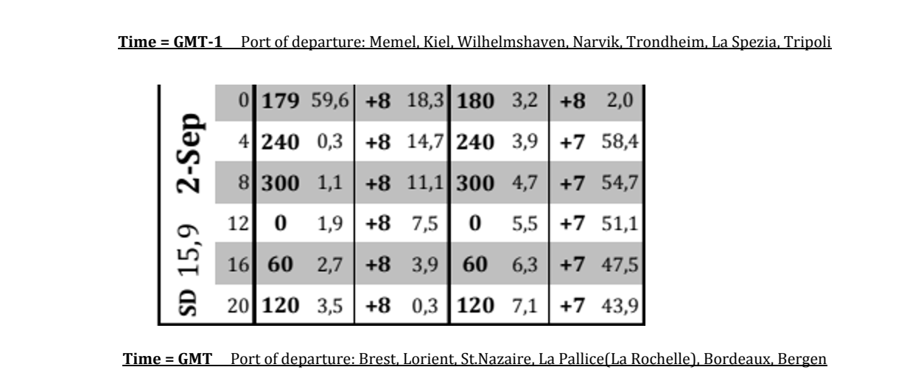

*Монтаж: верхняя подпись **Time = GMT-1**, блок 2-Sep (слева столбец 1939, справа 1940), нижняя подпись **Time = GMT**. Шапка столбцов на монтаже не показана; обе подписи относятся к одной сетке.*

Отдельно вычислено положение Солнца на 2 сентября 1939 года по **JPL DE421** — независимой численной эфемериде, то есть расчётным положениям небесных тел — через Skyfield. Сравнение выполнено для видимого геоцентрического Солнца и исторического GMT, принятого здесь за UT1. Игровые координаты, часы или камера не использовались.

| Сравнение с сохранёнными бумажными числами | Результат |
|---|---|
| GHA при исходной метке 10:03:07 | Разница около 0,45′ |
| Тот же GHA при предполагаемой метке 11:03:07 | Разница около 15°; простой перенос времени на час не поддерживается |
| Склонение при исходной метке 10:03:07 | Разница около 1,80′; причина отличия не установлена |

При этом сохранённый расчёт GHA использует ровные 15°/ч, хотя строки PDF 57 дают **60°00,8′ за четыре часа**. Интерполяция полных строк добавляет около **0,41′** к сохранённому результату и объясняет большую часть расхождения GHA. Она не устраняет расхождение склонения и не устанавливает шкалу времени новой игровой сцены. Подробность добавлена к уроку 4; защищённые числа не переписаны.

Малое расхождение часового угла **не подтверждает весь образец**: склонение проверяется отдельно и здесь не совпало. Исходная метка, заданные клетки и защищённый пример оставлены без изменений. В уроках по-прежнему можно разбирать табличный метод, но нельзя объявлять это подтверждённой точностью нового наблюдения или переводить часы ради готового ответа.

Источники метода проверки: [положения в Skyfield](https://rhodesmill.org/skyfield/positions.html) и [файл JPL DE421](https://ssd.jpl.nasa.gov/ftp/eph/planets/bsp/de421.bsp). Сверка не устанавливает происхождение расхождения и не разрешает править первоисточник.

### Ограничения ручного метода в этой реализации

- Сброс барабана R не измеряет ошибку нуля. Отдельной механической ошибки в оптике нет; чистый профиль даёт 0,0′ по реализации. Если происхождение сохранённой поправки неизвестно, это остановка, а не разрешение принять нуль.
- C — служебная калибровка по известному светилу, не шаг ручного решения. Её предел ±5′ не превращает неизвестную поправку в известную.
- Азимут в основном пути получают по F XI. Неподтверждённый солнечный пеленг UZO или готовая карточка не заменяют табличный расчёт.
- Скрытые координаты игры, программное наведение и телепорт не заменяют действия и источники данных, которым учит пособие.
- Описанная табличная ветвь ограничена указанными полушариями, диапазонами и близкой принятой точкой. На другие ветви правила не переносят по догадке.
- Даже пересечение хороших линий остаётся оценкой с ошибками времени, высоты, поправок и пути. Неизвестный снос сохраняется в записи.

### Как использовать иллюстрации

Основные числовые схемы сохранены. Дополнительные иллюстрации, подготовленные с помощью ИИ, можно раскрыть рядом с подходящими объяснениями. Это не фотографии исторических приборов и не изображения реальной игровой сцены. Геометрия во врезке урока 2 и на дополнительных схемах уроков 6 и 7 нанесена отдельно; в уроке 6 показан условный сдвиг к Солнцу, тогда как числовой образец даёт сдвиг от Солнца.

Для высоты глаза оставлена основная техническая схема с однозначными границами измерения: от уровня воды до глаза, не до палубы. У рисунка клетки F I после согласования исправлена нижняя подпись о восстановлении общей части `9,`; прежний файл сохранён в исходном снимке редакции, остальные принятые изображения не заменялись.

### Перед будущей игровой проверкой

Первой проверяется **только цепочка урока 1**. Нужны согласованные условия работы, учебная копия сохранения, свежая резервная копия настроек и возможность отката. Игровая проверка проводится отдельно; при подготовке этой редакции игра не запускается и её живое состояние не меняется. Если действие недоступно, записывают точное место остановки и исправляют инструкцию.

### Уточнения по отдельным урокам

#### Секстант и касание

Маршрут — кандидат по исходникам `CharacterPortraitUI.OnPointerClick/OnZoomClick`, `KeyboardShortcuts` и `FPPCameraController`, не новая игровая приёмка. Левый двойной щелчок отличён от правого наведения камеры; учтён режим CaptainOnly. Точная геометрия прохода через люк и самостоятельное выполнение начинающим пользователем ещё не подтверждены. Схемы объясняют измерение, не являются снимками этого перехода. Проверять только урок 1 с оператором, свежими backup/rollback и отдельным разрешением на LIVE.

#### Время наблюдения

Самостоятельный проход этого урока в игре ещё не подтверждён. Описание действий не означает их успешного выполнения.

#### Поправки высоты

Арифметика образца проверяется по сохранённым данным. Важное ограничение реализации: оптика не имеет отдельной механической ошибки нуля, поэтому ручная поверка по горизонту не даёт независимого числа. Не выдавайте её за выполненную. Самостоятельный проход урока в игре ещё не подтверждён.

#### Положение Солнца

Арифметика образца сопоставлена с сохранённым расчётом. Повторно просмотрен оригинал PDF 57: одна сетка, две портовые подписи. Проверка JPL DE421 / Skyfield не поддерживает сдвиг метки на час; GHA при исходном времени отличается примерно на 0,45′, δ — на 1,80′. Полное эфемеридное совпадение не заявляется, причина разницы δ не установлена. Это не проверка игровых часов и не новое наблюдение. `example.json` и числовой контроль не менялись. Самостоятельная работа начинающего пользователя ещё не проверена; схемы Земли объясняют понятия, а не показывают контрольную сцену.

#### Принятая точка и расчёт

Рабочее округление исторического образца сопоставлено с сохранённым расчётом. Самостоятельный проход новичком ещё не подтверждён. В прежней редакции бытовая таблица с карандашами объясняла только прямой и обратный поиск; в текущей редакции этот переход разобран непосредственно на F II. Свежая арифметическая проверка учебной пары хранится отдельно и не является человеческой приёмкой.

#### Линия положения

Клетки и арифметика табличного образца сверены с исходным примером и справочником. Самостоятельное чтение новичком и обычная прокладка на игровой карте ещё не проверены. Рисунок направления не является приборным пеленгом, а схема линии — новым определением места.

#### Перенос и место

Реальная пара наблюдений для этого урока не снята; самостоятельный проход новичком и доступность всех игровых источников пути ещё не проверены. Рисунки переноса и пересечения объясняют действия, не добавляя отсутствующего второго отсчёта.
