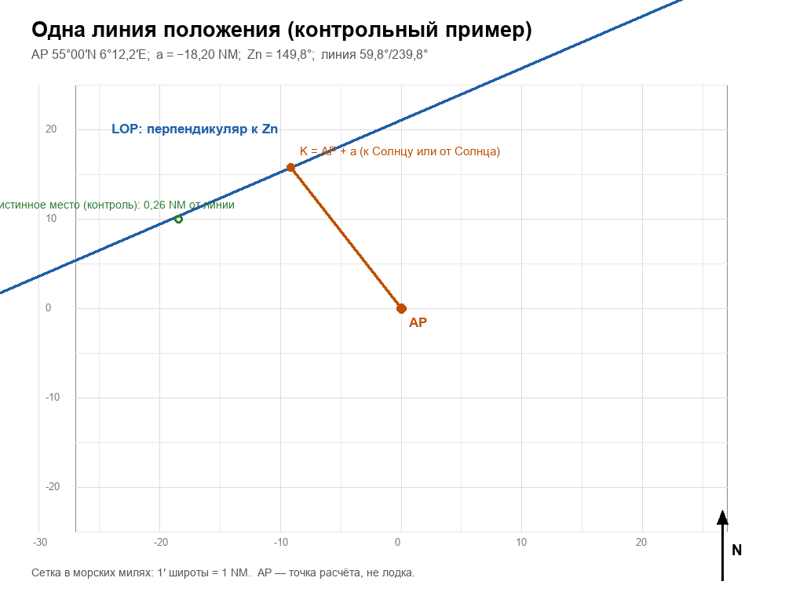
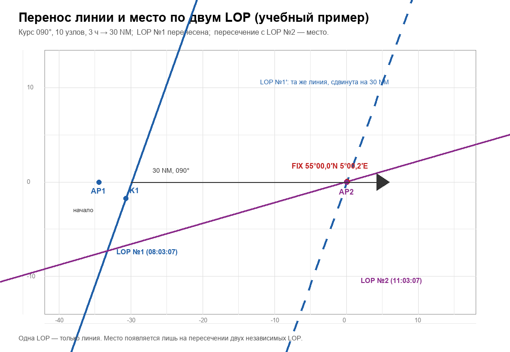

# Страницы журнала и поля ввода

Проектируется **строго по** `ALGORITHM.md`. Ни одно поле здесь не появляется,
если его нет в алгоритме, и наоборот.

Версия 1, 2026-10-21. Реализация интерфейса — только после утверждения этого
документа.

---

## 1. Принципы экрана

1. **Один шаг — один экран.** На экране не больше одного нового действия.
2. **Поле = вопрос из алгоритма.** У каждого поля есть:
   - подпись и единица (`Hs, ° ′`);
   - откуда взять (прибор/таблица/страница);
   - допустимый диапазон;
   - сообщение об ошибке;
   - подсказка «что это простыми словами».
3. **Нельзя идти дальше с неверным числом.** Кнопка «Дальше» активна только
   после проверки диапазона и знака. Исключение — поля, которые проверяются
   парой (см. §5), они блокируют следующий экран.
4. **Числа не запоминаются.** Все промежуточные величины показываются на
   экране и остаются в журнале; игрок не должен держать их в голове.
5. **Источник рядом с полем.** Ссылка «F VIII, стр. 72 / PDF 98, строка 38°»
   открывает нужную страницу таблицы (в игре — вкладку таблиц).
6. **Никаких свободных ответов там, где есть число.** Только числовой ввод;
   знак выбирается переключателем N/S, E/W, +/−.
7. **Результат честный.** После одной линии экран результата показывает
   «ЛИНИЯ, НЕ МЕСТО» и не показывает координаты.
8. **Сложный экран идёт подшагами.** На экранах 3, 4, 6, 7, 10 одно действие
   за подшаг: **таблица → ячейка → число → арифметика → проверка → дальше**.
   Подшаги перечислены в описании каждого экрана. Игрок не видит сразу четыре
   поля: он видит одну инструкцию и одно поле.
9. **Правила проверяются тестом, а не глазами.** `journal_rules.py` содержит
   те же проверки, что и экраны; `python journal_rules.py` должен дать
   `13 PASS / 0 FAIL`.

---

## 2. Карта экранов

```
0  Готовность            (проверка приборов, таблиц, глаза, ИП, GMT)
1  Время                 (GMT)
2  Измерение             (Hs, фильтры, качество контакта)
3  Поправки              (h, F VIII, месяц, Ho)
4  Альманах              (GHA, δ)
5  Место и AP            (DR, φAP, t, λAP)
6  Высота Hc             (U, V, Gr.δ, q, log sin q, log sin Hc, Hc)
7  Интерсепт             (a, Zn)
8  Построение            (LOP №1, подпись)
9  Второе наблюдение     (повтор 1–8)
10 Перенос / fix         (курс, скорость, S, перенесённая LOP, пересечение)
11 Результат             (LOP или fix; координаты только для fix)
12 Журнал/экспорт        (список наблюдений, проверки, печать)
```

Экраны 1–8 — один цикл наблюдения. Их можно повторять; каждое наблюдение
получает номер.

---

## 3. Экран 0. Готовность

| Поле | Тип | Единица | Проверка | Источник |
|---|---|---|---|---|
| Высота глаза | число | м | 1…14 (v1) | палуба/журнал |
| Индексная поправка | число + знак | ′ | −10…+10 | паспорт/поверка |
| Фильтры | два числа | 0…3 | 0…3 | прибор |
| GMT идёт | флаг | — | да/нет | часы |
| Горизонт виден | флаг | — | да | глаз |
| Таблицы открыты | флаг | — | да | SH5, F-Tafel |

Если любой обязательный флаг «нет» — экран блокирует переход и пишет, чего не
хватает. Это не подсказка «нажмите да», а список того, что нужно сделать.

---

## 4. Экран 1. Время

| Поле | Тип | Формат | Проверка |
|---|---|---|---|
| Дата GMT | дата | ГГГГ-ММ-ДД | 1939-01-01…1945-12-31 |
| Время GMT | время | ЧЧ:ММ:СС | 00:00:00…23:59:59 |
| Секунды записаны | флаг | — | да |

Проверки:
- дата не в будущем относительно игрового времени;
- при повторном наблюдении время **больше** предыдущего;
- если игрок поставил паузу до записи времени — предупреждение.

---

## 5. Экран 2. Измерение

| Поле | Тип | Единица | Проверка | Источник |
|---|---|---|---|---|
| Hs | градусы + минуты | ° ′ | 0…90°; минуты 0…59,9 | секстант |
| Лимб | выбор | — | «нижний» (для F VIII) | глаз |
| Солнце одно | флаг | — | да | глаз |
| Контакт | флаг | — | да | глаз |
| Фильтры | два числа | 0…3 | 0…3 | прибор |

Блокирующие условия:
- лимб **верхний** → STOP-экран: «Эта таблица — только для нижнего края.
  Верхний край в v1 не считается». F VIII не применяется, экран 3 закрыт;
- «Солнце одно» = нет → блок: «В поле два диска — измерение недействительно»;
- «Контакт» = нет → блок: «Нет касания горизонта — Hs не записывается»;
- Hs вне 0…90 → ошибка ввода.

Поле Hs принимает только десятые минуты (шаг 0,1′) — как барабан.

---

## 6. Экран 3. Поправки

| Поле | Тип | Единица | Проверка |
|---|---|---|---|
| h = Hs + ИП | вычисляемое | ° ′ | h = Hs + ИП/60 |
| Столбцы глаза | вычисляемое | м | два целых метра, между которыми лежит фактическая высота глаза; 0…14 |
| F VIII, нижняя строка | 2 числа | ′ | клетки для двух столбцов глаза |
| F VIII, верхняя строка | 2 числа | ′ | клетки для двух столбцов глаза |
| F VIII при вашей высоте глаза | вычисляемое | ′ | интерполяция по столбцам |
| F VIII при h | вычисляемое | ′ | интерполяция по строкам |
| Добавка месяца | число | ′ | −1…+1 |
| Суммарная F | вычисляемое | ′ | FVIII + месяц; лежит между введёнными клетками |
| **Ho** | вычисляемое | ° ′ | h + F/60 |

Экран показывает таблицу 2×2 (две строки × два столбца глаза) и подставляет
числа; игрок вводит только прочитанные клетки. Столбцы выбираются по
**фактической** высоте глаза, а не всегда 5/6: 5,5 → 5 и 6 (50 %); 7,2 → 7 и 8
(20 %); 12,4 → 12 и 13 (40 %); при ровной высоте 7,0 → только столбец 7
(100 %). F VIII покрывает 0–30 м (две страницы), но **v1 аттестована 0–14 м**.

Проверки:
- высота глаза 0…14 м (v1); 15…30 м — STOP «v1 не аттестована», хотя таблица
  продолжается;
- если игрок ввёл клетки 38° и 40°, но h вне 38…40 → «вы выбрали не те строки»;
- клетки должны соответствовать именно выбранным столбцам глаза;
- **нет** универсального допуска 5…20′: суммарная поправка проверяется по
  введённым клеткам (должна лежать между ними с точностью округления).

**Подшаги экрана (по одному действию):**
1. «Откройте F VIII, строки 38° и 40°» → кнопка «Готово».
2. «Ваша высота глаза 5,5 м → столбцы 5 и 6; доля 0,50» → кнопка «Готово».
3. «Введите клетку 38°/5 м» → поле.
4. «Введите клетку 38°/6 м» → поле.
5. «Введите клетку 40°/5 м» → поле.
6. «Введите клетку 40°/6 м» → поле.
7. Экран показывает смешивание по столбцам (доля 0,50) и по строкам.
8. «Введите добавку месяца» → поле.
9. «Проверьте: F лежит между клетками» → зелёная/красная полоса.
10. «Дальше» → Ho.

---

## 7. Экран 4. Альманах

| Поле | Тип | Единица | Проверка |
|---|---|---|---|
| Час до | выбор | 0/4/8/12/16/20 | ближайший ≤ GMT |
| GHA (час) | ° ′ | 0…360 | из таблицы |
| δ (час) | ° ′ + N/S | −23,5…23,5 | из таблицы |
| Прошло времени | вычисляемое | ч | GMT − час |
| Приращение GHA | вычисляемое/ввод | ° ′ | 0…60 |
| d | число | ′ | **−6…+6 за 4 ч**; контрольное −3,6 принимается |
| Поправка δ | вычисляемое | ′ | d × часы/4 |
| **GHA** | вычисляемое | ° ′ | 0…360 |
| **δ** | вычисляемое | ° ′ N/S | −23,5…23,5 |

Проверки:
- GHA растёт ~15°/ч: если разница с предыдущим наблюдением не 14…16° на час —
  предупреждение;
- `d` — это напечатанное изменение δ за **4 часа**, не за час; диапазон
  −6…+6′; значение −3,6′ нормальное;
- δ меняется не более 1′/ч;
- при переходе через 360° — нормализация и явная запись.

**Подшаги экрана:**
1. «Откройте SH5, день 2-Sep, год 1939, шкала GMT» → «Готово».
2. «Строка 08:00: введите GHA» → поле.
3. «Введите δ» → поле.
4. «Строка 12:00: введите δ» → поле (нужно для d).
5. «Введите d» → поле (проверка −6…+6).
6. Экран показывает приращение GHA по часам/минутам/секундам.
7. «Проверьте GHA 0…360 и δ ±23,5°» → полоса.
8. «Дальше» → AP.

---

## 8. Экран 5. DR и AP

| Поле | Тип | Единица | Проверка |
|---|---|---|---|
| DR широта | ° ′ + N/S | 0…90 | из карты |
| DR долгота | ° ′ + E/W | 0…180 | из карты |
| LHA | вычисляемое | ° | GHA + λE |
| tE / tW | выбор | — | по LHA |
| t (табличный) | выбор из списка | ччмм | только значения F I |
| φAP | выбор | целый градус | ближайший к DR |
| λAP | вычисляемое | ° ′ E/W | по формуле |
| Проверка GHA+λAP | вычисляемое | ° | = t |

Список `t` — не свободный ввод: выпадающий список табличных значений
(`0h12m`, `0h16m`, …). Так игрок физически не может выбрать угол, которого нет
в таблице.

`t` — часовой угол от меридиана, 0…12 ч: `t = 0` — на меридиане, `t = 6h` —
90° (Солнце на горизонте), `t > 6h` — Солнце за горизонтом. Это **не**
«близость к меридиану»: `1h32m` — всего 23° от меридиана.

Проверки:
- |AP − DR| ≤ 60 NM, иначе предупреждение;
- λAP в −180…+180° (после нормализации);
- проверка `GHA + λAP` подсвечивается зелёным только при совпадении.

**STOP-ветка.** Перед выбором `t` экран проверяет условия v1:
`φ = N`, `δ = N` **и** `t < 6h`. Если нет — STOP-экран:
«Ветвь F I не аттестована: нельзя вычислить U, q и Hc». Кнопка «Дальше»
заблокирована; предлагается выбрать другое время наблюдения.

---

## 9. Экран 6. Hc

| Поле | Тип | Единица | Проверка |
|---|---|---|---|
| U | ° ′ | 0…90 | из F I |
| V | десятичное | 9,8…10,0 | из F I |
| Gr.δ | ° | 0…90 | из F I |
| Ветвь | выбор | — | только разрешённая правилом |
| q | вычисляемое | ° ′ | U + δ |
| log sin q | десятичное | 9,0…10,0 | из F II |
| log sin Hc | вычисляемое | 9,0…10,0 | log sin q + V − 10 |
| Hc | ° ′ | 0…90 | обратное чтение F II |

Проверки:
- `V` — 9,0…10,0; при `t = 0` бывает ровно 10,00000;
- `log sin q` — логарифм; на малых высотах (0…5°) может быть **ниже 9**;
- `Hc ≤ q`: при `V < 10` строго меньше, при `V = 10` (t = 0) равенство
  допускается;
- `log sin Hc = log sin q + V − 10`;
- **Hc лежит между двумя клетками F II, по которым шёл обратный поиск**;
- `log10(sin Hc)` совпадает с `log sin Hc` в пределах округления таблицы;
- **нет** отдельного допуска «|Hc − q| ≤ 5°»: расхождение может быть любым,
  если цепочка сходится;
- если условия ветви не совпадают с разрешённой — экран блокируется и
  показывает, какое условие не выполнено.

**Подшаги экрана:**
1. «Введите U» → поле.
2. «Введите V» → поле (проверка 9…10).
3. «Введите Gr.δ» → поле (контроль чтения).
4. Экран показывает q = U + δ.
5. «Откройте F II, столбец q» → «Готово».
6. «Введите log sin q» → поле.
7. Экран показывает `log sin q + V − 10`.
8. «Найдите две клетки F II, между которыми лежит это число: нижняя» → поле.
9. «Верхняя клетка» → поле.
10. «Введите Hc» → поле; проверка попадания между клетками.
11. «Дальше» → интерсепт.

---

## 10. Экран 7. Интерсепт

| Поле | Тип | Единица | Проверка |
|---|---|---|---|
| Ho | вычисляемое | ° ′ | с экрана 3 |
| Hc | вычисляемое | ° ′ | с экрана 6 |
| a | вычисляемое | ′ = NM | (Ho − Hc) × 60 |
| Знак a | вычисляемый | — | + к Солнцу / − от Солнца |
| Прибор пеленга | выбор | — | UZO / перископ / магнитный компас |
| Относительный пеленг β | ° | 0…360 | шкала в окуляре |
| Истинный курс K | ° | 0…360 | репитер гирокомпаса |
| Девиация Dev | ° + E/W | −10…+10 | только для магнитного компаса |
| Склонение Var | ° + E/W | −30…+30 | только для магнитного компаса |
| **Zn истинный** | вычисляемое | 0…360 | `Zn = K + β` (магнитный: + Dev + Var) |
| Источник | выбор | — | UZO+гиро / перископ+гиро / магнитный / F XI |
| Zn по F XI (сверка) | ° | 0…360 | табличная ветвь F I/F XI; расхождение с измеренным ≤3°, иначе STOP |

Проверки:
- `β` и `K` сохранены отдельно: результат можно пересчитать;
- `Zn = K + β` по модулю 360°;
- утром 0…180°, после полудня 180…360° (северное полушарие) — иначе блок с
  подсказкой «проверьте tE/tW и пеленг»;
- `Zn` не подставляется из мода и не берётся из карточки: только `β` и `K`
  с инструментов;
- если измерение недоступно (шкала нечитаема, прибор недоступен) — BLOCKER и
  переключение на F XI с пометкой `Zn: F XI (табличный)`;
- |a| ≤ 60 NM, иначе блок с подсказкой «проверьте AP и Hc»;
- без истинного Zn кнопка «Дальше» заблокирована: линию нечем ориентировать.

**Историческая проверка.** Табличный `Zn` (F I/F XI → `P` → `A` → квадрант)
вводится как независимая проверка измеренного. В v1 первым принимается
измеренный пеленг (утверждённое решение №2); расхождение >3° — STOP.
В методичке надо объяснить, почему при AP с точным табличным `t` не нужна
F III: `t` не округляется, поправка за округление исчезает.

**Подшаги экрана:**
1. «Наведите UZO/перископ на центр Солнца» → «Готово».
2. «Введите относительный пеленг β» → поле.
3. «Введите истинный курс K с гирокомпаса» → поле.
4. Экран показывает `Z = K + β` (и нормализацию).
5. «Проверьте сторону (утро/вечер)» → полоса.
6. «Дальше» → построение.

---

## 11. Экран 8. Построение одной LOP

| Поле | Тип | Проверка |
|---|---|---|
| Номер наблюдения | целое | 1…3 |
| Точка AP на карте | координаты | совпадает с экраном 5 |
| Направление Zn | линия | совпадает с экраном 7 |
| Точка K | координаты | AP + a по Zn |
| LOP | линия | перпендикулярна Zn через K |
| Подпись | текст | №, GMT, a, Zn |

Экран показывает построение по шагам: AP → направление → отрезок `a` → точка
K → перпендикуляр. Игрок подтверждает каждый шаг; система проверяет
перпендикулярность и знак.



При одном наблюдении кнопка «Результат» ведёт на экран 11 в режиме
**«ЛИНИЯ, НЕ МЕСТО»**.

---

## 12. Экран 10. Перенос и fix

Экран открывается только когда есть **две независимые LOP** (два разных
наблюдения со своими GMT, Hs и AP). Если вторая LOP не построена — экран
показывает «Нужно второе независимое наблюдение» и не считает координаты.

| Поле | Тип | Единица | Проверка |
|---|---|---|---|
| LOP №1 | ссылка | — | измерение 1 |
| LOP №2 | ссылка | — | измерение 2, **не** копия/перенос LOP1 |
| Курс между наблюдениями | ° | 0…360 | из журнала (COG) |
| Скорость | узлы | 0…30 | фактическая (SOG) |
| Δt | вычисляемое | ч | GMT₂ − GMT₁ |
| S = V × Δt | вычисляемое | NM | 0…200 |
| LOP №1′ | линия | — | параллельна LOP1, сдвинута на S по курсу |
| Пересечение LOP1′ × LOP2 | координаты | — | в пределах 60 NM от DR |

Проверки:
- LOP2 построена по своему измерению (разные GMT и Hs) — иначе блок;
- угол между LOP1 и LOP2 ≥ 30° (предупреждение при меньшем);
- LOP1′ параллельна LOP1 (проверка угла);
- fix не дальше 60 NM от DR, иначе блок с просьбой проверить данные.

**Течение и дрейф.** Перенос идёт по фактическому пути. Если течение
неизвестно, экран пишет: «течение не учтено; ошибка места включает снос» — и
не подставляет ноль как «течения нет».



**Запрещено:** показывать координаты, если есть только LOP1 и её перенос;
считать перенесённую линию вторым измерением; переносить обе линии и
пересекать их между собой.

**Подшаги экрана:**
1. «Выберите LOP №1» → список.
2. «Выберите LOP №2 (другое измерение)» → список; копия LOP1 не предлагается.
3. «Введите курс между наблюдениями» → поле.
4. «Введите скорость» → поле.
5. Экран показывает Δt и S = V × Δt.
6. «Постройте LOP №1′: от точки LOP1 отложите курс и S» → «Готово».
7. «Проверьте параллельность» → полоса.
8. «Отметьте пересечение LOP №1′ и LOP №2» → точка.
9. «Проверьте: fix в пределах 60 NM от DR» → полоса.
10. «Дальше» → результат.

---

## 13. Экран 11. Результат

**Режим «одна линия»:**
```
РЕЗУЛЬТАТ: ЛИНИЯ ПОЛОЖЕНИЯ
Координаты не определены.
Линия: 59,2° / 239,2°, через 18,2 NM от AP в сторону 329,2°.
Чтобы получить место, нужно второе наблюдение.
```

**Режим «линия перенесена, второй линии нет»:**
```
РЕЗУЛЬТАТ: ЛИНИЯ ПЕРЕНЕСЕНА, МЕСТО НЕ ОПРЕДЕЛЕНО
Перенос показывает, где первая линия была бы сейчас.
Это не новое измерение и не координаты.
Нужна вторая независимая LOP.
```

**Режим «fix»:**
```
РЕЗУЛЬТАТ: МЕСТО ПО ДВУМ ЛИНИЯМ
55°00,0′N 5°00,2′E
Угол между линиями 52°. Время второго наблюдения 11:03:07.
Течение: не учтено (если неизвестно) — входит в ошибку места.
```

**Режим «три линии»:** координаты + размер треугольника.

Запрещено: показывать координаты в режиме одной линии или в режиме
«линия перенесена»; называть счислимое место астрономическим.

---

## 14. Экран 12. Журнал

Список наблюдений с полями §4–§11, статусами (`черновик`, `проверено`,
`отклонено`) и кнопками:
- «Показать источник» (страница таблицы);
- «Пересчитать» (только арифметика, без изменения введённых чисел);
- «Экспорт» — текст/PDF для печати (структура полей уже пригодна для
  методички).

---

## 15. Проверки цепочки (сводка)

| Проверка | Где | Действие |
|---|---|---|
| Hs 0…90, шаг 0,1′ | 2 | блок |
| лимб **нижний** | 2 | STOP «верхний край в v1 не считается» |
| один диск, контакт | 2 | блок |
| ИП −10…+10 | 0 | блок |
| Ho = h + F/60 | 3 | автопроверка |
| столбцы глаза по фактической высоте | 3 | блок |
| высота глаза 0…14 м | 3 | STOP «v1 не аттестована» |
| F между четырьмя клетками | 3 | блок |
| GHA 0…360, δ ±23,5 | 4 | блок |
| GHA растёт 14…16°/ч | 4 | предупреждение |
| d −6…+6 (4-часовое) | 4 | блок |
| t только табличный | 5 | список |
| GHA + λAP = t | 5 | блок |
| φ/δ не N или t ≥ 6h | 5 | STOP «ветвь F I не аттестована» |
| V 9,0…10,0 | 6 | блок |
| log sin Hc = log sin q + V − 10 | 6 | автопроверка |
| Hc ≤ q (равенство при V=10) | 6 | блок |
| Hc между выбранными клетками F II | 6 | блок |
| β и K получены с инструментов | 7 | блок |
| Zn = K + β (модуль 360) | 7 | автопроверка |
| утро/вечер и Zn согласованы | 7 | блок |
| \|a\| ≤ 60 NM | 7 | блок |
| перпендикулярность LOP | 8 | блок |
| LOP2 — независимое измерение | 10 | блок |
| угол между линиями ≥30° | 10 | предупреждение |
| fix ≤60 NM от DR | 10 | блок |
| перенос одной LOP без LOP2 | 11 | координаты запрещены |

---

## 16. Тест страниц на контрольном примере

Поля должны дать ровно эти значения (из `ALGORITHM.md` §19 и
`example.json` в этой же папке):

| Поле | Ожидаемое |
|---|---|
| Hs | 39,223333° = 39°13,4′ |
| h | 39°13,4′ |
| F VIII | +10,7612′ |
| Сентябрь | −0,1′ |
| Ho | 39°24,061′ |
| GHA | 330°47,85′ |
| δ | +8°09,253′ |
| φAP / t / λAP | 55° / 23° (1h32m) / 6°12,15′E |
| U / V / Gr.δ | 32°48,2′ / 9,98881 / 52,7° |
| q | 40°57,45′ |
| log sin q | 9,81657 |
| log sin Hc | 9,80538 |
| Hc | 39°42,26′ |
| a | −18,198 NM |
| Zn | 149,2° (измеренный пеленг; формула K+β — отдельный пример ниже) |
| LOP | 59,2° / 239,2° |
| d | −3,6′ (принимается) |
| Столбцы глаза | 5 и 6 (для 5,5 м) |
| Клетки F II для Hc | 9,80534 / 9,80550 |

Допуск: ±0,1′ в табличных величинах, ±0,01 NM в `a` (округления).

Правила полей проверяются отдельно: `python journal_rules.py` →
**25 PASS / 0 FAIL**, включая `d = −3,6`, столбцы глаза 5,5/7,0/7,2/7,5/8,0/
13,8/14,0 и числовую интерполяцию, `Hc = q` при `V = 10`, низкие `log sin`
и `Zn = K + β`.

---

## 17. Приёмка «матрос с нуля» (сценарий)

1. Дать человеку **только**: этот журнал, секстант, часы GMT, карту, SH5,
   F-Tafel, карандаш.
2. Задача A: одно наблюдение → нанести линию → объяснить, почему это не
   координаты.
3. Задача B: два наблюдения с ходом → перенести линию → получить место.
4. Задача C: три наблюдения → треугольник.
5. Фиксировать **каждый** момент, когда испытатель:
   - спросил «что дальше»;
   - искал внешнюю инструкцию;
   - угадывал знак или таблицу.
6. Любой такой момент — **дефект журнала**, а не ошибка испытателя.

Ожидаемый результат: 0 вопросов «что дальше», 0 внешних инструкций,
0 угадываний.

---

## 18. Что не входит в v1

- звёзды, Луна, планеты;
- определение индексной поправки по звезде;
- поправки за наклон горизонта на волне;
- совместная обработка нескольких светил;
- печать PDF (структура полей готова, вёрстка — позже).

---

## 19. STOP-экраны и их тексты

STOP — это результат, а не сбой. Экран показывает причину, номер шага и что
именно осталось неизвестным. Кнопка «Дальше» заблокирована; «В журнал»
записывает отказ с причиной.

| Условие | Текст на экране | Что заблокировано |
|---|---|---|
| Верхний край | «Эта таблица — только для нижнего края. Верхний край в v1 не считается» | F VIII, Ho |
| φ или δ южного полушария | «Ветвь F I для S не аттестована: нельзя вычислить U, q и Hc» | экран 6 |
| t ≥ 6h | «t ≥ 6h: 90° от меридиана; ветвь F I не аттестована (знак U и полюс азимута меняются)» | экран 6 |
| ИП вне ±10′ | «Прибор вне допуска: Hs недостоверна» | экран 0 → 2 |
| Горизонт закрыт | «Нет горизонта — нет высоты» | экран 2 |
| Солнце под горизонтом | «В v1 только дневное Солнце» | всё наблюдение |
| Нет таблицы | «Нет таблицы — нет расчёта. Не заменяйте похожей» | соответствующий экран |
| Высота глаза > 14 м | «v1 не аттестована выше 14 м (таблица F VIII идёт до 30 м)» | F VIII, Ho |
| Hc не между клетками F II | «Цепочка F II не сходится: проверьте log sin q, V и клетки» | Hc |
| q/Hc вне F II | «Вне диапазона таблицы: экстраполяция запрещена» | экран 6 |
| Пеленг измерить нечем | «BLOCKER: нет измеренного азимута. F XI (табличный) или отложить наблюдение» | Zn, построение |
| Ход неизвестен | «Нечем перенести линию: нужен курс и скорость» | экран 10 |
| Одна LOP | «Это линия, а не место» | координаты |
| Треугольник > 3 NM | «Одно наблюдение ошибочно: место ненадёжно» | результат-fix |

**Проверка:** каждый STOP-экран оставляет в журнале запись «отказ» с датой,
шагом и причиной. Отказ нельзя «исправить» повторным нажатием — только новым
наблюдением.
